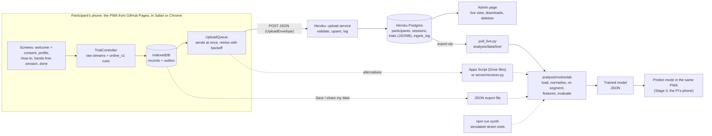

# Project overview

Audience: the student and the PI. Applies to app 0.2.0, data schema 1.2.0 and protocol 2.0.0 (the street protocol).

Other documents: [01 Protocol](01_PROTOCOL.md) · [02 Data schema](02_DATA_SCHEMA.md) · [03 Sensors and platforms](03_SENSORS_AND_PLATFORMS.md) · [04 Segmentation](04_SEGMENTATION.md) · [05 Modeling plan](05_MODELING_PLAN.md) · [06 Considerations](06_CONSIDERATIONS.md) · [07 Deployment](07_DEPLOYMENT.md) · [08 Stage 3 predictor](08_STAGE3_PREDICTOR.md) · [09 Stage 2 and 3 plan](09_STAGE2_3_PLAN.md) · [10 Field guide](10_FIELD_GUIDE.md)

## 1. Problem statement

A person holds a smartphone with the arm fully extended straight in front of them and brings it in to touch their nose. The question is whether the phone's own motion sensors are enough to tell if they used the left or the right hand.

The participant instruction, verbatim from `app/src/i18n/en/common.ts`: *"Stretch your arm out and hold still. At the beep, bring the phone to gently touch your nose (any part of the phone may touch it) and hold it there until the double beep, then stretch your arm out again."*

| Aspect | Definition used in this project |
|---|---|
| Unit of prediction | One **trial**: a single movement from the extended arm to the nose. Its recording runs from the hold-still before the GO cue, through the hold at the nose, to the return of the arm. |
| Input | The phone's motion streams for the trial at about 60 Hz, plus the automatic segmentation. The streams are `acc_x/y/z` (acceleration without gravity), `accg_x/y/z` (acceleration including gravity) and `rr_alpha/beta/gamma` (rotation rate about device x/y/z). Euler angles, quaternions, absolute orientation, the magnetometer and screen touches are kept as metadata. |
| Output | `hand` (left or right) with a calibrated probability, or an abstention with a reason when the attempt is unusable or unusual ([09 §4.6](09_STAGE2_3_PLAN.md#46-probability-output)). |
| Use case | A person the model has never seen, an unknown phone and grip, and a single trial. The predictor never sees the instructed condition. |
| Secondary aims | Detect where the movement starts and ends automatically. Find where errors concentrate: sex, handedness, age, speed, grip, start position, movement variant, platform. |
| Exploratory add-on | Predict the person's handedness from their trials with both hands and from the hand they chose in their free trial. |

## 2. Why it is non-trivial

| Challenge | Why it is hard | How the project handles it |
|---|---|---|
| Grip and orientation | Motion data are reported in the phone's own frame (x = right edge, y = top edge, z = out of the screen), regardless of screen rotation ([W3C][w3c]). The same right-hand movement puts its sideways component on x, −x or ±y depending on the grip, and the PI may hold the phone any way. | Street visits record upright and both sideways grips with the screen facing the participant; researcher presets add upside-down, flat and free grips. Screen-facing-away grips proved impractical: the analysis synthesises them by turning the sensor frame 180° ([05 §3.6](05_MODELING_PLAN.md#36-screen-away-synthesis-protocol-200)). Grip-invariant features are computed relative to gravity, and the grip is checked against gravity before GO and after each attempt. |
| Speed | A natural one-way finger-to-nose movement takes about 0.6 s ([Chen 2021][chen2021]). For a 0.45 m path, the minimum-jerk peak acceleration (≈5.77·A/D², [Flash & Hogan][minjerk]) falls from ≈42 m/s² at 0.25 s to ≈0.3 m/s² at 3 s, close to Chrome's 0.1 m/s² rounding step. Displacement integrated from the accelerometer is reliable only over about 1–2 s ([Bai 2022][bai2022]). | Three speed conditions with per-speed segmentation overrides. Rotation features remain usable at slow speeds (peak angular speed ≈40 deg/s for 60° over 3 s). The achieved duration is measured, not assumed. |
| Start pose | From the shoulder line the hand travels sideways to the midline, so sideways translation separates the hands; from in front of the face it barely moves sideways, and rotation has to carry the signal. The forearm rotates by about 54° in finger-to-nose movements ([Öhberg 2019][ohberg2019]). | A `start_position` factor (`natural`, `shoulder`, `center`). Street trials start `natural`; `shoulder` and `center` are drawn as variety cells. The canonical pose is an open question for the PI (§9). |
| Hand dominance | About 10.6% of people are left-handed ([Papadatou-Pastou 2020][pp2020]), so "right hand" nearly equals "dominant hand". Dominant and non-dominant reaches differ, and left-handers less so ([Sainburg 2002][sainburg2002], [Przybyla 2012][przybyla2012]). A model can learn dominance instead of side and then fail on left-handers. | Everyone does both hands, balanced at every tier boundary of the visit. Left-handed friends are asked on purpose (target 10 or more, [09 §7](09_STAGE2_3_PLAN.md#7-what-we-need-from-data-collection)). Mirror augmentation, antisymmetric models and a hand × handedness term in the error analysis. |
| Platform differences | All iOS browsers run WebKit, which inverts all three axes of `acceleration` and `accelerationIncludingGravity`: face-up z reads ≈ −9.81 ([WebKit source][webkit-mm], [W3C list 2014][w3c-list], [2026 measurement][gaitscope]). Chrome rounds to 0.1 m/s² and 0.1 deg/s; iOS does not ([Chromium][cr-util]). `event.interval` is in seconds on iOS and in milliseconds on Chrome. Euler angles hit gimbal lock in the upright start pose ([W3C][w3c]). | No calibration step. The sign is the browser engine's, confirmed by the trials' own upright holds (implicit calibration and trial votes); the rotation-rate mapping comes from the gravity closure of the trials (`norm_v2`, [03 §5](03_SENSORS_AND_PLATFORMS.md#5-normalisation-layer-for-analysis)). Raw values are stored as delivered and normalised offline. Evaluation includes leave-one-platform-out. |
| Labels and people | People sometimes use the wrong hand: in a supervised multi-day study, 16% of participants wore the wrist sensor on the wrong wrist at least once ([PLOE 2019][ploe]). Movement style is personal, so random trial splits leak identity: record-wise CV reported a median error of 5.6% against 13.0% subject-wise ([Saeb 2017][saeb2017]). | The hand is named at every block intro, on its Start button and in huge letters during each trial. A wrong grip holds GO back. "Last one was the wrong hand" on the pause sheet; offline wrong-hand screening ([09 D6](09_STAGE2_3_PLAN.md#42-labels-and-exclusions)). Every attempt is kept. Evaluation is by person, with a locked test set. |
| Time | A friend on the street gives about five minutes. The protocol-1.0.0 pilot took 11 min 45 s for 23 attempts, and 56% of its trial phase passed between trials. | A hands-free visit: trials chain without taps, the most important conditions come first, stopping is possible at any moment, and every trial uploads at once. |

**The physics that helps.** A left-hand movement is approximately the mirror image of a right-hand movement across the body's sagittal plane. Write the phone's orientation as a rotation R from the device frame to the body frame. Mirroring gives R' = M·R·S with M = S = diag(−1, 1, 1). For any grip, this maps the device-frame readings as follows:

- **Acceleration:** (x, y, z) → (−x, y, z).
- **Angular velocity:** (x, y, z) → (x, −y, −z). Angular velocity is a pseudovector, so it transforms differently from acceleration. In W3C field names, `rr_alpha` is kept and `rr_beta` and `rr_gamma` are negated.
- **Labels:** the hand flips, `top_left_*` ↔ `top_right_*`, and the other orientations are unchanged.

Some scalars, such as the rotation about gravity (ω·ĝ), do not depend on the grip but change sign between hands. They give physically correct augmentation, antisymmetric models and sanity checks. In the pilot (one person, 16 trials) the hand showed in the *time course* of that rotation, not in its net value: early in the reach the phone turns one way for the right hand and the other way for the left, then the wrist turns it back, so the net yaw cancels ([09 §2.1](09_STAGE2_3_PLAN.md#21-the-hand-is-in-the-yaw-time-course-not-in-the-net-yaw)). Rules therefore learn their sign from data. The accelerometer sign has to be normalised first: iOS's global sign flip is an improper transformation (a point reflection), so it would reverse these features ([05 §3.3](05_MODELING_PLAN.md#33-what-the-ios-sign-inversion-means-parity)).

## 3. The three stages

### Stage 1: data-collection platform (built, version 0.2.0)

**Goal:** a zero-install instrument that records labelled, raw, high-quality trials from many people on both platforms in about five minutes each, plus everything needed to analyse them.

| Deliverable | Where |
|---|---|
| Collector PWA. Participant path: welcome with the consent, a short profile, a How-to card with an animated illustration, a free-choice trial and its hand question, hands-free blocks in priority tiers, a pause sheet, a checkpoint with an optional bonus, a Done screen with the live upload state. A sensor repair screen when a phone cannot record. For researchers: a setup screen with every preset (`?setup=1`), a tap-review mode, data export and deletion, settings, a live sensor sandbox. English and Hebrew; works offline. | `app/` |
| Gesture illustrations | `app/src/ui/GestureAnimation.tsx`, [img/gesture/](img/gesture/) |
| Data contract (schema 1.2.0): `SessionRecord`, `TrialRecord`, `ExportBundle`, `UploadEnvelope` | `schema/records.schema.json`, `app/src/core/types.ts` |
| Live upload service: FastAPI and Postgres on Heroku, with an admin page, exports and deletion by participant | `backend/heroku/` |
| Alternative backends: Google Apps Script (one Drive file per record), and a local receiver for lab sessions and development | `backend/google-apps-script/`, `server/receiver.py` |
| Simulator (`?sim=1`) and synthetic dataset generator (whole street visits) | `app/src/sim/`, `app/scripts/synth.ts` |
| Analysis starter kit `motionlab` (io, conventions with `norm_v2`, preprocess, segment, features, augment with the screen-away flip, synth, models, evaluate, qa) and `pull_live.py` | `analysis/` |
| Tests: Vitest, pytest, silent Playwright journeys of the simulated participant; CI and GitHub Pages deployment | `app/tests/`, `app/e2e/`, `.github/workflows/` |
| phyphox experiment file for a high-rate validation cohort (**not built**; only if such a cohort is run) | [01 §11](01_PROTOCOL.md) |

| ID | Milestone | Evidence that it is reached |
|---|---|---|
| S1-M1 | Code complete | Done. The typecheck, Vitest, pytest (analysis, server, upload service) and the Playwright journeys pass; CI (`.github/workflows/ci.yml`) runs all but the Playwright journeys. `npm run synth` → `qa_report.py` → `train_baseline.py` runs end to end on street data. |
| S1-M2 | Deployed | Done. <https://axelfridman.github.io/nosetouch-study/> serves 0.2.0, and `config.json` points uploads at the Heroku service (`json_post`). |
| S1-M3 | Real-device check of 0.2.0 | The checklist of [03 §8](03_SENSORS_AND_PLATFORMS.md#8-pilot-verification-checklist) passes on at least one iPhone and one Android phone, including the hands-free chain, beeps after taps, the wake lock and sideways grips. Protocol 1.0.0 was piloted on one Android phone. |
| S1-M4 | First 10 people | `pull_live.py` → `qa_report.py` clean; the real visit time measured; the ICC estimated. |
| S1-M5 | Collection targets | [09 §7](09_STAGE2_3_PLAN.md#7-what-we-need-from-data-collection): at least 30 people with tiers 0–2 complete (target 40+), iPhone users at least 25%, at least 8 left-handers, 2 or more Android brands. |
| S1-M6 | Validation cohort (optional) | A written decision on whether 60 Hz is adequate, only if a phyphox cohort is run (ablation A2). |

**Acceptance criteria** (proposed, to be agreed with the PI):

1. **Reach.** The app opens from a link or QR code in Safari (iOS) and Chrome (Android), with nothing to install. The motion permission is requested inside the Start tap. In-app browsers that the app recognises get a clear request to switch. The first GO comes within 45 s of opening the link.
2. **Signal.** The median achieved motion rate per trial is at least 50 Hz on both platforms (≈60 Hz expected; the pilot: 59.998 Hz). Trials with gaps over 50 ms, or during whose movement the page was hidden, are flagged in `quality`.
3. **Conventions.** The implicit calibration gives `gravity_sign` −1 on iPhones and +1 on Android with `upright_check` = `ok`; the analysis resolves the sign as `engine_vote` and confirms the W3C rotation-rate mapping by gravity closure. The pilot data reproduce the table calibration this way.
4. **Integrity.** Every record validates against schema 1.2.0. Every saved trial and every session update is uploaded at once and retried until confirmed, and the backend keeps one current copy per record.
5. **Segmentation.** The Python port of `online_v1` reproduces the app's onset and end indices (pilot: 23 of 23; street synthetic data: all).
6. **Burden.** A whole street visit (29 trials) takes about 5 minutes. Stopping at any point keeps everything recorded so far.
7. **Consent.** Every session carries `consent_version` `2026-10-v3`. The participants are adult friends who consent in the app; the researcher decided that no ethics review is needed ([06 §1](06_CONSIDERATIONS.md#1-ethics-and-law)).

### Stage 2: model building

**Goal:** a left/right classifier that works for people and phones it has never seen, with an honest estimate of its accuracy and of where it fails. The plan is [09](09_STAGE2_3_PLAN.md); [05](05_MODELING_PLAN.md) is the reference for methods.

| Deliverable | Where |
|---|---|
| Versioned normalisation `norm_v2`: gravity sign from the engine confirmed by trial votes, rotation-rate mapping from the gravity closure, no in-hand gyro bias; optional iOS quantisation; gravity propagated with the gyro | `motionlab.conventions`, `motionlab.preprocess`, `motionlab.features` |
| Segmentation: the `online_v1` port and the offline methods; the deployed model uses `offline_v1`, identically in Python and TypeScript (09 D10) | `motionlab.segment` |
| Features: basic, device-frame, grip-invariant and chiral (including the yaw time course), sequences; the deploy pipeline `feat_d1` (09 D11) | `motionlab.features` |
| Augmentation: the mirror and the screen-away flip, inside training folds only | `motionlab.augment`, `motionlab.evaluate` |
| Model ladder: chance → `YawSignRule` → antisymmetric logistic regression (the default candidate) → gradient boosting → research sequence models (09 D12) | `motionlab.models` |
| Evaluation by person, a locked 25% test set, calibrated probabilities, abstention, subgroup report (09 §4) | `motionlab.evaluate`, `analysis/reports/` |
| Report and deck, every number generated from analysis runs (09 §6) | `report/`, `presentation/` |
| Handedness add-on (exploratory) | `analysis/` |

| ID | Milestone | Evidence |
|---|---|---|
| S2-M1 | Normalisation verified | On the first development people of each platform, the mirror rule (acc −x; gyro −y, −z) maps mirrored right-hand trials onto real left-hand trials better than any of the other 63 sign patterns (09 M2). |
| S2-M2 | Baselines | Rungs 0–2 on the deploy pipeline; shuffled labels give 45–55% (09 M2). |
| S2-M3 | Model selection | 30 or more development people: calibration, abstention, ablations; the chosen model frozen with its sha256 (09 M4). |
| S2-M4 | Locked test | One run on the locked test set (40 or more people), reported whether or not it lands inside the development CI (09 M5). |
| S2-M5 | Handedness add-on | Leave-one-person-out AUC with a CI, labelled exploratory. |

**Acceptance criteria** (proposed):

1. **Person-wise splits only.** Every number comes from splits by person (`person_key`, which merges one person's codes; 09 D2). Tuning is nested inside the training folds, and augmentation happens inside the estimator's `fit`, so validation folds hold real trials only.
2. **Metrics with honest CIs.** Accuracy (primary), balanced accuracy, ROC AUC, log loss, Brier score and ECE, each with a person-bootstrap 95% CI, plus the distribution of per-person accuracy ([Varoquaux 2018][varoquaux], [Saravanan 2020][hboot]).
3. **Robustness.** Leave-one-grip-, leave-one-platform-, leave-one-speed- and leave-one-variant-out results, and a learning curve. Leave-one-device-model-out once there are enough devices ([Stisen 2015][stisen]).
4. **Error analysis.** A GLMM on out-of-fold correctness, `correct ~ hand*handedness + sex + age + speed + orientation + platform + (1|participant)` ([lme4][lme4]), reported with the number of people per subgroup.
5. **Ablations A1–A14** ([09 §4.7](09_STAGE2_3_PLAN.md#47-ablations-one-table-a1a8-as-in-05-82)), including the mirror, quantisation, the screen-away flip and the return movement.
6. **Mirror consistency:** p(right | mirror(x)) = 1 − p(right | x), exactly (to 1e-9) for antisymmetric models.
7. **Performance target agreed with the PI.** For reference, one LSTM study detected the hand from everyday phone motion with 89–97% accuracy, possibly not on unseen users ([Chen et al. 2023][chen2023]). If canonical trials score well below 90%, suspect a sign, axis or label bug before blaming the task.

### Stage 3: a predictor the PI can use

**Goal:** the PI opens a link on their own phone, makes the movement, and sees, for example, "RIGHT 91 %", or "not sure" with a reason.

| Deliverable | Where |
|---|---|
| Predict mode in the same PWA: `?predict=1&model=<id>`, offline, no network requests, a 2.5-s upright check instead of a calibration, `offline_v1` and `feat_d1` ported to TypeScript, a bundled JSON model, a local scoring log (09 §5) | `app/src/predict/` (to be built) |
| Model export and golden-file parity tests, Python as the reference | `motionlab/deploy.py`, `scripts/export_model.py`, `app/tests/` (to be built) |
| PI evaluation protocol (12 attempts per person, 09 D29), a one-page PI sheet, the hand-off checklist | [08](08_STAGE3_PREDICTOR.md), `report/pi_sheet.tex` |

| ID | Milestone | Evidence |
|---|---|---|
| S3-M1 | Export and parity | Golden-file parity tests pass (09 M3). |
| S3-M2 | Predict mode | Works offline on 2 iPhones and 2 Android phones, with zero requests after load (09 M3). |
| S3-M3 | Dry run | 3–5 people who were never in the training data run the PI protocol (09 D29). |
| S3-M4 | PI evaluation | Results reported against the expectation committed beforehand (09 M7). |

**Acceptance criteria** (proposed):

1. The model uses only sensor streams, never `trial.condition` (the `Predictor` contract; a test randomises the condition).
2. It is trained at 60 Hz with exactly the pipeline the browser runs. The upright check must agree with the browser engine's sign, otherwise the predictor refuses.
3. It abstains, and says why, when the recording is incomplete, the movement unusual or the confidence low (gates G1–G4, 09 D5).
4. It runs offline on the PI's phone within the budgets of [08](08_STAGE3_PREDICTOR.md) (model ≤ 200 KB, inference ≤ 50 ms).
5. The PI's session is reported with an exact CI and a per-condition breakdown.

## 4. System architecture

Solid arrows are the main path; dotted arrows are fallbacks and auxiliary inputs.

| Component | Code | Notes |
|---|---|---|
| Screens and session flow | `app/src/app/`, `app/src/ui/` | Preact. Screens: welcome (with the consent), profile, sensors (repair only), setup (researchers), session, done, data, settings, sandbox, about. |
| Session controller | `app/src/app/sessionRunner.ts`, `sessionFlow.ts`, `startFlow.ts` | The hands-free chain, the hand question, the pause sheet, the checkpoint, saving and finishing; free of Preact, so it is unit-tested end to end. |
| Trial engine | `core/trialController.ts`, `core/recorder.ts`, `core/segmentation.ts` | Driven only by incoming samples and free of DOM code, so it runs identically in the browser, the simulator and Node tests. Adds the grip gate, the false-start policy and the recording of the return. |
| Sensors, calibration, cues | `core/sensors.ts`, `core/calibration.ts`, `core/cues.ts` | Permission flow, measured rates, engine detection, optional extra streams; the implicit calibration; Web Audio beeps, speech and the wake lock, silenced on computers running the simulator or an automated browser. |
| Protocol | `core/protocol.ts` | Seeded plans for the street visit and the researcher presets; per-condition segmentation overrides (`resolveParams`); the time estimate. |
| Storage and upload | `core/storage.ts`, `core/uploader.ts`, `core/exporter.ts`, `core/config.ts` | IndexedDB outbox, one POST per record (sent right after every save, plus a keepalive flush of small records when the page is left), file export, runtime `config.json`, name redaction per `upload_nickname`. |
| Simulator | `app/src/sim/` | Minimum-jerk kinematic model of both hands, all grips and the return of the arm; used by `?sim=1`, the tests and `synth`. |
| Upload service | `backend/heroku/` | FastAPI, SQLAlchemy and psycopg on Heroku with Postgres. Validates like `server/receiver.py`, upserts idempotently, keeps the newest copy of each record, logs every upload by identifier only; admin page, exports and deletion behind an admin token. |
| Analysis kit | `analysis/motionlab/`, `analysis/scripts/` | Loads folder trees, zips and export bundles, deduplicates by id; `pull_live.py` downloads the live data. |
| Contract | `schema/records.schema.json` | JSON Schema 2020-12. Minor version bump for additive changes (1.2.0 added the street fields). |
| Stage 3 hook | `core/predictor.ts` | Interface only today. |

## 5. Data flow

1. **Onboarding** (about half a minute):
   - **Welcome and consent.** The Start tap requests the motion permission as its first statement (WebKit shows the prompt only during a tap), unlocks audio, takes the wake lock, records the consent time and measures the sensor rates in the background.
   - **Profile:** `participant_id` (`P-XXXXXX`), the full name (optional), age, sex, dominant hand, usual phone hand, optional height.
   - **Session created** with the study's default preset (`street`), posture standing, and an implicit calibration that the first still upright trial fills in. The session also holds device info, capabilities, the seeded plan and the base segmentation parameters. A participant who comes back within 2 h (a reload, an app switch, "Exit for now") resumes their unfinished session instead; the welcome screen offers it for 24 h.
2. **Trials.** How-to card → one free trial → "Which hand did you use?" → block intros (one tap each) → hands-free trials: hold still (the grip gate; a new instruction gets up to 2.5 s of reading time) → random foreperiod → GO beep → move → hold at the nose → double beep → the return of the arm is recorded → the next trial starts by itself. The `TrialController` keeps every sample of every stream in memory as columnar arrays; `online_v1` only decides when to beep and whether the attempt succeeded.
3. **Save.** Every attempt becomes a `TrialRecord`. A complete trial is accepted unless its grip was detected as another one (then it runs again); failed attempts are kept with `accepted: false`; the free trial gets the reported hand (`hand_source: reported`). Saves run in the background: one IndexedDB transaction writes the trial, the session update and both outbox items, all or nothing. At every app start, a stored trial without an outbox item is queued again, and unfinished sessions untouched for more than 24 h are closed as `abandoned`.
4. **Upload.** Each save triggers a send. The `UploadQueue` posts one `UploadEnvelope` (`kind`, `study_key`, `sent_at`, `record`) at a time to the Heroku service (`json_post`), retries transient failures with jittered backoff, and marks an item sent only on a readable `ok: true`. When the page is left, small records (< 60 KB) go out with `keepalive`; larger ones wait for the next visit. A permanent refusal (e.g. a wrong study key) waits on the phone for "Upload now".
5. **Store.** The service validates the envelope (id formats, schema major version, size, study key), refuses junk without storing it, and upserts the record into Postgres: a session's newer `updated_at` wins; a trial's decided copy replaces its placeholder and a revoked copy replaces both. Every upload adds one `ingest_log` row with identifiers, sizes and a hash, never the body or a name.
6. **Monitor and download.** The admin page shows participants, sessions and trials as they arrive (refreshing every 15 s). `analysis/scripts/pull_live.py` downloads `export.zip` (the shared folder layout) into `analysis/data/live/`, which git ignores.
7. **Analyse.** `motionlab` loads any mix of folder trees, zips and export bundles. The versioned preprocessing then normalises signs and axes per session (`norm_v2`), optionally quantises iOS data, resamples, re-segments offline and computes features.
8. **Deploy the model.** The chosen model is exported as JSON and bundled into the PWA's predict mode (Stage 3).

**What the phone never does:**

- crop the recording window, or store filtered sensor values in place of the raw ones;
- normalise or flip signs;
- upload the participant's name unless `upload_nickname` is set (it is set in this study, with the participants' consent);
- use the camera, microphone or location;
- vibrate while recording, because the motor would contaminate the accelerometer;
- beep or talk on a computer running the simulator or an automated browser.

## 6. Design decisions and why

These are settled. The table records the reasons; the linked documents give the details.

| # | Decision | Main reason | Details |
|---|---|---|---|
| 1 | The instrument is a PWA. Participants open a link or QR code. Built with Vite, TypeScript and Preact, statically hosted on GitHub Pages. | Nothing to install on any iPhone or Android phone. Native distribution needs TestFlight ($99/year, App Review, builds that expire after 90 days; [Apple][apple-programs], [TestFlight][testflight]) or APK sideloading. Since May 2026, Expo Go cannot load our project for arbitrary participants ([Expo][expo-go]). | [03](03_SENSORS_AND_PLATFORMS.md), [07](07_DEPLOYMENT.md) |
| 2 | Accept ≈60 Hz | **Browser caps:** WebKit uses a 1/60 s timer ([WebKit][webkit-h]), Chromium a 60 Hz event pump ([Chromium][cr-pump]) and a 60 Hz cap for the Generic Sensor API ([Chromium][cr-traits]). **Adequacy:** for minimum-jerk movements of 0.25 s or longer, 99% of the acceleration energy lies below ≈10 Hz (our calculation); wrist motion in daily activities has its dominant frequency near 1 Hz ([Mann 1989][mann1989]). **Native ceiling:** at most 100 Hz on iOS ([Apple][wwdc23], [Apple DTS][apple-dts]) and 200–500 Hz on Android ([Android][android-sensors]). | [03](03_SENSORS_AND_PLATFORMS.md), [04](04_SEGMENTATION.md) |
| 3 | phyphox as the high-rate reference, only if a validation cohort is run; native only if that shows 60 Hz loses accuracy | phyphox is free and open source ([phyphox][phyphox]) and reaches ≈100 Hz on iPhone and the device maximum on Android ([phyphox forum][phyphox-rates]). | [01 §11](01_PROTOCOL.md) |
| 4 | Offline first: IndexedDB outbox, upload right after every save, "export my data" fallback | Safari deletes a site's storage after 7 days without interaction ([WebKit][itp]); iOS IndexedDB connections can drop ([WebKit bug][idb-bug]); a friend on the street may close the page at any moment. | [02](02_DATA_SCHEMA.md), [07](07_DEPLOYMENT.md) |
| 5 | Backend: a small upload service with Postgres on Heroku; Apps Script and the local receiver stay as alternatives | Live uploads into a database that the researcher watches on an admin page and can query, deletion of a participant in one call, and exports in the shared folder layout, for about $12–16 a month (an always-on Basic dyno and an Essential Postgres plan). Apps Script stays as the free fallback that needs no server; free hosted databases fell short: Firebase Storage needs a billing plan since February 2026 ([Firebase][fb-storage]) and Supabase pauses free projects ([Supabase][sb-pause]). | [backend/heroku/README.md](../backend/heroku/README.md), [backend/README.md](../backend/README.md) |
| 6 | Never crop on the device. Store raw values as delivered, and normalise offline in a versioned step. | Onset/offset methods disagree by tens to hundreds of ms, and their bias depends on speed ([Botzer & Karniel 2009][botzer], [Dotti 2024][dotti]). Re-segmenting offline must stay possible. | [02](02_DATA_SCHEMA.md), [04](04_SEGMENTATION.md) |
| 7 | Take the platform conventions from the data, never assume them: the engine's sign confirmed by the trials, the rotation-rate mapping from the gravity closure | iOS inverts the accelerometer sign; the mapping of rotationRate fields to axes changed in 2019 ([W3C PR #43][w3c-pr43]) and MDN still shows the old one ([MDN][mdn-alpha]); since Chrome 151, `requestPermission()` no longer identifies iOS ([Chrome 151][chrome151]). A table calibration is impossible on the street, and on the pilot the trials alone reproduced it. | [03](03_SENSORS_AND_PLATFORMS.md) |
| 8 | The street protocol: one free-choice trial, then tiers by priority (upright speeds, sideways grips, varied movements, an optional bonus); both hands balanced at every tier boundary; 29 trials plus 10 bonus, about 5 minutes | The PI's test conditions are unknown, so the data must stay diverse, but a friend gives about five minutes and may stop at any time. Researcher presets (18, 48 and 86 trials) remain for lab sessions. | [01](01_PROTOCOL.md) |
| 9 | A hands-free trial chain: complete trials are accepted automatically and the next starts by itself; a wrong grip holds GO back | In the pilot, 56% of the trial phase was spent between trials (review screens, Ready taps). Corrections stay possible from the pause sheet. | [01 §7–8](01_PROTOCOL.md) |
| 10 | No screen-facing-away grips; the analysis synthesises them | Participants could not do them; a 180° turn of the sensor frame is exact for the gyroscope. Synthetic screen-away accuracy is never reported. | [05 §3.6](05_MODELING_PLAN.md#36-screen-away-synthesis-protocol-200) |
| 11 | Online segmentation (`online_v1`) only drives the cues and quality checks | It must run causally on the phone. The analysis re-segments offline, and the deployed model uses `offline_v1` in both languages. | [04](04_SEGMENTATION.md), [09](09_STAGE2_3_PLAN.md) |
| 12 | Mirror symmetry as a modelling prior | Physically correct augmentation, antisymmetric models f(x) = g(x) − g(mirror(x)), and sanity checks. Published sign rules disagree ([OREBA][oreba], [OpenWatch 2026][openwatch]), so the rule is derived from first principles and checked on data. | [05](05_MODELING_PLAN.md) |
| 13 | Person-wise evaluation, a locked test set and a subgroup GLMM | The PI will test on new people, and record-wise CV underestimates error ([Saeb 2017][saeb2017], [Chaibub Neto 2019][chaibub]). | [05](05_MODELING_PLAN.md), [09](09_STAGE2_3_PLAN.md) |
| 14 | Stage 3 runs in the same PWA | Same sensors, same 60 Hz and the same pipeline as the training data. Nothing for the PI to install. | [08](08_STAGE3_PREDICTOR.md) |
| 15 | Participants are the researcher's adult friends; no ethics review (the researcher's decision of 2026-10-24); privacy by practice | Names are stored with consent on a private server, behind an admin token; participant codes and deletion on request; no camera, microphone or location; 18+ only. Amendment 13 of the Israeli Privacy Protection Law applies ([IAPP][iapp]); people in the EU would bring in the GDPR ([GDPR Art. 3][gdpr]). | [06](06_CONSIDERATIONS.md) |
| 16 | Computers never beep or talk | The researcher works next to the machines that run the simulator and the tests. | `app/src/core/cues.ts` |

## 7. Where things stand

**Done in 0.2.0:**

- Everything in the Stage 1 deliverables table except the phyphox file.
- The app is live on GitHub Pages and uploads to the Heroku service.
- Testing: unit tests, the analysis and backend test suites, and end-to-end journeys of the simulated participant (a whole street visit takes about 3 minutes at machine speed: 181 s in English, 188 s in Hebrew on 2026-10-24). The local journeys never reach the live backend.

**The pilot** (protocol 1.0.0, one session on the researcher's Android phone, Chrome): 23 attempts, 18 accepted; motion at a median 59.998 Hz; gravity sign +1 (23 of 23 trial votes) and the W3C rotation-rate mapping; the Python port matched the app on every attempt. It also showed what had to change: the visit took 11 min 45 s and was abandoned at the screen-away block; 2 min 38 s passed before the first trial; 7 of 8 false starts came from slow trials; and the fast trials hit the nose at up to 8.4 g.

**Not done yet:**

- Verification of 0.2.0 on real phones (S1-M3).
- Participant data beyond the pilot.
- The researcher's contact in `config.json` (the consent then tells participants to contact the researcher who sent the link) and a native proofread of the Hebrew text.
- The phyphox experiment file.
- Stage 2 beyond the starter baselines, and all of Stage 3 ([09](09_STAGE2_3_PLAN.md)).

**Next steps, in order.** The effort column holds estimates; adjust them to the PI's timeline.

| Step | What | Exit criterion | Indicative effort |
|---|---|---|---|
| 1. Real-device check | Run street visits on an iPhone and an Android phone (borrow one if needed) against the live service. | [03 §8](03_SENSORS_AND_PLATFORMS.md#8-pilot-verification-checklist) passes; the visit time measured. | 1–2 days |
| 2. First friends | About 10 people on both platforms, run with the [field guide](10_FIELD_GUIDE.md). | QA clean; ICC and visit time estimated; protocol frozen (bump `PROTOCOL_VERSION` if anything changes). | 1 week |
| 3. Collection | To the targets of [09 §7](09_STAGE2_3_PLAN.md#7-what-we-need-from-data-collection). | Quotas reached; QA clean. | 2–4 weeks |
| 4. Stage 2 | 09 M1, M2, M4, M5. It can start on synthetic and pilot data. | An evaluation that meets the Stage 2 criteria | 2–4 weeks, overlapping step 3 |
| 5. Stage 3 | 09 M3, M6, M7: predict mode, rehearsal, PI session. | PI evaluation done | 1–2 weeks |

## 8. Risks and mitigations

| Risk | Consequence | Mitigation | See |
|---|---|---|---|
| iOS accelerometer sign inverted | Chirality features flip, so iOS trials look like the other hand | The engine's sign, confirmed by the upright holds of the trials (`engine_vote`); sessions without a supported sign excluded (rule S3); leave-one-platform-out | [03](03_SENSORS_AND_PLATFORMS.md) |
| Gyro channels mislabelled (MDN's outdated "alpha = z") | Wrong features and physically impossible augmentation | Schema states alpha = x; a per-session gravity-closure check picks or flags the mapping; unit tests; the 64-sign-pattern check | [03](03_SENSORS_AND_PLATFORMS.md), [05](05_MODELING_PLAN.md) |
| Platform shortcut: Chrome quantises, iOS does not | The model learns the platform instead of the hand | Quantise iOS in preprocessing (ablation A3); stratify; leave-one-platform-out | [05](05_MODELING_PLAN.md) |
| Dominance confound | Fails on left-handers | Both hands for everyone; left-handed friends asked on purpose; mirror augmentation; antisymmetric models; hand × handedness in the GLMM | [01](01_PROTOCOL.md), [05](05_MODELING_PLAN.md) |
| Wrong hand or wrong grip | Label noise; `accepted` no longer means "confirmed by the participant" | The hand named at every block intro and during each trial; the grip gate and the auto-reject of a detected wrong grip; "Last one was the wrong hand"; offline wrong-hand screening (09 D6); 5–15% deviations budgeted | [01 §8](01_PROTOCOL.md) |
| Identity leakage, one person under two codes | The PI sees lower accuracy than reported | Person-wise CV with `person_key` and an alias table; nested tuning; locked test set; person-bootstrap CIs | [05](05_MODELING_PLAN.md), [09](09_STAGE2_3_PLAN.md) |
| Data lost on the phone: Safari's 7-day deletion, IndexedDB drops, a closed page | Missing trials | Upload right after every save; keepalive flush on page leave; outbox with retries; idempotent backend; export | [07](07_DEPLOYMENT.md) |
| Upload failures go unnoticed | Unnoticed backlog | The Done screen shows the live upload state; the admin page lists every arrival and every refused upload; the phone retries with backoff | [10](10_FIELD_GUIDE.md), [backend/heroku](../backend/heroku/README.md) |
| iOS motion permission denied; a Cancel sticks until Safari is fully closed ([WebKit][webkit-perm]) | No data from that participant | Permission requested inside the Start tap; the repair screen gives steps that match the context; the field guide | [03](03_SENSORS_AND_PLATFORMS.md), [10](10_FIELD_GUIDE.md) |
| Sensors silent or gapped: blocking browsers ([Brave][brave]), hidden page, screen lock | Empty or truncated trials | A background rate check before the session (repair below 20 Hz or without data); a 2-s stall pauses the session; wake lock; `quality` flags | [03](03_SENSORS_AND_PLATFORMS.md) |
| iOS audio and wake lock: beeps only after a tap, and audio can stay silent after a call or an app switch; with Low Power Mode the screen may lock after 30 s | Silent beeps, a hidden page mid-block | The visual GO; every block intro and Continue re-unlock (on iPhones: repair or replace) the audio and re-take the wake lock; the How-to card's test beep and its Do Not Disturb, Low Power and Auto-Lock advice; `wake_lock_not_held` on trials recorded without the lock; the pause sheet catches a hidden page | [03](03_SENSORS_AND_PLATFORMS.md) |
| A gentle return of the arm is not detected | The next trial waits for the 25-s no-GO pause | Watch `ui_abort:idle`; Continue restarts the trial | [04 §4.1](04_SEGMENTATION.md) |
| Onset detection in slow trials got worse with the protocol-2.0.0 parameters (95th percentile 184 → 338 ms in simulation) | Late online onsets | Timing features come from offline re-segmentation; watch `no_movement` in real slow trials | [04 §5](04_SEGMENTATION.md#5-how-well-it-works-simulation) |
| 60 Hz too coarse for fast or odd movements | Lower accuracy or timing error | A phyphox cohort only if needed; native app only if that shows a loss | [01 §11](01_PROTOCOL.md) |
| Segmentation bias varies with speed | Spurious speed effects | Never crop; offline multi-method segmentation; disagreement flags; bin trials by measured duration | [04](04_SEGMENTATION.md) |
| Too few people per subgroup | Inconclusive error analysis | Targeted recruitment; report the number of people per subgroup; GLMM; CIs | [09 §7](09_STAGE2_3_PLAN.md#7-what-we-need-from-data-collection) |
| Names in the database | A privacy breach | Private database; the admin token kept outside the repository; names never in tables, reports or the repository; deletion on request | [06 §2](06_CONSIDERATIONS.md#2-privacy-and-security) |
| Public upload endpoint abused | Junk records or quota use | Validation, a 4 MB cap, the study key (a spam filter only), an origin allowlist; refusals logged by identifier only, at most 500 a day | [06 §2](06_CONSIDERATIONS.md#2-privacy-and-security) |
| Synthetic screen-away data taken for real | Over-claimed robustness | The flip augments training folds only; screen-away accuracy is never reported from it; the rehearsal tests real screen-away grips | [05 §3.6](05_MODELING_PLAN.md#36-screen-away-synthesis-protocol-200) |
| The PI tests on an untested phone or browser | A poor demonstration | The upright check, abstention, leave-one-device-model-out, a dry run with new people | [08](08_STAGE3_PREDICTOR.md) |
| Simulated records mixed with real ones | Corrupted dataset | `simulated: true` on every simulated record; simulation never remembered; the admin page marks it; `pull_live.py --real-only` | [02](02_DATA_SCHEMA.md) |

## 9. Open questions for the PI

1. **Start pose.** Which start pose is canonical: the hand in front of the same shoulder, or the phone in front of the face? The street visit uses the participant's own reading (`natural`) and draws `shoulder` and `center` as variety cells.
2. **Contact point.** Protocol 2.0.0 lets any part of the phone touch the nose. Acceptable for the PI's test?
3. **Evaluation format and success criterion:** the questions a–j of [09 §10](09_STAGE2_3_PLAN.md#10-open-questions-for-the-pi) (phone, forced choice or abstention, target accuracy, people and attempts, display, report, language, the 2.5-s check, per-user calibration, odd movements).
4. **Data reuse.** May the data be reused beyond the admission project, e.g. in a publication?
5. **Data storage.** Is a Heroku Postgres database acceptable (check its region with `heroku apps:info`)? What retention period?
6. **Recruitment area.** Israel only? It avoids GDPR obligations.
7. **Native app.** If a validation cohort showed that 60 Hz costs accuracy, would a native high-rate app be worth $99/year for Apple distribution?
8. **Repository visibility.** GitHub Pages on a free plan requires a public repository ([GitHub][gh-pages]); data and generated report assets never enter it.
9. **Deadline** for the admission decision.

## 10. Glossary

| Term | Meaning |
|---|---|
| Trial / attempt | A trial is one planned movement (`trial_index`). An attempt is one recording of it: a re-run creates attempt 2, 3, and so on. Every attempt is stored, and `outcome.accepted` marks the one that counts. |
| Block / tier | A block is consecutive trials with the same hand and grip; `kind` is `choice`, `main`, `odd` or `free`. Street plans group blocks into tiers: 0 the free-choice trial, 1 basics (upright, three speeds), 2 sideways, 3 different movements, 4 bonus (`optional`). |
| Session / preset | A session is one run through a plan (`SessionRecord`), ending `completed` or `ended_early`; a page simply closed leaves it `in_progress` until it is resumed, or until it is closed as `abandoned` (a new session of the same person, or 24 h untouched). Presets: `street` (the participant visit, 29 + 10 bonus trials), and for researchers `quick` (18), `standard` (48), `full` (86), `custom`. |
| Free-choice trial, `hand_source` | The first trial of a street visit: any hand, any grip; the participant reports the hand afterwards (`hand_source = reported`). All other trials are `instructed`. |
| Hands-free (auto) review | `settings.review_mode = auto`: a complete trial is accepted unless its grip was detected as another one, and the next trial starts by itself. `tap`: the researchers' mode with a review after every trial. |
| Grip gate | Before GO, a confidently wrong grip (from gravity) holds GO back and names the instructed grip in words; the grip picture is added only when the page has turned with the phone. |
| Return of the arm | After the double beep the recording continues while the arm goes back out (`timing.return_onset_ms`, `return_end_ms`); a trial whose return was not seen makes the next one wait for it (`awaitReturn`). |
| Pause sheet, checkpoint | The pause sheet (Continue, Redo last movement, Last one was the wrong hand, Finish now with a second tap to confirm, Exit for now) opens on a long press of "Hold to pause", the back button, a hidden page or a problem. The checkpoint after tier 3 offers Finish or the bonus. |
| ABBA | Hand order of the researcher presets across orientation pairs: A·o1, B·o1, B·o2, A·o2, … The first hand A follows the parity of the session seed. |
| Hand (label) | The hand of a trial (`condition.hand`), instructed or reported. Not the dominant hand. |
| Handedness, EHI-SF | The participant's preferred hand: self-reported as `handedness_self` (`right`, `left`, `ambidextrous`). Protocol 1.0.0 also recorded the 4-item Edinburgh short form, giving a laterality quotient `ehi_lq` and a class `ehi_class` ([Veale 2014][ehi-sf]); protocol 2.0.0 writes them as null. |
| `OrientationId` | How the phone is held: `upright`, `upside_down`, `top_left` or `top_right`, each with the screen `toward` or `away` from the participant; plus `flat_up` and `free`. The `*_away` values stay in the enum but are never collected in protocol 2.0.0. |
| Screen-away synthesis | Turning a recorded `*_toward` trial 180° about the device y axis: (x, y, z) → (−x, y, −z) for acceleration and angular velocity, label `*_away`. A training augmentation only. |
| `start_position` | `natural` (the participant's own "arm straight in front"), `shoulder` (hand in line with the same shoulder), `center` (phone in front of the face). |
| `variant` | `standard`, or one of 10 odd movements: `curved`, `pause`, `twist`, `elbow_high`, `bent_start`, `lean_in`, `chin`, `forehead`, `jerky`, `tilted_touch` (the top edge touches the nose). |
| Canonical trial | In this document: `upright_toward`, `natural` speed, `natural` start, `standard` variant. |
| Device frame | x points to the right edge, y to the top edge, z out of the screen. Fixed to the device ([W3C][w3c]). |
| `acc_*`, `accg_*`, `rr_*` | Motion columns: acceleration without gravity and with gravity (m/s²), and rotation rate in deg/s about device x (`rr_alpha`), y (`rr_beta`) and z (`rr_gamma`). |
| `gravity_sign` | +1 if gravity reads in the W3C direction (Android: an upright phone reads `accg_y` ≈ +9.81), −1 if inverted (iOS WebKit). Protocol 2.0.0 measures it from the first still upright hold. |
| Implicit calibration (`implicit_v1`) | The calibration filled from the hold before GO of the first still `upright_toward` trial: `upright`, `gravity_sign`, `gravity_magnitude`, `upright_check`. No flat pose, no gyro bias, no tilt step. The guided procedure of protocol 1.0.0 is `guided_v1`. |
| `axis_check` | Protocol 1.0.0's tilt-gesture test of the rotationRate mapping, sign and units. Protocol 2.0.0 leaves it null; the analysis infers the mapping from the gravity closure of the trials. |
| `norm_v2` | The analysis normalisation for protocol 2.0.0 sessions: sign from the engine confirmed by trial votes (`engine_vote`), rotation-rate mapping from the gravity closure, no in-hand gyro bias. |
| Engine | The browser engine: `webkit` (every iOS browser), `blink` (Chromium) or `gecko` (Firefox). |
| `online_v1` | The app's causal segmentation: hold-still, onset and end detection. Its exact specification is in `app/src/core/segmentation.ts`. `offline_v1` is the analysis's non-causal method. |
| Foreperiod | A random 400–900 ms delay between detected stillness and the GO cue, so participants cannot anticipate it. |
| GO cue / end cue | GO: an 880 Hz beep plus a colour change. End: two 660 Hz beeps, once the hold at the nose is confirmed; it means "arm out again". |
| Post-roll | At least 500 ms recorded after the end of the movement is confirmed; the recording then follows the return of the arm, for at most 3 s after the end. |
| Mirror | Reflection across the body's sagittal plane. Acceleration maps to (−x, y, z), the gyro to (x, −y, −z), the hand flips, and `top_left` ↔ `top_right`. |
| Pseudovector | A vector such as angular velocity that transforms differently from a position under reflection. This is why the gyro mirror rule differs from the accelerometer rule. |
| Chirality pseudoscalar | A feature that does not depend on the grip but flips sign under mirroring, e.g. ω·ĝ (rotation about gravity) and its integral over the first half of the reach. |
| Gimbal lock | The Euler-angle singularity at beta = ±90°, which is exactly a phone held upright in portrait. |
| Person-wise CV, LOSO | Cross-validation in which all of a person's trials sit in the same fold. LOSO = leave one subject out. |
| Locked test set | About 25% of people, chosen by a fixed hash rule, kept unseen until the final evaluation ([09 D3](09_STAGE2_3_PLAN.md#41-data)). |
| GLMM | Generalised linear mixed model. Here it models per-trial correctness with condition and subgroup effects and a random intercept per participant. |
| ICC, design effect | The ICC (intra-class correlation) measures how similar errors are within one person. It inflates the required sample size by 1 + (m − 1)·ICC for m trials per person. |
| Outbox, `UploadEnvelope` | The IndexedDB queue of records waiting for upload, and the JSON object `{kind, study_key, sent_at, record}` that is posted to the backend. |
| Upload service, admin page | The FastAPI service on Heroku that stores uploads in Postgres (`backend/heroku/`), and its `/admin` page for the live view, downloads and deletion, protected by the admin token. |
| PWA | Progressive web app: a website that also works offline and can be added to the home screen. |
| Quantisation | Chrome rounds readings to 0.1 m/s² and 0.1 deg/s ([Chromium][cr-util]); iOS does not. |
| Simulator, `?sim=1` | The built-in kinematic model that plays a participant. Its records carry `simulated: true`, and it never beeps or talks. |
| phyphox | A free, open-source app from RWTH Aachen that records phone sensors at native rates ([phyphox][phyphox]). |
| Generic Sensor API | A sensor API available only in Chromium browsers. The app uses its relative and absolute orientation quaternions and, where exposed, the magnetometer. |

## Sources

Browsers and platforms
- [W3C Device Orientation and Motion, Candidate Recommendation Draft 12 Feb 2025][w3c]; [PR #43, the rotationRate axis mapping (2019)][w3c-pr43]; [MDN rotationRate.alpha page (outdated)][mdn-alpha]
- WebKit: [WebCoreMotionManager.mm][webkit-mm], [WebCoreMotionManager.h][webkit-h], [motion permission cache][webkit-perm]; [W3C list, iOS sign report (2014)][w3c-list]; [iPadOS 26 sign measurement (2026)][gaitscope]
- Chromium: [device_sensor_event_pump.h][cr-pump], [sensor_traits.h][cr-traits], [platform_sensor_util.h][cr-util]; [Chrome 151 release notes][chrome151]
- [WebKit storage policy and the 7-day cap][itp]; [WebKit bug 273827, IndexedDB connection lost][idb-bug]; [Brave sensor blocking (2021)][brave]
- [Apple WWDC23 session 10179][wwdc23]; [Apple DTS on the 100 Hz cap (2026)][apple-dts]; [Android sensors overview][android-sensors]; [phyphox][phyphox]; [phyphox forum on rates][phyphox-rates]; [Expo Go loading changes (May 2026)][expo-go]; [Apple Developer Program][apple-programs]; [TestFlight overview][testflight]

Backend and hosting
- [Heroku pricing][heroku-pricing]; [Firebase Storage pricing change][fb-storage]; [Supabase free-project pausing][sb-pause]; [GitHub Pages][gh-pages]

Movement and segmentation
- [Minimum-jerk profile (Flash & Hogan 1985)][minjerk]; [Chen 2021, finger-to-nose with IMUs][chen2021]; [Öhberg 2019, joint excursions][ohberg2019]; [Bai 2022, IMU displacement with ZUPT][bai2022]; [Botzer & Karniel 2009][botzer]; [Dotti 2024][dotti]; [Mann 1989, wrist motion spectrum][mann1989]

Handedness, modelling and evaluation
- [Papadatou-Pastou 2020, prevalence of left-handedness][pp2020]; [Sainburg 2002][sainburg2002]; [Przybyla 2012][przybyla2012]; [Veale 2014, EHI short form][ehi-sf]; [PLOE 2019, wrong-wrist rate][ploe]; [OREBA, mirror augmentation][oreba]; [OpenWatch 2026, a differing mirror rule][openwatch]; [Chen et al. 2023, which-hand LSTM][chen2023]
- [Saeb 2017, record-wise vs subject-wise CV][saeb2017]; [Chaibub Neto 2019, identity confounding][chaibub]; [Stisen 2015, device heterogeneity][stisen]; [Varoquaux 2018, CV error bars][varoquaux]; [Saravanan 2020, hierarchical bootstrap][hboot]; [Bates 2015, lme4][lme4]

Law
- [IAPP on Amendment 13][iapp]; [GDPR][gdpr]

[w3c]: https://w3c.github.io/deviceorientation/
[w3c-pr43]: https://github.com/w3c/deviceorientation/pull/43
[mdn-alpha]: https://developer.mozilla.org/en-US/docs/Web/API/DeviceMotionEventRotationRate/alpha
[webkit-mm]: https://github.com/WebKit/WebKit/blob/main/Source/WebCore/platform/ios/WebCoreMotionManager.mm
[webkit-h]: https://github.com/WebKit/WebKit/blob/main/Source/WebCore/platform/ios/WebCoreMotionManager.h
[webkit-perm]: https://github.com/WebKit/WebKit/blob/main/Source/WebKit/UIProcess/WebsiteData/WebDeviceOrientationAndMotionAccessController.cpp
[w3c-list]: https://lists.w3.org/Archives/Public/public-geolocation/2014Jul/0024.html
[gaitscope]: https://github.com/soroushdty/gaitscope/issues/96
[cr-pump]: https://github.com/chromium/chromium/blob/main/third_party/blink/renderer/modules/device_orientation/device_sensor_event_pump.h
[cr-traits]: https://github.com/chromium/chromium/blob/main/services/device/public/cpp/generic_sensor/sensor_traits.h
[cr-util]: https://github.com/chromium/chromium/blob/main/services/device/generic_sensor/platform_sensor_util.h
[chrome151]: https://developer.chrome.com/release-notes/151
[itp]: https://webkit.org/blog/10218/full-third-party-cookie-blocking-and-more/
[idb-bug]: https://bugs.webkit.org/show_bug.cgi?id=273827
[brave]: https://community.brave.app/t/device-motion-data-accelerometer-gyro-not-available-on-android/292620
[wwdc23]: https://developer.apple.com/videos/play/wwdc2023/10179
[apple-dts]: https://developer.apple.com/forums/thread/813136
[android-sensors]: https://developer.android.com/develop/sensors-and-location/sensors/sensors_overview
[phyphox]: https://phyphox.org/download/
[phyphox-rates]: https://phyphox.org/forums/printthread.php?tid=2356
[expo-go]: https://expo.dev/changelog/expo-go-loading-changes-may-2026
[apple-programs]: https://developer.apple.com/programs/
[testflight]: https://developer.apple.com/help/app-store-connect/test-a-beta-version/testflight-overview/
[heroku-pricing]: https://www.heroku.com/pricing
[fb-storage]: https://firebase.google.com/docs/storage/faqs-storage-changes-announced-sept-2024
[sb-pause]: https://supabase.com/docs/guides/platform/free-project-pausing
[gh-pages]: https://docs.github.com/en/pages/getting-started-with-github-pages/creating-a-github-pages-site
[minjerk]: https://www.socsci.ru.nl/wilberth/physics/smooth.html
[chen2021]: https://pmc.ncbi.nlm.nih.gov/articles/PMC8072355/
[ohberg2019]: https://pmc.ncbi.nlm.nih.gov/articles/PMC6427602/
[bai2022]: https://pmc.ncbi.nlm.nih.gov/articles/PMC9823748/
[botzer]: https://www.frontiersin.org/journals/neuroscience/articles/10.3389/neuro.20.002.2009/full
[dotti]: https://pmc.ncbi.nlm.nih.gov/articles/PMC11435557/
[mann1989]: https://pubmed.ncbi.nlm.nih.gov/2918428
[pp2020]: https://research-repository.st-andrews.ac.uk/handle/10023/19889
[sainburg2002]: https://link.springer.com/doi/10.1007/s00221-001-0913-8
[przybyla2012]: https://pure.psu.edu/en/publications/dynamic-dominance-varies-with-handedness-reduced-interlimb-asymme/
[ehi-sf]: https://www.millisecond.com/library/v7/edinburghhandednessinventory/edinburghhandednessinventory_sf.manual
[ploe]: https://pmc.ncbi.nlm.nih.gov/articles/PMC6538999/
[oreba]: https://ar5iv.labs.arxiv.org/html/2007.15831
[openwatch]: https://arxiv.org/html/2605.04791
[chen2023]: https://scholars.cityu.edu.hk/en/publications/deep-learning-based-unobtrusive-handedness-prediction-for-one-han/
[saeb2017]: https://pmc.ncbi.nlm.nih.gov/articles/PMC5441397/
[chaibub]: https://pmc.ncbi.nlm.nih.gov/articles/PMC6789029/
[stisen]: https://portal.findresearcher.sdu.dk/da/publications/smart-devices-are-different-assessing-and-mitigating-mobile-sensi/
[varoquaux]: https://arxiv.org/abs/1706.07581
[hboot]: https://pmc.ncbi.nlm.nih.gov/articles/PMC7906290
[lme4]: https://www.jstatsoft.org/article/view/v067i01
[iapp]: https://iapp.org/news/a/israel-marks-a-new-era-in-privacy-law-amendment-13-ushers-in-sweeping-reform
[gdpr]: https://eur-lex.europa.eu/eli/reg/2016/679/oj
