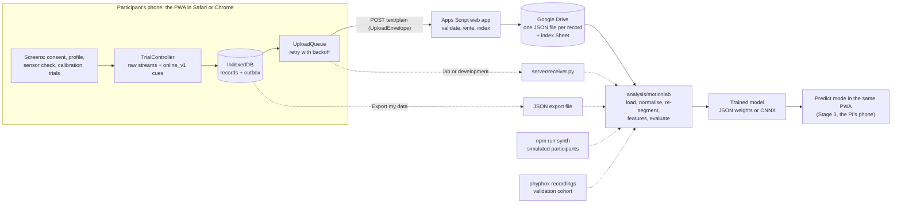

# Project overview

Audience: the student and the PI. Applies to app 0.1.0, data schema 1.1.0, protocol 1.0.0.

Other documents: [01 Protocol](01_PROTOCOL.md) · [02 Data schema](02_DATA_SCHEMA.md) · [03 Sensors and platforms](03_SENSORS_AND_PLATFORMS.md) · [04 Segmentation](04_SEGMENTATION.md) · [05 Modeling plan](05_MODELING_PLAN.md) · [06 Considerations](06_CONSIDERATIONS.md) · [07 Deployment](07_DEPLOYMENT.md) · [08 Stage 3 predictor](08_STAGE3_PREDICTOR.md)

## 1. Problem statement

A person holds a smartphone with the arm fully extended straight in front of them and brings it in to touch their nose. The question is whether the phone's own motion sensors are enough to tell if they used the left or the right hand.

The participant instruction, verbatim from `app/src/i18n/en/common.ts`: *"Stretch your arm out and hold still. At the beep, bring the phone to gently touch the tip of your nose and hold it there until the double beep."*

| Aspect | Definition used in this project |
|---|---|
| Unit of prediction | One **trial**: a single movement from the extended arm to the nose. It is recorded from a hold-still period before the GO cue until the phone has been held at the nose. |
| Input | The phone's motion streams for the trial at about 60 Hz, plus the automatic segmentation. The streams are `acc_x/y/z` (acceleration without gravity), `accg_x/y/z` (acceleration including gravity) and `rr_alpha/beta/gamma` (rotation rate about device x/y/z). Euler orientation and quaternions are kept only as metadata. |
| Output | `hand` (left or right) with a calibrated probability `p_right` (`Prediction` in `app/src/core/predictor.ts`), or an abstention when the trial is unusable. |
| Use case | A person the model has never seen, an unknown phone and grip, and a single trial. The predictor never sees the instructed condition. |
| Secondary aims | Detect where the movement starts and ends automatically. Find where errors concentrate: sex, handedness, age, speed, orientation, start position, platform. |
| Exploratory add-on | Predict the person's handedness from their trials with both hands. |

## 2. Why it is non-trivial

| Challenge | Why it is hard | How the project handles it |
|---|---|---|
| Grip and orientation | Motion data are reported in the phone's own frame (x = right edge, y = top edge, z = out of the screen), regardless of screen rotation ([W3C][w3c]). The same right-hand movement therefore puts its sideways component on x, −x or ±y depending on the grip. A rule learned on `upright_toward` does not transfer to other grips, and the PI may hold the phone any way. | 10 `OrientationId` conditions, including `free`. Grip-invariant features are computed offline relative to gravity. Each trial's grip is checked against the measured gravity direction (`detected.orientation_match`). |
| Speed | A natural one-way finger-to-nose movement takes about 0.6 s ([Chen 2021][chen2021]). For a 0.45 m path, the minimum-jerk peak acceleration (≈5.77·A/D², [Flash & Hogan][minjerk]) falls from ≈42 m/s² at 0.25 s to ≈0.3 m/s² at 3 s. At 3 s it is close to Chrome's 0.1 m/s² rounding step. Displacement integrated from the accelerometer is reliable only over about 1–2 s without correction ([Bai 2022][bai2022]). | Three speed conditions (`natural`, `fast`, `slow`) with per-speed segmentation overrides. Rotation features remain usable at slow speeds: peak angular speed is still ≈40 deg/s for a 60° rotation over 3 s (same model). The achieved duration is measured, not assumed. |
| Start pose | From the shoulder line, the hand travels sideways to the midline, so sideways translation separates the hands. From in front of the face it barely moves sideways, and rotation has to carry the signal. The forearm rotates by about 54° in finger-to-nose movements ([Öhberg 2019][ohberg2019]). | A `start_position` factor (`natural`, `shoulder`, `center`) with exact instructions, recorded on every trial. Which pose is canonical is an open question for the PI (section 9). |
| Hand dominance | About 10.6% of people are left-handed ([Papadatou-Pastou 2020][pp2020]), so in a random sample "right hand" nearly equals "dominant hand". Dominant and non-dominant reaches differ in path curvature and initial direction, and left-handers are less asymmetric ([Sainburg 2002][sainburg2002], [Przybyla 2012][przybyla2012]). A model can learn dominance instead of side and then fail on left-handers. | Every participant does both hands in ABBA-ordered blocks. At least 20–30 left-handers are recruited deliberately. Training uses mirror augmentation, and the error analysis models the hand × handedness interaction. |
| Platform differences | All iOS browsers run WebKit, which inverts all three axes of `acceleration` and `accelerationIncludingGravity`: face-up z reads ≈ −9.81, not +9.81 ([WebKit source][webkit-mm], [W3C list 2014][w3c-list], [2026 measurement][gaitscope]). Chrome rounds to 0.1 m/s² and 0.1 deg/s; iOS does not round ([Chromium][cr-util]). Both platforms deliver ≈60 Hz. `event.interval` is in seconds on iOS and in milliseconds on Chrome. Euler angles hit gimbal lock in the upright start pose ([W3C][w3c]). | Conventions are measured on each device with a 3-step calibration (`gravity_sign`, `upright_check`, `axis_check`). Raw values are stored as delivered. Normalisation and iOS quantisation happen offline. Evaluation includes leave-one-platform-out. |
| Labels and people | People sometimes use the wrong hand: in a supervised multi-day study, 16% of participants wore the wrist sensor on the wrong wrist at least once ([PLOE 2019][ploe]). Movement style is personal, so random trial splits leak identity. Across studies, record-wise cross-validation reported a median error of 5.6%, against 13.0% for subject-wise ([Saeb 2017][saeb2017]). | A review screen after each trial with Redo and "wrong hand" flags. Every attempt is kept, marked by `outcome.accepted`. Evaluation is subject-wise, with a locked participant test set. |

**The physics that helps.** A left-hand movement is approximately the mirror image of a right-hand movement across the body's sagittal plane. Write the phone's orientation as a rotation R from the device frame to the body frame. Mirroring gives R' = M·R·S with M = S = diag(−1, 1, 1). For any grip, this maps the device-frame readings as follows:

- **Acceleration:** (x, y, z) → (−x, y, z).
- **Angular velocity:** (x, y, z) → (x, −y, −z). Angular velocity is a pseudovector, so it transforms differently from acceleration. In W3C field names, `rr_alpha` is kept and `rr_beta` and `rr_gamma` are negated.
- **Labels:** the hand flips, `top_left_*` ↔ `top_right_*`, and the other orientations are unchanged.

Some scalars, such as the net rotation about gravity (∫ ω·ĝ dt), do not depend on the grip but change sign between hands. Wrist-IMU finger-to-nose studies report counter-clockwise rotation for the right hand and clockwise for the left ([Mohammadi-Ghazi 2022][mg2022]). That rotation is measured about a wrist-sensor axis, which the paper does not say is vertical, so it is suggestive evidence, not proof, that the rotation about gravity separates the hands. This gives us a rule-based first baseline (`YawSignRule`), physically correct augmentation, and sanity checks. The accelerometer sign has to be normalised first. iOS's global sign flip is an improper transformation (a point reflection), so it would reverse these features. Pilot data from both platforms must confirm the rule before we rely on it ([05 Modeling plan](05_MODELING_PLAN.md)).

## 3. The three stages

### Stage 1: data-collection platform (built, version 0.1.0)

**Goal:** a zero-install instrument that records labelled, raw, high-quality trials from many people on both platforms, plus everything needed to analyse them.

| Deliverable | Where |
|---|---|
| Collector PWA. Screens: consent (18+), profile with the Edinburgh short form (EHI-SF), sensor check, 3-step calibration, preset selection, trial runner with review/redo/flags, export and deletion, researcher settings, live sandbox. English and Hebrew; works offline. | `app/` |
| Data contract: `SessionRecord`, `TrialRecord`, `ExportBundle`, `UploadEnvelope` | `schema/records.schema.json`, `app/src/core/types.ts` |
| Upload backend: validation, one Drive file per record, index Sheet, a capped quarantine log of rejected uploads (identifiers only) | `backend/google-apps-script/` |
| Local receiver with the same layout, for lab sessions and development | `server/receiver.py` |
| Simulator (`?sim=1`) and synthetic dataset generator | `app/src/sim/`, `app/scripts/synth.ts` |
| Analysis starter kit `motionlab`: io, conventions, preprocess, segment (`online_v1` port and offline methods), features, augment, synth, models, evaluate, qa | `analysis/` |
| CI and GitHub Pages deployment | `.github/workflows/` |
| phyphox experiment file for the validation cohort (**not built yet**) | see [01 Protocol](01_PROTOCOL.md) |

| ID | Milestone | Evidence that it is reached |
|---|---|---|
| S1-M1 | Code complete | CI green (typecheck, Vitest, pytest; `.github/workflows/ci.yml`), and `npm run e2e` (Playwright) passing locally, because CI does not run it. `npm run synth` → `qa_report.py` → `train_baseline.py` runs end to end. |
| S1-M2 | Deployed | The Pages URL is live. A GET on the Apps Script `/exec` URL answers `ok: true`, and `config.json` points to it. |
| S1-M3 | Self-pilot passed | The real-device checklist in [03](03_SENSORS_AND_PLATFORMS.md) passes on at least one iPhone and one Android phone. |
| S1-M4 | Ethics approval | Approval letter in hand. The in-app consent text and `consent_version` match the approved form. |
| S1-M5 | Pilot (8–10 people) | Protocol and segmentation parameters frozen. Error rate and ICC estimated, and the sample size set from them. |
| S1-M6 | Validation cohort | A written decision on whether 60 Hz is adequate, with the numbers behind it. |
| S1-M7 | Main collection | Target N and subgroup quotas reached. QA report clean. Locked test participants defined. |

**Acceptance criteria** (proposed, to be agreed with the PI):

1. **Reach.** The app opens from a link or QR code in Safari (iOS) and Chrome (Android), with nothing to install. The motion permission is requested from an explainer tap. In-app browsers and browsers that block sensors show the participant a clear message.
2. **Signal.** The median achieved motion rate per trial is at least 50 Hz on both platforms (≈60 Hz expected). Trials with gaps over 50 ms, or during which the page was hidden, are flagged in `quality`.
3. **Conventions.** Calibration returns `gravity_sign` = −1 on iPhones and +1 on Android, `upright_check` = `ok` and `axis_check.verdict` = `w3c`. These are the values the browser sources predict; the self-pilot confirms or corrects them.
4. **Integrity.**
   - Every record validates against the schema.
   - After an offline-then-online cycle, the backend holds exactly one file per local record.
   - About 30 parallel uploads of the largest trial records (≈75 KB, see [02](02_DATA_SCHEMA.md)) succeed; retries are allowed.
5. **Segmentation.** The Python port of `online_v1` reproduces the app's onset and end indices on the synthetic dataset. Against the simulator's ground truth, the error stays within the tolerance set in [04](04_SEGMENTATION.md).
6. **Burden.** A first-time participant completes the `standard` preset (56 trials) in about 15 minutes with a redo rate of 10% or less, as measured in the pilot.
7. **Ethics.** No data are collected from anyone but the student before approval.

### Stage 2: model building

**Goal:** a left/right classifier that works for people and phones it has never seen, with an honest estimate of its accuracy and of where it fails.

| Deliverable | Where |
|---|---|
| Versioned normalisation and preprocessing: gravity sign and rotation-rate mapping from the calibration, iOS quantisation, resampling, gravity propagated with the gyro from the rest windows | `motionlab.conventions`, `motionlab.preprocess` |
| Offline re-segmentation with several methods, flagging disagreements over 100 ms and multi-peak movements | `motionlab.segment` |
| Features: basic, device-frame, grip-invariant and chiral, plus time-normalised sequences | `motionlab.features` |
| Model ladder: `YawSignRule` → logistic regression on invariant and chiral features → `HistGradientBoosting` → optional 1D-CNN/GRU with mirror augmentation | `motionlab.models`, `motionlab.augment` |
| Evaluation and subgroup error report | `motionlab.evaluate`, `analysis/reports/` |
| Handedness add-on (exploratory) | `analysis/` |

| ID | Milestone | Evidence |
|---|---|---|
| S2-M1 | Normalisation verified | On pilot data from both platforms, the mirror rule (acc −x; gyro −y, −z) maps mirrored right-hand trials onto real left-hand trials better than any of the other 63 sign patterns. |
| S2-M2 | Baselines | Subject-wise CV results for the model ladder on pilot and synthetic data. |
| S2-M3 | Model selection | Nested subject-wise CV on the main dataset, with the test set untouched. |
| S2-M4 | Final evaluation | A single evaluation on the locked test set, plus the subgroup report. |
| S2-M5 | Handedness add-on | Leave-one-subject-out AUC with a CI, labelled exploratory. |

**Acceptance criteria** (proposed):

1. **Subject-wise splits only.** Every number comes from splits by `participant_id` (StratifiedGroupKFold or leave-one-subject-out). Tuning is nested inside the training folds, and mirrored copies stay in their source participant's fold.
2. **Metrics with honest CIs.** Report accuracy, balanced accuracy, ROC AUC, log loss and Brier score, each with a participant-level (hierarchical) bootstrap 95% CI. Also report the distribution of per-participant accuracy (median, worst decile). Fold standard errors alone are not enough ([Varoquaux 2018][varoquaux], [Saravanan 2020][hboot]).
3. **Robustness.** Leave-one-orientation-out and leave-one-platform-out results. Also leave-one-device-model-out, once there are enough devices ([Stisen 2015][stisen]).
4. **Error analysis.** A GLMM `correct ~ hand*handedness + sex + age + speed + orientation + platform + (1|participant)` fitted on out-of-fold predictions ([lme4][lme4]). It is reported with the number of people in each subgroup.
5. **Ablations.**
   - With vs without mirror augmentation.
   - 60 Hz vs high-rate phyphox data.
   - Quantised vs raw iOS data.
6. **Mirror consistency** on held-out data: p(right | mirror(x)) ≈ 1 − p(right | x).
7. **Performance target agreed with the PI.** For reference, one LSTM study detected the hand from everyday phone motion with 89–97% accuracy; it is unclear whether its test users were unseen ([Chen et al. 2023][chen2023]). If canonical trials score well below 90%, suspect a sign, axis or label bug before blaming the task.

### Stage 3: a predictor the PI can use

**Goal:** the PI opens the app on their own phone, makes the movement, and sees "left" or "right" with a probability.

| Deliverable | Where |
|---|---|
| Predict mode in the same PWA. It records one trial with the normal cues and shows the hand, `p_right` and the confidence, or an abstention with its reason. | `app/` (new screen) |
| Exported model implementing `Predictor`: JSON weights for logistic regression or gradient boosting, or ONNX with onnxruntime-web for neural networks | `app/src/core/predictor.ts` |
| Parity test: the browser and Python give the same predictions on the same trials | `app/tests/`, `analysis/tests/` |
| Evaluation protocol for the PI, a results template, and a hand-off checklist | [08 Stage 3 predictor](08_STAGE3_PREDICTOR.md) |

| ID | Milestone | Evidence |
|---|---|---|
| S3-M1 | Export and parity | Parity test passes. |
| S3-M2 | Predict mode | Works offline on an iPhone and an Android phone. |
| S3-M3 | Dry run | A lab member who was never in the training data uses their own phone. |
| S3-M4 | PI evaluation | Results reported per the protocol in [08](08_STAGE3_PREDICTOR.md). |

**Acceptance criteria** (proposed):

1. The model uses only sensor streams and segmentation, never `trial.condition` (the `Predictor` contract).
2. It is trained at the deployment rate (60 Hz). At inference it applies the same normalisation as in training, using the phone's own calibration.
3. It abstains, and says why, when the trial did not complete or the confidence is low.
4. It runs offline on the PI's phone, within the size and latency budgets in [08](08_STAGE3_PREDICTOR.md).
5. Results of the PI's session are reported with a CI and a per-condition breakdown.

## 4. System architecture

Solid arrows are the main path; dotted arrows are fallbacks and auxiliary inputs.

| Component | Code | Notes |
|---|---|---|
| Screens and session flow | `app/src/app/`, `app/src/ui/` | Preact. Screens: welcome, consent, profile, sensors, calibration, setup, session, done, data, settings, sandbox, about. |
| Trial engine | `core/trialController.ts`, `core/recorder.ts`, `core/segmentation.ts` | Driven only by incoming samples and free of DOM code, so it runs identically in the browser, the simulator and Node tests. |
| Sensors, calibration, cues | `core/sensors.ts`, `core/calibration.ts`, `core/cues.ts` | Permission flow, measured rates, engine detection; Web Audio beeps; screen wake lock. |
| Protocol | `core/protocol.ts` | Seeded plans for the presets; per-condition segmentation overrides (`resolveParams`). |
| Storage and upload | `core/storage.ts`, `core/uploader.ts`, `core/exporter.ts`, `core/config.ts` | IndexedDB outbox, simple-request POST, file export, runtime `config.json`, nickname redaction. |
| Simulator | `app/src/sim/` | Minimum-jerk kinematic model of both hands and all grips; used by `?sim=1`, the tests and `synth`. |
| Backend | `backend/google-apps-script/` | Idempotent: a re-sent record overwrites its own file. |
| Analysis kit | `analysis/motionlab/`, `analysis/scripts/` | Loads folder trees and export bundles, deduplicates by id. |
| Contract | `schema/records.schema.json` | JSON Schema 2020-12. Minor version bump for additive changes. |
| Stage 3 hook | `core/predictor.ts` | Interface only today. |

## 5. Data flow

1. **Onboarding** (once per participant and device):
   - Consent: `consent_version`, 18+.
   - Profile: `participant_id` (`P-XXXXXX`), age, sex, handedness, EHI-SF answers giving `ehi_lq` and `ehi_class`, the hand usually used for the phone, and optional height and phone model.
   - Sensor check: permission and measured rates.
   - Calibration: phone flat → `gravity_sign`; upright → `upright_check`; tilt gesture → `axis_check`.

   All of this goes into a `SessionRecord`, together with device info, the seeded plan, and the base segmentation parameters.
2. **Trial.** Tap Ready → hold still → random foreperiod → GO beep → move → hold at the nose → double beep → review. From the Ready tap to the end of the 1000 ms post-roll, the `TrialController` keeps every sample of every stream in memory as columnar arrays (`streams.motion`, `orientation`, `quaternion`, `touches`, `cues`). `online_v1` only decides when to beep and whether the attempt succeeded.
3. **Save.** Every attempt becomes a `TrialRecord` (`attempt`, `outcome.accepted`, `outcome.participant_flag`). A complete attempt is saved as soon as its review opens, as not accepted with `outcome.note` = `review_interrupted`, and saved again with the participant's decision (Next, Redo or a problem flag). Failed attempts (`no_movement`, `too_long`, `aborted`, `interrupted`) are saved automatically with `accepted: false`. Each save is one short IndexedDB transaction, and the trial and session records are both queued in the outbox.
4. **Upload.** The `UploadQueue` sends one `UploadEnvelope` (`kind`, `study_key`, `sent_at`, `record`) at a time as a `text/plain` POST. It retries transient failures with jittered backoff and marks an item sent only when the response says `ok: true`. A permanent rejection (`retry: false`, e.g. a wrong study key) is not retried automatically; the record stays on the phone until someone taps "Upload now".
5. **Store.** Apps Script validates the envelope: id formats, schema major version, size and the optional study key. Rejected payloads are not stored: the backend logs only their identifiers and the reason in the `quarantine` sheet, at most 500 rows per day. Valid records are written to `<study_code>/<participant_id>/<session_id>/session.json` or `trial_<trial_index:3>_a<attempt>_<trial_id>.json`, and an index row is appended to the Sheet.
6. **Download.** The researcher syncs or zips the Drive folder into `analysis/data/`, which git ignores. Export files and receiver output go to the same place.
7. **Analyse.** `motionlab` loads any mix of folder trees and export bundles. The versioned preprocessing then:
   - normalises signs and axes from each session's calibration;
   - optionally quantises iOS data to Chrome's grid (ablation A3, `train_baseline.py --quantize ios`; off by default until A3 decides);
   - resamples, re-segments offline and computes features.
8. **Deploy the model.** The chosen model is exported as JSON or ONNX and shipped in the PWA's predict mode (Stage 3).

**What the phone never does:**

- crop the recording window, or store filtered sensor values in place of the raw ones;
- normalise or flip signs;
- upload the nickname, unless `upload_nickname` is set;
- use the camera, microphone or location;
- vibrate while recording, because the vibration motor would contaminate the accelerometer.

## 6. Design decisions and why

These are settled. The table records the reasons; the linked documents give the details.

| # | Decision | Main reason | Details |
|---|---|---|---|
| 1 | The instrument is a PWA. Participants open a link or QR code, with optional Add to Home Screen. Built with Vite, TypeScript and Preact, statically hosted on GitHub Pages. | Nothing to install on any iPhone or Android phone. Native distribution needs TestFlight, which means $99/year, App Review and builds that expire after 90 days ([Apple][apple-programs], [TestFlight][testflight]), or APK sideloading. Since May 2026, Expo Go cannot load our project for arbitrary participants ([Expo][expo-go]). | [03](03_SENSORS_AND_PLATFORMS.md), [07](07_DEPLOYMENT.md) |
| 2 | Accept ≈60 Hz | **Browser caps:** browsers cap motion data at ≈60 Hz. WebKit uses a 1/60 s timer ([WebKit][webkit-h]), Chromium a 60 Hz event pump ([Chromium][cr-pump]) and a 60 Hz cap for the Generic Sensor API ([Chromium][cr-traits]). **Adequacy:** for minimum-jerk movements of 0.25 s or longer, 99% of the acceleration energy lies below ≈10 Hz (our calculation). Wrist motion in 24 daily activities has its dominant frequency near 1 Hz ([Mann 1989][mann1989]). **Native ceiling:** native apps reach at most 100 Hz on iOS ([Apple][wwdc23], [Apple DTS][apple-dts]) and 200–500 Hz on Android ([Android][android-sensors]). | [03](03_SENSORS_AND_PLATFORMS.md), [04](04_SEGMENTATION.md) |
| 3 | phyphox as the high-rate reference for a validation cohort; native only if that shows 60 Hz loses accuracy | phyphox is free and open source ([phyphox][phyphox]). It reaches ≈100 Hz on iPhone and the device maximum on Android ([phyphox forum][phyphox-rates]). | [01](01_PROTOCOL.md), [03](03_SENSORS_AND_PLATFORMS.md) |
| 4 | Offline first: IndexedDB outbox, upload per record, "export my data" fallback | Safari deletes a site's storage after 7 days without interaction ([WebKit][itp]). iOS IndexedDB connections can drop ([WebKit bug][idb-bug]). | [02](02_DATA_SCHEMA.md), [07](07_DEPLOYMENT.md) |
| 5 | Backend: a Google Apps Script web app writing one Drive file per record, plus an index Sheet | **Free and robust:** costs nothing, needs no card and never pauses. Firebase Storage has required a billing plan since February 2026 ([Firebase][fb-storage]). Supabase pauses free projects after 7 days without activity ([Supabase][sb-pause]). **CORS:** a `text/plain` POST is a CORS simple request, and Apps Script's JSON reply is readable ([Fetch][fetch], [Tanaike][tanaike]). **Drive files:** a Sheets cell holds at most 50,000 characters, so the raw data cannot live in the Sheet ([Google][drive-limits]). | [backend/README.md](../backend/README.md) |
| 6 | Never crop on the device. Store raw values as delivered, and normalise offline in a versioned step. | Onset/offset methods disagree by tens to hundreds of ms, and their bias depends on speed ([Botzer & Karniel 2009][botzer], [Dotti 2024][dotti]). Re-segmenting offline must stay possible. | [02](02_DATA_SCHEMA.md), [04](04_SEGMENTATION.md) |
| 7 | Measure platform conventions on each device instead of assuming them | iOS inverts the accelerometer sign. The mapping of rotationRate fields to axes changed in 2019 ([W3C PR #43][w3c-pr43]), and MDN still shows the old mapping ([MDN][mdn-alpha]). Since Chrome 151, Chrome also ships `requestPermission()`, so its presence no longer identifies iOS ([Chrome 151][chrome151]). | [03](03_SENSORS_AND_PLATFORMS.md) |
| 8 | Fully within-subject protocol: both hands, ABBA hand order, seeded randomisation, presets of 24, 56 and 132 trials | Keeps hand separate from dominance and from position in the session. Sessions last about 7.5–30 minutes (the app's estimate). | [01](01_PROTOCOL.md) |
| 9 | Online segmentation (`online_v1`) only drives the cues and quality checks | It must run causally on the phone. Analysis re-segments offline with several methods and flags disagreements. | [04](04_SEGMENTATION.md) |
| 10 | Mirror symmetry as a modelling prior | It gives physically correct augmentation, antisymmetric models f(x) = g(x) − g(mirror(x)), and sanity checks. Published sign rules disagree ([OREBA][oreba], [OpenWatch 2026][openwatch]), so the rule is derived from first principles and then checked on pilot data. | [05](05_MODELING_PLAN.md) |
| 11 | Subject-wise evaluation and a subgroup GLMM | The PI will test on new people, and record-wise CV underestimates error ([Saeb 2017][saeb2017], [Chaibub Neto 2019][chaibub]). | [05](05_MODELING_PLAN.md) |
| 12 | Stage 3 runs in the same PWA | Same sensors, same 60 Hz and same calibration as the training data. Nothing for the PI to install. | [08](08_STAGE3_PREDICTOR.md) |
| 13 | Privacy by design | Pseudonymous `P-XXXXXX` codes. The nickname stays on the device unless `upload_nickname` is set. No camera, microphone or location; participants must be 18+. Recruitment is limited to Israel unless GDPR basics are added ([GDPR Art. 3][gdpr]). Amendment 13 of the Israeli Privacy Protection Law has applied since 14 Aug 2025 ([IAPP][iapp]). | [06](06_CONSIDERATIONS.md) |

## 7. Where things stand

**Done in 0.1.0:**

- Everything in the Stage 1 deliverables table except the phyphox file.
- Testing so far is limited to unit tests, the end-to-end test and the simulator.

**Not done yet:**

- Verification on real phones.
- Ethics approval.
- Any participant data.
- The phyphox experiment file.
- Stage 2 beyond the starter baselines, and all of Stage 3.

**Next steps, in order.** The effort column holds estimates; adjust them to the PI's timeline.

| Step | What | Exit criterion | Indicative effort |
|---|---|---|---|
| 1. Self-pilot | Run `quick` and `standard` yourself on an iPhone and an Android phone (borrow one if needed). Upload to the real backend, load the data with `motionlab`, and run `YawSignRule` on both hands. | The real-device checklist in [03](03_SENSORS_AND_PLATFORMS.md) passes. Conventions confirmed: gravity sign per platform, `axis_check` verdict, ≈60 Hz, touch events from the nose on screen-toward trials. | 2–4 days |
| 2. Ethics | Ask the PI which Bar-Ilan committee applies ([BIU][biu-ethics]). Submit the protocol, consent text and data-management plan. Then set `consent_version` to the approved form. | Approval | Depends on the committee; submit during step 1 |
| 3. Pilot, 8–10 people | Both platforms (recommendation: at least 3 each, ideally at least 2 left-handers), `standard` preset, sessions observed | Protocol and segmentation parameters frozen; bump `PROTOCOL_VERSION` if anything changes. Redo/failure rates, error rate and ICC estimated; sample size fixed. | 1–2 weeks |
| 4. Validation cohort | 10–20 people, lab-run. Same protocol, alternating PWA and phyphox blocks on the same phone. | A decision on whether 60 Hz is adequate: accuracy and timing error compared with the high-rate data | 1–2 weeks; can overlap step 5 |
| 5. Main collection | 40–60+ participants. At least 20–30 left-handers through targeted recruitment (random recruitment needs ≈190 people for 20). Each platform at least 30%; sex balanced within handedness groups. | Quotas reached, QA report clean, ≈20% of participants locked as the test set | 3–6 weeks |
| 6. Modeling (Stage 2) | Model ladder, evaluation, subgroup analysis, handedness add-on. This can start earlier on synthetic and pilot data. | An evaluation report that meets the Stage 2 criteria | 2–4 weeks |
| 7. Stage 3 | Export, predict mode, dry run, PI evaluation | PI evaluation done | 1–2 weeks |

## 8. Risks and mitigations

| Risk | Consequence | Mitigation | See |
|---|---|---|---|
| iOS accelerometer sign inverted | Chirality features flip, so iOS trials look like the other hand | `gravity_sign` measured per device; engine recorded; normalisation offline; leave-one-platform-out | [03](03_SENSORS_AND_PLATFORMS.md) |
| Gyro channels mislabelled (MDN's outdated "alpha = z") | Wrong features and physically impossible augmentation | Schema states alpha = x; tilt-gesture `axis_check` per device; unit tests; the 64-sign-pattern check on pilot data | [03](03_SENSORS_AND_PLATFORMS.md), [05](05_MODELING_PLAN.md) |
| Platform shortcut: Chrome quantises, iOS does not | The model learns the platform instead of the hand | Quantise iOS in preprocessing (and run an ablation); stratify; leave-one-platform-out | [05](05_MODELING_PLAN.md) |
| Dominance confound | Fails on left-handers | Both hands for everyone; 20–30+ left-handers; mirror augmentation; hand × handedness term in the GLMM | [01](01_PROTOCOL.md), [05](05_MODELING_PLAN.md) |
| Wrong hand or wrong grip used | Label noise | Large per-block hand and orientation instructions; review screen with flags; `detected.orientation_match`; model-based outlier flags later; 5–15% deviations budgeted | [01](01_PROTOCOL.md) |
| Identity leakage | The PI sees lower accuracy than reported | Subject-wise CV, nested tuning, locked participant test set, bootstrap CIs | [05](05_MODELING_PLAN.md) |
| Data lost on the phone: Safari 7-day deletion, IndexedDB drops, in-app browsers | Missing trials | Upload after every record; outbox with retries; idempotent backend; export; in-app-browser warning; suggest Add to Home Screen | [07](07_DEPLOYMENT.md) |
| Silent upload failures: Apps Script errors and content blockers both surface only as "Failed to fetch" | Unnoticed backlog | Items stay queued with backoff; pending counter on screen; `doGet` health check; Apps Script Executions dashboard; export | [backend README](../backend/google-apps-script/README.md) |
| iOS motion permission denied. A Cancel is sticky until Safari is force-quit ([WebKit][webkit-perm]). | No data from that participant | Explainer screen before the system prompt; recovery steps on screen that match the context (Safari tab, Home Screen app, other iOS browser, in-app browser) | [03](03_SENSORS_AND_PLATFORMS.md) |
| Sensors silent or gapped: blocking browsers ([Brave][brave]), hidden page, screen lock | Empty or truncated trials | The sensor check blocks the session when no motion data arrive in its 2.5 s measurement or the rate is below 20 Hz; wake lock; abort as `interrupted`; `quality.hidden_during` and gap counts | [03](03_SENSORS_AND_PLATFORMS.md) |
| 60 Hz too coarse for fast or odd movements | Lower accuracy or timing error | phyphox validation cohort; native app only if needed | [01](01_PROTOCOL.md) |
| Segmentation bias varies with speed | Spurious speed effects | Never crop; offline multi-method segmentation; disagreement flags; bin trials by measured duration | [04](04_SEGMENTATION.md) |
| Too few people per subgroup | Inconclusive error analysis | Targeted recruitment; report the number of people per subgroup; GLMM; CIs | [01](01_PROTOCOL.md) |
| Ethics approval delayed | No data from others | Submit early; meanwhile self-pilot and develop on synthetic data | [06](06_CONSIDERATIONS.md) |
| Public upload endpoint abused | Junk files or quota exhaustion | Server-side validation, size cap, study key (a spam filter only); rejected uploads are never stored, only logged by identifier in a quarantine sheet capped at 500 rows per day; private Drive folder | [06](06_CONSIDERATIONS.md) |
| The PI tests on an untested phone or browser | A poor demonstration | Sensor check before predicting; abstention; leave-one-device-model-out; dry run with a new person | [08](08_STAGE3_PREDICTOR.md) |
| Simulated records mixed with real ones | Corrupted dataset | `simulated: true` on every simulated record; simulation never persisted; QA report counts these records | [02](02_DATA_SCHEMA.md) |

## 9. Open questions for the PI

1. **Start pose.** Which start pose is canonical: the hand in front of the same shoulder, or the phone in front of the face? The app records both (`shoulder`, `center`) and the participant's own reading (`natural`).
2. **Contact point.** Which part of the phone should touch the nose: the screen centre, the top edge or the back? This defines the end pose.
3. **Evaluation format:**
   - the PI's own phone, iOS or Android;
   - single trials;
   - whether odd movements are included;
   - sitting or standing;
   - whether a short per-device calibration is allowed;
   - whether the predictor may abstain.
4. **Success criterion.** Target accuracy or AUC, and on which conditions: canonical trials only, or all orientations and speeds?
5. **Ethics.** Which Bar-Ilan committee covers the lab, and is there an umbrella protocol to amend? May admission-task data be reused in publications?
6. **Data storage.** Is a Google Drive owned by a dedicated Gmail account acceptable, or must data stay on university infrastructure? What retention period?
7. **Recruitment area.** Is Israel-only recruitment acceptable? It avoids GDPR obligations.
8. **Native app.** If the validation cohort shows that 60 Hz costs accuracy, is a native high-rate app worth $99/year for Apple distribution? Does the lab already have an Apple developer team?
9. **Repository visibility.** GitHub Pages on a free plan requires a public repository ([GitHub][gh-pages]); is that acceptable? GitHub Pro through the Student Developer Pack is the alternative.
10. **Deadline** for the admission decision.

## 10. Glossary

| Term | Meaning |
|---|---|
| Trial / attempt | A trial is one planned movement (`trial_index`). An attempt is one recording of it: Redo creates attempt 2, 3, and so on. Every attempt is stored, and `outcome.accepted` marks the one that counts. |
| Block | Consecutive trials with the same hand and orientation. `kind` is `main`, `odd` or `free`. |
| Session / preset | A session is one run through a plan (`SessionRecord`). Presets: `quick` (24 trials), `standard` (56), `full` (132), `custom`. |
| ABBA | Hand order across orientation pairs: A·o1, B·o1, B·o2, A·o2, … The first hand A follows the parity of the session seed, and the first orientation is always `upright_toward`. |
| Hand (label) | The instructed hand of a trial (`condition.hand`). Not the dominant hand. |
| Handedness, EHI-SF, LQ | The participant's preferred hand, recorded two ways: self-report (`handedness_self`) and the 4-item Edinburgh short form (writing, throwing, toothbrush, spoon) ([Veale 2014][ehi-sf]). The form gives a laterality quotient from −100 to 100 (`ehi_lq`). Classes (`ehi_class`): left −100 to −61, mixed −60 to 60, right 61 to 100. |
| `OrientationId` | How the phone is held: `upright`, `upside_down`, `top_left` or `top_right`, each with the screen `toward` or `away` from the participant; plus `flat_up` and `free`. |
| `start_position` | `natural` (the participant's own reading of "arm straight in front"), `shoulder` (hand in line with the same shoulder), `center` (phone in front of the face). |
| `variant` | `standard`, or one of 9 odd movements: `curved`, `pause`, `twist`, `elbow_high`, `bent_start`, `lean_in`, `chin`, `forehead`, `jerky`. |
| Canonical trial | In this document: `upright_toward`, `natural` speed, `natural` start, `standard` variant. |
| Device frame | x points to the right edge, y to the top edge, z out of the screen. Fixed to the device ([W3C][w3c]). |
| `acc_*`, `accg_*`, `rr_*` | Motion columns: acceleration without gravity and with gravity (m/s²), and rotation rate in deg/s about device x (`rr_alpha`), y (`rr_beta`) and z (`rr_gamma`). |
| `gravity_sign` | +1 if a face-up phone reads `accg_z` ≈ +9.81 (W3C, Android); −1 if inverted (iOS WebKit). |
| `axis_check` | A tilt-gesture test of the rotationRate mapping, sign and units. Verdicts: `w3c`, `w3c_inverted`, `legacy`, `legacy_inverted`, `unclear`. |
| Engine | The browser engine: `webkit` (every iOS browser), `blink` (Chromium) or `gecko` (Firefox). |
| `online_v1` | The app's causal segmentation: hold-still, onset and end detection. Its exact specification is in `app/src/core/segmentation.ts`. |
| Foreperiod | A random 500–1200 ms delay between detected stillness and the GO cue. It prevents participants from anticipating the cue. |
| GO cue / end cue | GO: an 880 Hz beep plus a colour change. End: two 660 Hz beeps, played once the hold at the nose is confirmed. |
| Post-roll | The 1000 ms recorded after the end of the movement is confirmed. |
| Mirror | Reflection across the body's sagittal plane. Acceleration maps to (−x, y, z), the gyro to (x, −y, −z), the hand flips, and `top_left` ↔ `top_right`. |
| Pseudovector | A vector such as angular velocity that transforms differently from a position under reflection. This is why the gyro mirror rule differs from the accelerometer rule. |
| Chirality pseudoscalar | A feature that does not depend on the grip but flips sign under mirroring, e.g. ∫ ω·ĝ dt (net rotation about gravity). |
| Gimbal lock | The Euler-angle singularity at beta = ±90°, which is exactly a phone held upright in portrait. |
| Subject-wise CV, LOSO | Cross-validation in which all of a participant's trials sit in the same fold. LOSO = leave one subject out. |
| Locked test set | ≈20% of participants kept unseen until the final evaluation. |
| GLMM | Generalised linear mixed model. Here it models per-trial correctness with condition and subgroup effects and a random intercept per participant. |
| ICC, design effect | The ICC (intra-class correlation) measures how similar errors are within one person. It inflates the required sample size by 1 + (m − 1)·ICC for m trials per person. |
| Outbox, `UploadEnvelope` | The IndexedDB queue of records waiting for upload, and the JSON object `{kind, study_key, sent_at, record}` that is posted to the backend. |
| PWA | Progressive web app: a website that also works offline and can be added to the home screen. |
| Quantisation | Chrome rounds readings to 0.1 m/s² and 0.1 deg/s ([Chromium][cr-util]); iOS does not. |
| Simulator, `?sim=1` | The built-in kinematic model that plays a participant. Its records carry `simulated: true`. |
| phyphox | A free, open-source app from RWTH Aachen that records phone sensors at native rates ([phyphox][phyphox]). |
| Generic Sensor API | A sensor API available only in Chromium browsers. On Android the app uses its `RelativeOrientationSensor` quaternion. |

## Sources

Browsers and platforms
- [W3C Device Orientation and Motion, Candidate Recommendation Draft 12 Feb 2025][w3c]; [PR #43, the rotationRate axis mapping (2019)][w3c-pr43]; [MDN rotationRate.alpha page (outdated)][mdn-alpha]
- WebKit: [WebCoreMotionManager.mm][webkit-mm], [WebCoreMotionManager.h][webkit-h], [motion permission cache][webkit-perm]; [W3C list, iOS sign report (2014)][w3c-list]; [iPadOS 26 sign measurement (2026)][gaitscope]
- Chromium: [device_sensor_event_pump.h][cr-pump], [sensor_traits.h][cr-traits], [platform_sensor_util.h][cr-util]; [Chrome 151 release notes][chrome151]
- [WebKit storage policy and the 7-day cap][itp]; [WebKit bug 273827, IndexedDB connection lost][idb-bug]; [Brave sensor blocking (2021)][brave]
- [Apple WWDC23 session 10179][wwdc23]; [Apple DTS on the 100 Hz cap (2026)][apple-dts]; [Android sensors overview][android-sensors]; [phyphox][phyphox]; [phyphox forum on rates][phyphox-rates]; [Expo Go loading changes (May 2026)][expo-go]; [Apple Developer Program][apple-programs]; [TestFlight overview][testflight]

Backend and hosting
- [Fetch standard][fetch]; [Tanaike, Apps Script web apps][tanaike]; [Apps Script deployments][gas-deploy]; [Drive and Sheets limits][drive-limits]; [Firebase Storage pricing change][fb-storage]; [Supabase free-project pausing][sb-pause]; [GitHub Pages][gh-pages]

Movement and segmentation
- [Minimum-jerk profile (Flash & Hogan 1985)][minjerk]; [Chen 2021, finger-to-nose with IMUs][chen2021]; [Öhberg 2019, joint excursions][ohberg2019]; [Bai 2022, IMU displacement with ZUPT][bai2022]; [Botzer & Karniel 2009][botzer]; [Dotti 2024][dotti]; [Mann 1989, wrist motion spectrum][mann1989]

Handedness, modelling and evaluation
- [Mohammadi-Ghazi 2022, finger-to-nose rotation direction][mg2022]; [Papadatou-Pastou 2020, prevalence of left-handedness][pp2020]; [Sainburg 2002][sainburg2002]; [Przybyla 2012][przybyla2012]; [Veale 2014, EHI short form][ehi-sf]; [PLOE 2019, wrong-wrist rate][ploe]; [OREBA, mirror augmentation][oreba]; [OpenWatch 2026, a differing mirror rule][openwatch]; [Chen et al. 2023, which-hand LSTM][chen2023]
- [Saeb 2017, record-wise vs subject-wise CV][saeb2017]; [Chaibub Neto 2019, identity confounding][chaibub]; [Stisen 2015, device heterogeneity][stisen]; [Varoquaux 2018, CV error bars][varoquaux]; [Saravanan 2020, hierarchical bootstrap][hboot]; [Bates 2015, lme4][lme4]

Ethics and law
- [Bar-Ilan research ethics][biu-ethics]; [IAPP on Amendment 13][iapp]; [GDPR][gdpr]

[w3c]: https://w3c.github.io/deviceorientation/
[w3c-pr43]: https://github.com/w3c/deviceorientation/pull/43
[mdn-alpha]: https://developer.mozilla.org/en-US/docs/Web/API/DeviceMotionEventRotationRate/alpha
[webkit-mm]: https://github.com/WebKit/WebKit/blob/main/Source/WebCore/platform/ios/WebCoreMotionManager.mm
[webkit-h]: https://github.com/WebKit/WebKit/blob/main/Source/WebCore/platform/ios/WebCoreMotionManager.h
[webkit-perm]: https://github.com/WebKit/WebKit/blob/main/Source/WebKit/UIProcess/WebsiteData/WebDeviceOrientationAndMotionAccessController.cpp
[w3c-list]: https://lists.w3.org/Archives/Public/public-geolocation/2014Jul/0024.html
[gaitscope]: https://github.com/soroushdty/gaitscope/issues/96
[cr-pump]: https://github.com/chromium/chromium/blob/main/third_party/blink/renderer/modules/device_orientation/device_sensor_event_pump.h
[cr-traits]: https://github.com/chromium/chromium/blob/main/services/device/public/cpp/generic_sensor/sensor_traits.h
[cr-util]: https://github.com/chromium/chromium/blob/main/services/device/generic_sensor/platform_sensor_util.h
[chrome151]: https://developer.chrome.com/release-notes/151
[itp]: https://webkit.org/blog/10218/full-third-party-cookie-blocking-and-more/
[idb-bug]: https://bugs.webkit.org/show_bug.cgi?id=273827
[brave]: https://community.brave.app/t/device-motion-data-accelerometer-gyro-not-available-on-android/292620
[wwdc23]: https://developer.apple.com/videos/play/wwdc2023/10179
[apple-dts]: https://developer.apple.com/forums/thread/813136
[android-sensors]: https://developer.android.com/develop/sensors-and-location/sensors/sensors_overview
[phyphox]: https://phyphox.org/download/
[phyphox-rates]: https://phyphox.org/forums/printthread.php?tid=2356
[expo-go]: https://expo.dev/changelog/expo-go-loading-changes-may-2026
[apple-programs]: https://developer.apple.com/programs/
[testflight]: https://developer.apple.com/help/app-store-connect/test-a-beta-version/testflight-overview/
[fetch]: https://fetch.spec.whatwg.org/
[tanaike]: https://github.com/tanaikech/taking-advantage-of-Web-Apps-with-google-apps-script
[gas-deploy]: https://developers.google.com/apps-script/concepts/deployments
[drive-limits]: https://support.google.com/drive/answer/37603
[fb-storage]: https://firebase.google.com/docs/storage/faqs-storage-changes-announced-sept-2024
[sb-pause]: https://supabase.com/docs/guides/platform/free-project-pausing
[gh-pages]: https://docs.github.com/en/pages/getting-started-with-github-pages/creating-a-github-pages-site
[minjerk]: https://www.socsci.ru.nl/wilberth/physics/smooth.html
[chen2021]: https://pmc.ncbi.nlm.nih.gov/articles/PMC8072355/
[ohberg2019]: https://pmc.ncbi.nlm.nih.gov/articles/PMC6427602/
[bai2022]: https://pmc.ncbi.nlm.nih.gov/articles/PMC9823748/
[botzer]: https://www.frontiersin.org/journals/neuroscience/articles/10.3389/neuro.20.002.2009/full
[dotti]: https://pmc.ncbi.nlm.nih.gov/articles/PMC11435557/
[mann1989]: https://pubmed.ncbi.nlm.nih.gov/2918428
[mg2022]: https://pmc.ncbi.nlm.nih.gov/articles/PMC9609238/
[pp2020]: https://research-repository.st-andrews.ac.uk/handle/10023/19889
[sainburg2002]: https://link.springer.com/doi/10.1007/s00221-001-0913-8
[przybyla2012]: https://pure.psu.edu/en/publications/dynamic-dominance-varies-with-handedness-reduced-interlimb-asymme/
[ehi-sf]: https://www.millisecond.com/library/v7/edinburghhandednessinventory/edinburghhandednessinventory_sf.manual
[ploe]: https://pmc.ncbi.nlm.nih.gov/articles/PMC6538999/
[oreba]: https://ar5iv.labs.arxiv.org/html/2007.15831
[openwatch]: https://arxiv.org/html/2605.04791
[chen2023]: https://scholars.cityu.edu.hk/en/publications/deep-learning-based-unobtrusive-handedness-prediction-for-one-han/
[saeb2017]: https://pmc.ncbi.nlm.nih.gov/articles/PMC5441397/
[chaibub]: https://pmc.ncbi.nlm.nih.gov/articles/PMC6789029/
[stisen]: https://portal.findresearcher.sdu.dk/da/publications/smart-devices-are-different-assessing-and-mitigating-mobile-sensi/
[varoquaux]: https://arxiv.org/abs/1706.07581
[hboot]: https://pmc.ncbi.nlm.nih.gov/articles/PMC7906290
[lme4]: https://www.jstatsoft.org/article/view/v067i01
[biu-ethics]: https://research.biu.ac.il/he/node/22446
[iapp]: https://iapp.org/news/a/israel-marks-a-new-era-in-privacy-law-amendment-13-ushers-in-sweeping-reform
[gdpr]: https://eur-lex.europa.eu/eli/reg/2016/679/oj
