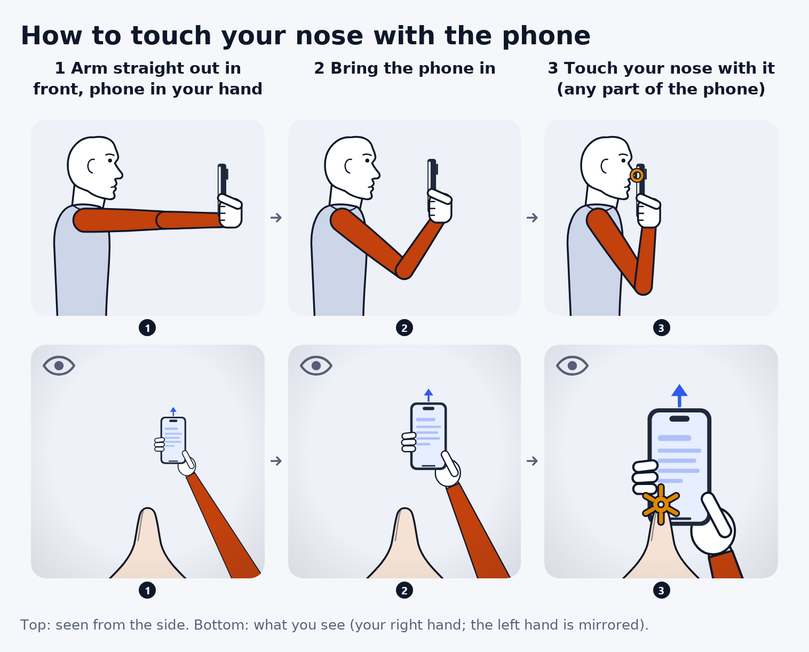

# 01 Experimental protocol (stage 1)

This document applies to `PROTOCOL_VERSION` 2.0.0, app 0.2.0, schema 1.2.0 and consent `2026-10-v3`, as set in [constants.ts](../app/src/core/constants.ts). Protocol 2.0.0 is the **street protocol**: a hands-free visit of about 5 minutes that a friend can do anywhere, on their own phone, with nothing but the phone. Protocol 1.0.0 (app 0.1.0: a table calibration, a long profile, a review screen after every trial) was piloted once; [section 16](#16-changes-from-protocol-100) lists what changed and why.

**Sources of truth.** The code defines the protocol. This document explains it. If the two disagree, the code is right and this document must be fixed. Every session record stores its seed, full plan and parameters, so each session can be reproduced from its own record.

| What | File |
|---|---|
| Plans: presets, tiers, block order, randomisation, time estimate | [protocol.ts](../app/src/core/protocol.ts) |
| The path to the session: Start tap, profile, sensor repair | [startFlow.ts](../app/src/app/startFlow.ts), [sensorCheck.ts](../app/src/app/sensorCheck.ts) |
| The session: hands-free chain, hand question, pause sheet, checkpoint, finish | [sessionRunner.ts](../app/src/app/sessionRunner.ts), [sessionFlow.ts](../app/src/app/sessionFlow.ts) |
| One trial: gates, cues, segmentation, the return of the arm | [trialController.ts](../app/src/core/trialController.ts), [segmentation.ts](../app/src/core/segmentation.ts) |
| Implicit calibration | [calibration.ts](../app/src/core/calibration.ts) |
| Participant wording | [onboarding.ts](../app/src/i18n/en/onboarding.ts) (consent, profile, done), [session.ts](../app/src/i18n/en/session.ts) (session screens), [common.ts](../app/src/i18n/en/common.ts) (the instructions) |
| Illustrations | [GestureAnimation.tsx](../app/src/ui/GestureAnimation.tsx); still images and GIFs in [img/gesture/](img/gesture/) |
| Data contract | [records.schema.json](../schema/records.schema.json), explained in [02_DATA_SCHEMA.md](02_DATA_SCHEMA.md) |

**Conventions.** Statements about the app describe the code at the versions above. **Recommendation** marks a proposal that is not implemented or decided. Literature and platform claims link to their sources. "Pilot" means the single protocol-1.0.0 session recorded on the researcher's Android phone (P-VPSDL4, 23 attempts, 18 accepted).

**Related documents:** [00](00_PROJECT_OVERVIEW.md) overview · [03](03_SENSORS_AND_PLATFORMS.md) sign and axis conventions · [04](04_SEGMENTATION.md) the movement detector · [05](05_MODELING_PLAN.md) mirroring, evaluation · [06](06_CONSIDERATIONS.md) consent, privacy, safety · [07](07_DEPLOYMENT.md) hosting and uploads · [08](08_STAGE3_PREDICTOR.md) the predictor · [09](09_STAGE2_3_PLAN.md) Stage 2 and 3 plan · [10](10_FIELD_GUIDE.md) field guide for running sessions

**Contents.** 1 Definitions · 2 Apparatus · 3 Factors and instructions · 4 Presets · 5 Order and randomisation · 6 Participant flow · 7 Trial timeline · 8 Acceptance and label quality · 9 Safety · 10 Participants · 11 Validation with phyphox · 12 Street, remote and lab sessions · 13 Consent and privacy · 14 Suggested improvements · 15 Open questions for the PI · 16 Changes from protocol 1.0.0

---

## 1. Scope and definitions

**The PI's question.** A person holds the phone with the arm fully extended in front and brings it to touch their nose. Can the phone's motion sensors alone tell whether they used the left or the right hand?

**What stage 1 produces:**
- a training set for stage 2, with both hands from every person;
- an error map: under which conditions, and for which people, the left/right decision fails;
- a small "natural use" set: one unpractised movement per person with a hand they chose themselves ([09 D4](09_STAGE2_3_PLAN.md#42-labels-and-exclusions)).

| Term | Definition (data field) |
|---|---|
| hand | The hand that holds the phone and performs the movement (`condition.hand`), the target label. The plan sets it per block and the block intro names it (`condition.hand_source = instructed`). In the free-choice trial of the street visit the participant picks the hand and reports it afterwards (`hand_source = reported`). |
| handedness | A profile trait: the self-reported dominant hand, `handedness_self` (`right`, `left`, `ambidextrous`, shown as "Both"). Protocol 1.0.0 also asked the Edinburgh short form (EHI-SF); protocol 2.0.0 writes those fields as null. `hand` is never derived from handedness. |
| start pose | The arm fully extended in front, the phone in the instructed grip with the screen facing the participant, held still. Its lateral position is the factor `start_position` (§3.3). |
| nose contact | The phone gently touches the nose and stays there until the double beep. **Any part of the phone may touch** (decided for protocol 2.0.0; the How-to card says so). The `tilted_touch` variant asks for the top edge; `chin` and `forehead` (researcher presets only) change the target. |
| trial | One planned movement of the session plan (`trial_index`, global, contiguous from 0). |
| attempt | One recording of a trial (`trial_id`; `attempt` = 1, 2, …). Every attempt is stored, including failed, re-run and revoked ones. |
| accepted | `outcome.accepted = true`. In the hands-free flow (`settings.review_mode = auto`) an attempt is accepted when it completed and its grip was not detected as another one. Normally one attempt per planned trial is accepted; §8 lists the exceptions (a free trial answered "Not sure", an attempt taken back from the pause sheet). |
| block | Consecutive trials with one hand and one grip (`block_index`; `kind` = `choice`, `main`, `odd` or `free`). Hands and grips change only at a block intro. |
| tier | Street plans group blocks by priority (`PlannedBlock.tier`): 0 the free-choice trial, 1 basics, 2 sideways, 3 different movements, 4 bonus (`optional: true`, run only when the participant opts in). |
| session | One pass through one plan (`session_id`). It ends `completed` when every trial of the non-optional blocks is done, or `ended_early` when the participant tapped Finish before that. A visit that is simply closed stays `in_progress` (its trials were uploaded all the same) until it is resumed, or until it ends as `abandoned`: when the same participant starts a new session, or at the next app start on that phone once it has been untouched for more than 24 hours ([sessionFlow.ts](../app/src/app/sessionFlow.ts)). |
| participant | A pseudonymous `participant_id`: "P-" plus 6 characters, without 0/O/1/I, generated on the phone and shown on the Done screen. |

**Unit of observation.** The unit is one attempt. Its raw recording starts with the trial: at the block-intro tap for the first trial of a block, or right after the previous trial for the chained ones. It ends when the arm is still again after the return movement, at most 3 s after the end of the movement was confirmed. It therefore contains:
- the arm settling (and, when the previous trial ended before its return was seen, that return);
- the hold-still in the start pose and the random foreperiod;
- the GO cue and the movement;
- the hold at the nose until the double beep, then at least 500 ms of post-roll;
- the return of the arm to arm's length.

The phone never crops the recording. The online detector `online_v1` only drives the cues and QA; the analysis re-segments every recording offline ([04_SEGMENTATION.md](04_SEGMENTATION.md)).

## 2. Apparatus

| Item | Specification |
|---|---|
| Phone | The participant's own iPhone or Android phone, with a gyroscope. An own phone adds device diversity and matches the PI's own-phone test. Without a gyroscope, `rotationRate` is null ([Chromium](https://github.com/chromium/chromium/blob/main/third_party/blink/renderer/modules/device_orientation/device_motion_event_pump.cc)); the visit still runs (the repair screen opens only when a phone cannot record at all), and `quality.rotation_available` flags those trials. |
| Browser | iPhone: Safari (every iOS browser uses WebKit). Android: Chrome or Samsung Internet. Brave on Android blocks motion sensors ([Brave forum](https://community.brave.app/t/device-motion-data-accelerometer-gyro-not-available-on-android/292620)). The app recognises the in-app browsers of WhatsApp, Instagram, Facebook, TikTok, Snapchat, LINE, the Google app, LinkedIn, WeChat and Pinterest, and generic WebViews (`device.in_app_browser`). Its welcome screen then asks the participant to open the link in their browser, with a "Copy the link" button; on an iPhone, Start becomes the secondary "Continue here anyway". |
| App | The NoseTouch PWA at <https://axelfridman.github.io/nosetouch-study/>, opened from a link or QR code over HTTPS. Nothing to install. |
| Motion stream | `devicemotion` (`acceleration`, `accelerationIncludingGravity`, `rotationRate`) at about 60 Hz, the browser maximum: WebKit's 1/60 s timer ([WebCoreMotionManager.h](https://github.com/WebKit/WebKit/blob/main/Source/WebCore/platform/ios/WebCoreMotionManager.h)), Chromium's 60 Hz pump ([device_sensor_event_pump.h](https://github.com/chromium/chromium/blob/main/third_party/blink/renderer/modules/device_orientation/device_sensor_event_pump.h)). Chrome rounds values to 0.1 m/s² and 0.1 °/s; WebKit does not ([platform_sensor_util.h](https://github.com/chromium/chromium/blob/main/services/device/generic_sensor/platform_sensor_util.h)). |
| Other streams | Metadata, all best effort: `deviceorientation` Euler angles (gimbal lock at the upright start pose, [W3C](https://w3c.github.io/deviceorientation/)); the relative quaternion (Chromium); since schema 1.2 the absolute, magnetometer-fused quaternion and `deviceorientationabsolute` (Chrome on Android), the magnetometer where a browser exposes it, screen-orientation changes, and on iOS the compass heading with its accuracy. Screen touches carry contact size, force, angle and the position as a fraction of the screen. A missing optional stream never blocks a trial; it is noted once per session in `quality.warnings`. |
| Cues | Synthesised beeps, large colour and text cues, spoken words (§7.3), a screen wake lock. Vibration only at a block intro, never while recording. |
| Illustrations | An animated drawing of the gesture (§6.5). |

**Why 60 Hz is enough.** For minimum-jerk movements lasting at least 0.25 s, 99% of the acceleration energy lies below about 10 Hz (our calculation on the [minimum-jerk profile](https://www.socsci.ru.nl/wilberth/physics/smooth.html)). The pilot sampled at a median 59.998 Hz. Native apps sample faster, about 100 Hz on iOS ([WWDC23 session 10179](https://developer.apple.com/videos/play/wwdc2023/10179)) and 200–500 Hz on Android ([Android sensors](https://developer.android.com/develop/sensors-and-location/sensors/sensors_overview)); §11 describes how to test whether that matters. Platform details are in [03](03_SENSORS_AND_PLATFORMS.md).

## 3. Factors and participant instructions

Quoted text is verbatim from [common.ts](../app/src/i18n/en/common.ts) or [session.ts](../app/src/i18n/en/session.ts). The Hebrew version in `app/src/i18n/he/` has not been proofread by a native speaker yet. **Recommendation:** have it checked before recruiting Hebrew speakers, because wording changes how people move. The language is stored per session in `settings.language`.

### 3.1 Overview

| Factor | Levels | In the street visit | Varies per | Field |
|---|---|---|---|---|
| hand | `left`, `right` | both, in every tier; chosen freely in tier 0 | block | `condition.hand`, `condition.hand_source` |
| orientation | 10 `OrientationId` values, 6 of them collected (§3.6) | `upright_toward`; `top_left_toward` and `top_right_toward`; `free` in tier 0 | block | `condition.orientation` |
| speed | `natural`, `fast`, `slow` | all three upright (tier 1); natural and fast sideways (tier 2) | trial | `condition.speed` |
| start position | `natural`, `shoulder`, `center` | `natural`; `shoulder` and `center` can be drawn as variety cells | trial | `condition.start_position` |
| variant | `standard` + 10 odd variants | `tilted_touch` plus 3 drawn variety cells (tier 3), 2 more in the bonus | trial (odd blocks) | `condition.variant` |
| posture | `standing`, `sitting` | standing, unless the participant ticks "I’m sitting" | session | `condition.posture`, `protocol.posture` |
| rep | 0, 1, …: repeats of an identical condition within a block | e.g. the two natural trials of a block (rep 0 and 1) | derived | `condition.rep` |

Models never get these fields as input ([predictor.ts](../app/src/core/predictor.ts)). `hand` is the target; the other factors define strata for the error analysis ([05](05_MODELING_PLAN.md)).

General instruction (`movementSummary`):

> Stretch your arm out and hold still. At the beep, bring the phone to gently touch your nose (any part of the phone may touch it) and hold it there until the double beep, then stretch your arm out again.

The How-to card that opens every visit says the same in three steps (`howTo.steps`): "Arm straight, screen facing you. Hold still." · "Beep → touch your nose with the phone (any part of it)." · "Wait there for the double beep, then arm out again. The next one starts by itself." During a trial the live panel shows the hand in huge letters (LEFT, RIGHT, or YOUR CHOICE in the free trial) and, next to it, the speed word (NORMAL, FAST, SLOW); a special movement or start position at natural speed shows its short name there instead (e.g. "Top edge", "Side start"), with its one-line instruction below.

### 3.2 Hand

- **Block intro.** The big line is worded against what the participant last did or saw, not against the plan: "Phone in your LEFT hand" when the hand changes or is not known (after the free trial, a redo or a resume), "Turn the phone: top to your LEFT" with a small "Same hand: LEFT" when only the grip changes, "Keep the phone in your LEFT hand" when nothing changes. "Switch hands!" appears only when the phone is known to be in the other hand. The Start button names the hand too ("Start — phone in LEFT hand") and is tapped with the free hand, so every block begins with an explicit hand confirmation.
- **The free-choice trial** (tier 0). Above its button: "Any hand. We’ll ask which one after." Then: "Which hand did you use?" with Left hand, Right hand, and "Not sure / something went wrong".
- **Corrections.** The pause sheet offers "Last one was the wrong hand" (§8).
- **Never inferred from handedness.** People hold the phone to the ear on their dominant side only about 70% of the time ([Seidman 2013](https://sciencedaily.com/releases/2013/05/130516161655.htm); a press-release survey, low confidence).

### 3.3 Start position

| `start_position` | Label | Instruction |
|---|---|---|
| `natural` | Arm straight in front | "Stretch your arm straight out in front of you, at shoulder height." |
| `shoulder` | Side start | "Arm straight, phone in front of that shoulder" |
| `center` | Middle start | "Arm straight, phone right in front of your nose" |

Why it matters:
- **From `shoulder`** the path includes a sideways shift of about half a shoulder width whose sign flips with the hand. Phone accelerometers recover it reliably only for short movements; a low-confidence simulation got the sign of a 15 cm shift right in about 100% of runs up to 1 s but in 67–95% at 3 s (background: [Bai 2022](https://pmc.ncbi.nlm.nih.gov/articles/PMC9823748/)).
- **From `center`** there is almost no sideways shift, so rotation must carry the signal: hand-to-nose movements involve about 54° of forearm rotation ([Öhberg 2019](https://pmc.ncbi.nlm.nih.gov/articles/PMC6427602/)), and wrist-IMU finger-to-nose studies report opposite rotation senses for the two hands ([Mohammadi-Ghazi 2022](https://pmc.ncbi.nlm.nih.gov/articles/PMC9609238/); about a wrist-sensor axis not stated to be vertical, so a hypothesis).
- **`natural`** is the participant's own reading of the PI's instruction and varies most between people. Every main trial of the street visit starts `natural`; `shoulder` and `center` appear only as variety cells (§4.1).
- **Consequence:** report accuracy by start position. A model that works only from `shoulder` has mainly learned the sideways shift.

### 3.4 Speed

| `speed` | Instruction | Expected one-way duration | Detector overrides (`resolveParams`) |
|---|---|---|---|
| `natural` | "Move at your normal, comfortable pace." | About 0.5–0.9 s; the outward phase of finger-to-nose takes 0.62 ± 0.12 s ([Chen 2021](https://pmc.ncbi.nlm.nih.gov/articles/PMC8072355/)) | none |
| `fast` | "Move quickly, as fast as you comfortably and safely can. Touch your nose gently!" | About 0.3–0.6 s; fast 50 cm pointing takes 276–651 ms ([Terrier 2011](https://pmc.ncbi.nlm.nih.gov/articles/PMC3045308/)) | `onset_sustain_ms` 40 |
| `slow` | "Move slowly and smoothly, taking about 3 seconds." | About 3 s, as instructed | onset floors 25 °/s and 0.55 m/s², `end_gyro_dps` 10, `end_acc_ms2` 0.25, `end_sustain_ms` 450, `max_movement_ms` 12000 |

- **What the pilot showed** (one person, protocol 1.0.0). From onset to the first nose touch in the clean upright trials: fast 0.31–0.53 s, natural 0.97–1.21 s, slow 1.95–2.55 s. The slow trials also caused 7 of the 8 false starts, because their onset floors (15 °/s, 0.3 m/s²) sat at the hold-still thresholds; protocol 2.0.0 raised them above ([04 §4](04_SEGMENTATION.md#4-parameters)).
- **Instruction, not enforcement.** The achieved duration is measured offline. **Recommendation:** analyse error by measured duration as well as by instruction.

**Why slow trials need lower end thresholds.** Expected peaks for a minimum-jerk movement over 0.45 m with 60° of rotation (our calculation):

| One-way duration | 0.35 s | 0.7 s | 3 s |
|---|---|---|---|
| Peak hand speed | 2.4 m/s | 1.2 m/s | 0.28 m/s |
| Peak linear acceleration | 21 m/s² | 5.3 m/s² | 0.29 m/s² |
| Peak angular speed | 321 °/s | 161 °/s | 38 °/s |

At 3 s the linear acceleration is close to Chrome's 0.1 m/s² rounding step and to postural tremor (about 0.14 m/s², [Elble 2005](https://smithengineering.queensu.ca/mme/faculty/deluzio/jam/files/Elble.pdf)), so the gyroscope carries slow trials. Fast trials can exceed the ±4 g range of some phones ([Galaxy A20 study](https://pmc.ncbi.nlm.nih.gov/articles/PMC9547012/)); the pilot's fast trials showed single-sample spikes of 6.5 and 8.4 g at the nose contact (the nose hitting the screen).

### 3.5 Movement variants ("odd" movements)

Odd trials use `upright_toward` at natural speed with the `natural` start, one trial per variant. Main trials use `standard`: "Bring the phone straight to your nose."

| `variant` | Label: instruction | Street visit | Researcher presets | Override |
|---|---|---|---|---|
| `tilted_touch` | Top edge: "Tilt it so the top edge touches your nose" | always, tier 3 | full | none |
| `curved` | Curve: "Swing out to the side, then in" | variety pool | standard, full | none |
| `pause` | Stop halfway: "Stop 1 second halfway, then go on" | variety pool | standard, full | `end_sustain_ms` 1800, `max_movement_ms` 12000 |
| `twist` | Twist: "Twist the phone on the way in" | variety pool | standard, full | none |
| `elbow_high` | Elbow up: "Lift your elbow out to the side" | variety pool | standard, full | none |
| `bent_start` | Elbow bent: "Start with your elbow a little bent" (the hold-still status then reads "Elbow bent — hold still") | variety pool | standard, full | none |
| `lean_in` | Lean in: "Move your head to meet the phone" | variety pool | standard, full | none |
| `jerky` | Stop-and-go: "Stop and go a few times on the way" | variety pool | standard, full | `end_sustain_ms` 600 |
| `chin` | Touch your chin: "This time touch your CHIN instead of your nose." | never | standard, full | none |
| `forehead` | Touch your forehead: "This time touch your FOREHEAD instead of your nose." | never | full | none |

The street variety pool also holds the two non-default start positions, `shoulder` and `center`, each at natural speed with the `standard` variant (9 cells in all). Every variant keeps the hand label valid. A pause longer than about 1.8 s counts as the end of the movement: the double beep then sounds during the pause. Whether odd movements should also form a class of their own is open (§15).

### 3.6 Phone orientation

The motion axes are fixed to the phone and do not follow screen rotation ([W3C](https://w3c.github.io/deviceorientation/)): x points to the right edge, y to the top edge, z out of the screen. Rotations are described from the participant's point of view; "toward" means the screen faces the participant.

| `OrientationId` | Instruction | Up axis at rest (W3C sign) | Mirror counterpart | Collected in 2.0.0 |
|---|---|---|---|---|
| `upright_toward` | "Hold the phone upright (top edge up) with the screen facing you, as if reading it." | +y | itself | street tiers 1, 3, 4; every preset |
| `top_left_toward` | "Turn the phone sideways so its top edge points to your LEFT, screen facing you." | +x | `top_right_toward` | street tier 2; every preset |
| `top_right_toward` | "Turn the phone sideways so its top edge points to your RIGHT, screen facing you." | −x | `top_left_toward` | street tier 2; every preset |
| `upside_down_toward` | "Hold the phone upside down (top edge pointing down), screen facing you." | −y | itself | standard, full |
| `flat_up` | "Hold the phone flat like a tray, screen facing the ceiling." | +z | itself | full |
| `free` | "Hold the phone however feels most natural to you." | any | itself | street tier 0; full (free blocks) |
| `upright_away`, `upside_down_away`, `top_left_away`, `top_right_away` | screen facing away from the participant | as the `toward` grip turned 180° about y | `top_left_away` ↔ `top_right_away` | **never** |

- **No screen-away grips.** Participants found them impractical (the pilot was abandoned at its screen-away block). The `*_away` values stay in the enum for protocol-1.0.0 records and synthetic data, and the analysis synthesises screen-away training data by turning the sensor frame 180° about y ([05 §3.6](05_MODELING_PLAN.md#36-screen-away-synthesis-protocol-200)). Screen-away accuracy is never reported from synthetic trials.
- **iPhones.** WebKit reports `acceleration` and `accelerationIncludingGravity` with all axes negated ([WebKit source](https://github.com/WebKit/WebKit/blob/main/Source/WebCore/platform/ios/WebCoreMotionManager.mm), [W3C list 2014](https://lists.w3.org/Archives/Public/public-geolocation/2014Jul/0024.html), [re-measured 2026](https://github.com/soroushdty/gaitscope/issues/96)). Raw values are stored as delivered; the sign comes from the implicit calibration and the browser engine (§6.4), and normalisation happens offline ([03](03_SENSORS_AND_PLATFORMS.md)).
- **Mirror.** Reflecting the body across its sagittal plane turns a right-hand attempt in orientation o into a left-hand attempt in `ORIENTATIONS[o].mirror`: acceleration (x, y, z) → (−x, y, z), angular velocity (x, y, z) → (x, −y, −z), i.e. `rr_alpha` kept, `rr_beta` and `rr_gamma` negated ([W3C CRD 2025](https://www.w3.org/TR/orientation-event/), [PR #43](https://github.com/w3c/deviceorientation/pull/43); derivation in [05 §3](05_MODELING_PLAN.md)). Every preset's orientation set is closed under this map, so mirrored copies land on conditions that also exist as real data. Keep custom sets closed too.

**How the grip is checked.**
- **Before GO (the grip gate, hands-free flow, never for `free`).** When the participant holds still, the gravity direction of the last 300 ms is classified (35° cone). If it confidently shows another grip than instructed, GO is withheld and the panel names the instructed grip in words (e.g. "Top of the phone to your LEFT"); the grip picture is added only when the page has turned with the phone, since with the rotation locked a picture of a sideways phone would look turned. GO follows as soon as the grip is right. An unclear reading never blocks.
- **After the attempt.** The rotation at the start (`detected.rotation_start`) is compared with the instruction (`detected.orientation_match`). In portrait, gravity cannot tell "toward" from "away"; in landscape a facing error shows up as a `top_left`/`top_right` swap.
- **The sign the check uses.** The implicit calibration's sign once an upright hold has confirmed it, otherwise the sign the browser engine is known to report (−1 for WebKit, +1 for Blink and Gecko). While no measured hold confirms the sign, a mismatch blocks GO, and counts as `orientation_match = false`, only when it survives flipping the sign; otherwise the match is null. A wrong prior can therefore never stall a session or reject its trials. Simulated sessions have no engine prior, so their gate starts once the implicit calibration is filled.

### 3.7 Posture

Standing is the default. The How-to card has an "I’m sitting" switch that sets `protocol.posture` and every planned trial's `condition.posture` to `sitting`; the researchers' setup screen asks "Will you stand or sit?". There is one posture per session. **Recommendations:** standing is the reference posture (facing forward, the free arm hanging); a sitting participant sits upright with the elbow unsupported and the arm free to extend. The final choice is the PI's (§15).

## 4. Presets and session length

| Preset | For | Blocks | Trials | Estimate |
|---|---|---|---|---|
| `street` (default: `config.default_preset`) | participants | 13: 9 required + 4 bonus | 29 required + 10 bonus | 5 min, plus about 1 min of bonus |
| `quick` | researchers | 6 | 18 | 3.5 min |
| `standard` | researchers | 10 | 48 | 8 min |
| `full` | researchers | 14 | 86 | 15 min |
| `custom` | researchers | 2 per orientation (+ 2 odd, + 2 free) | `speeds` × `start_positions` × `reps` per block | formula below |

Participants always get the study's default preset. The other presets are reachable only from the researchers' setup screen (§6.6). We verified the counts and estimates by running `buildPlan` (seed 42).

### 4.1 The street visit

A = the first hand, B = the other; S = the first sideways grip, S′ = the other; U = `upright_toward`. Trials inside a block are shuffled.

| Block | Tier | `kind` | Hand | Grip | Trials |
|---|---|---|---|---|---|
| 0 | 0 · Try it once | `choice` | the participant's choice (planned hand is a placeholder) | `free` | natural |
| 1 | 1 · Basics | `main` | A | U | natural, natural, fast, slow |
| 2 | 1 · Basics | `main` | B | U | natural, natural, fast, slow |
| 3 | 2 · Sideways | `main` | B | S | natural, natural, fast |
| 4 | 2 · Sideways | `main` | A | S | natural, natural, fast |
| 5 | 2 · Sideways | `main` | A | S′ | natural, natural, fast |
| 6 | 2 · Sideways | `main` | B | S′ | natural, natural, fast |
| 7 | 3 · Different movements | `odd` | B | U | `tilted_touch` + 3 cells drawn from the variety pool (§3.5) |
| 8 | 3 · Different movements | `odd` | A | U | the same 4 cells, own shuffle |
| 9 | 4 · Bonus | `main` | A | U | natural, fast, natural |
| 10 | 4 · Bonus | `main` | B | U | natural, fast, natural |
| 11 | 4 · Bonus | `odd` | B | U | the next 2 cells of the same draw |
| 12 | 4 · Bonus | `odd` | A | U | the same 2 cells |

- **Most important first.** If the participant stops early, the data so far still hold both hands at every tier boundary: hands switch A→B, B→A, A→B, B→A (blocks 1→2, 3→4, 5→6, 7→8). People who finish tier 2 (21 trials) give everything the model needs most ([09 §7](09_STAGE2_3_PLAN.md#7-what-we-need-from-data-collection)).
- **The bonus** is offered at the checkpoint after tier 3; its cells never repeat a tier-3 cell.
- **Design caveats.** The tier order is fixed, so tier is confounded with time in the session (upright always first, variety always last; use `block_index` or `trial_index` as a covariate). Sideways trials are never slow. Variety cells run only upright at natural speed, once per hand. `chin` and `forehead` never occur.

### 4.2 Researcher presets

| Preset | Main-block orientations | Trials per main block (`speed`, `start_position`) | Odd blocks (one per hand) | Free blocks (one per hand) |
|---|---|---|---|---|
| `quick` | `upright_toward`, `top_left_toward`, `top_right_toward` | 3: (natural, natural), (fast, natural), (slow, natural) | none | none |
| `standard` | the 4 `CORE_ORIENTATIONS`: the 3 above + `upside_down_toward` | 4: (natural, shoulder), (natural, center), (fast, natural), (slow, natural) | 8 variants: all but `forehead` and `tilted_touch` | none |
| `full` | the 5 collected grips (all but `free`) | 6: {natural, fast, slow} × {shoulder, center} | all 10 variants | speeds natural, fast, slow; start natural |
| `custom` | any collected grips (default: the 3 of `quick`) | `speeds` × `start_positions` × `reps` (1–10) | optional | optional |

`normalizeCustomSpec` drops unknown values and screen-away grips, removes duplicates, puts values in canonical order, falls back to the defaults for empty lists and clamps `reps` to 1–10; the normalised spec is stored in `protocol.custom`. The default custom spec (3 grips × 3 speeds, start natural, 1 rep) gives 18 trials in 6 blocks. Caveats: `standard` does not cross speed with start position, and `full` main blocks never start `natural`.

### 4.3 Time

- **Estimate** (`estimateMinutes`, stored as `protocol.estimated_minutes`): 40 s of onboarding, plus per trial 5.5 s (fast), 6.5 s (natural) or 10 s (slow), plus 2 s for a non-default start position or variant (an instruction to read), plus 6 s per block change, over the non-optional blocks, rounded to 0.5 min. The live panel's "about N min left" and the checkpoint's bonus estimate use the same model.
- **Measured in simulation.** In the end-to-end test (headless browser, simulated participant, machine speed) a whole street visit took 181 s (English) and 188 s (Hebrew) from the welcome screen to Done on 2026-10-24, with the first GO 9–10 s after the page opened. The reading time before GO (§7.1) made it longer, mostly in tier 3 (58 s, before 41–46 s); without it the visit took 149–168 s. Real people will be slower; the design target is the first GO within 45 s of opening the link and the whole visit in about 5 minutes. **Measure it on the first real visits.**
- **Why it changed.** The protocol-1.0.0 pilot needed 11 min 45 s for 23 attempts of `quick`: 2 min 38 s before the first trial and 56% of the trial phase between trials (review screens, Ready taps, block intros).

## 5. Block order, counterbalancing and randomisation

Rules from [protocol.ts](../app/src/core/protocol.ts):

1. **First hand A.** Left if the seed is odd, right if it is even (`resolveFirstHand`; a `firstHand` option overrides it).
2. **Street: first sideways grip S.** `top_left_toward` when bit 1 of the seed is 0, `top_right_toward` when it is 1. Seeds 4k … 4k+3 therefore cover the four combinations of first hand and first side.
3. **Street: the block sequence** is the fixed table of §4.1.
4. **Researcher presets:** a block is one hand × one orientation; `upright_toward` comes first as the familiarisation pose and the other orientations follow in seeded random order; hands follow ABBA over orientation pairs (A·o1, B·o1, B·o2, A·o2, A·o3, B·o3, …); odd blocks follow all main blocks (A, then B) and free blocks come last (A, then B).
5. **Trial order within a block** is shuffled; `rep` counts repeats of an identical condition in presentation order.
6. **One random stream:** mulberry32 (`makeRng`) seeded with `mixSeed(seed, 0x504c414e)` ("PLAN"). Street plans consume it first for the variety draw (one shuffle of the 9-cell pool: the first 3 cells go to tier 3, the next 2 to the bonus), researcher presets for the orientation order; then each block's shuffle in block order. The first hand, the sideways side and the posture do not consume the stream.
7. **Seed.** Each session gets a fresh cryptographic uint32 seed (`randomSeed`), stored in `protocol.seed` with `protocol_version`, `first_hand` and the full `plan`. The same seed gives a different plan under 1.0.0.
8. **Foreperiod.** Each attempt's foreperiod comes from `makeRng(trialSeed(seed, trial_index, attempt))` ([sessionFlow.ts](../app/src/app/sessionFlow.ts)), so it is reproducible too.

**Example** (`street`, seed 42; A = right, S = `top_right_toward`): the free trial (any hand) → R·upright (fast, natural, slow, natural) → L·upright → L·top_right → R·top_right → R·top_left → L·top_left → L·odd (pause, bent_start, tilted_touch, jerky) → R·odd (tilted_touch, bent_start, pause, jerky) → bonus: R·upright, L·upright, L·odd (twist, center), R·odd (twist, center).

**Balance across participants.** Random seeds balance the first hand and the first side only in expectation (with 40 participants the number who start left-handed has an SD of about 3). **Recommendation:** for exact balance, rotate seeds through the four classes; this needs a small change, because neither the participant path nor the setup screen passes a seed to `createSession`.

## 6. Participant flow

### 6.1 Screens

| Step | Screen | What happens | Stored in |
|---|---|---|---|
| 1 | Welcome + consent | First, when they apply: "Resume session" for an unfinished session of the last 24 h (Start then reads "Start over"), and the in-app browser notice with "Copy the link". Then a language switch, a small looping illustration, the four key facts, "Full information", other warnings (page not on https, no motion sensors, pending uploads), "Continue as {name}" and "New person" when a profile exists on this phone. Checkbox, then **Start**. | `session.consent` |
| 2 | About you | The short profile (§6.3) | `ParticipantProfile`, snapshotted into the session |
| – | Sensor check | **Repair only**: shown when the background check found no permission, no motion data, fewer than 20 Hz or an insecure page | `capabilities` |
| – | Session setup | **Researchers only** (`?setup=1` or Settings): presets and custom sessions | `protocol` |
| 3 | Session | How-to card → free trial → hand question → tiers 1–3 → checkpoint → bonus (optional) | trial records, `progress` |
| 4 | Done | "Thank you, {first name}!", movements recorded, the live upload state ("All data uploaded ✓ — you can close this page.", or "Upload now" while something is still waiting), the participant code "(to delete your data later)", "Send the link to a friend" (where the browser can share), "Someone else on this phone", Home, and a fold "For the researcher" (attempts, time, "Save / share my data") | `status`, `ended_at` |

**The Start tap** ([startFlow.ts](../app/src/app/startFlow.ts), order pinned by a test): (1) the motion-permission request is its first statement, because WebKit shows the prompt only while the tap is being processed; (2) audio unlock and screen wake lock; (3) the consent time; (4) a background measurement of the sensor rates (2.5 s) while the profile is filled in; (5) the profile. The profile's Continue waits at most 3 s for that measurement. It then resumes the participant's unfinished session if it was updated within the last 2 hours (a reload, an app switch, "Exit for now"), unless they tapped "Start over"; otherwise it creates a new session with `config.default_preset` (`street`), posture standing and an implicit calibration, and the participant's older unfinished sessions end as `abandoned`. Only a phone that cannot record goes to the repair screen first.

### 6.2 Consent (`2026-10-v3`)

The welcome screen carries the consent ([onboarding.ts](../app/src/i18n/en/onboarding.ts)):
- **Four key facts:** "You'll hold your phone at arm's length and touch your nose with it, about 30 times — around 5 minutes, plus an optional 1-minute bonus. You can stop at any time; everything you've done is kept." · "We record only the phone's motion sensors (movement and rotation) — no camera, microphone or location." · "We store your name, age, sex, dominant hand and height with the data on a private research server." · "To have your data deleted, contact the researcher who sent you this link and give your participant code (shown at the end)." (With a `contact` in `config.json`: "To have your data deleted, contact the researcher (details below).")
- **Full information** (a fold-out): purpose, procedure (about 30 movements, about 40 with the bonus, both hands, upright and sideways, any part of the phone may touch, no table), duration (about 5 minutes plus an optional bonus of about 1 minute), risks (dropping the phone, bumping the nose, stop if anything hurts), voluntariness and deletion, what is and is never recorded, the name on the research server, storage, retention, contact. With `contact` empty in `config.json`, it says "contact the researcher who sent you this link".
- **Checkbox:** "I agree, I'm 18 or older, and I have no arm or hand injury that makes this uncomfortable." (`region` in `config.json` adds "I'm taking part from …".)

Each session stores `consent.version` and `consent.accepted_at`. Bump `consent_version` whenever the wording changes. Consent decisions and safeguards: §13 and [06 §1](06_CONSIDERATIONS.md#1-ethics-and-law).

### 6.3 Profile ("About you")

Nothing else is asked ([ProfileScreen.tsx](../app/src/app/screens/ProfileScreen.tsx)):

| Question | Field | Notes |
|---|---|---|
| Full name (optional, ≤ 60 characters) | `nickname` | Uploaded, because `upload_nickname` is true in this study ([02 §9](02_DATA_SCHEMA.md#9-privacy-and-redaction)) |
| Age (required, at least `min_age` = 18) | `age_years` | |
| Sex: Female / Male / Other / Prefer not to say | `sex` | |
| Dominant hand: Right / Left / Both | `handedness_self` (`both` → `ambidextrous`) | |
| "Which hand do you usually hold your phone in?" Right / Left / Both | `phone_hand` | |
| Height (cm, optional, 50–250) | `height_cm` | |

The protocol-1.0.0 fields are written, never omitted: `ehi_sf`, `ehi_lq`, `ehi_class`, `phone_model` and `phone_case` as null, `arm_issue` as false (the consent checkbox covers it). A returning participant types their code under "Returning? Enter your code"; a profile stored on this phone under that code is loaded. Errors show inline only after the first Continue.

### 6.4 Implicit calibration (`implicit_v1`)

There is no calibration step. A street participant has no table, and the pilot's sensor check plus table calibration took 54 s. Instead ([calibration.ts](../app/src/core/calibration.ts)):
- the session starts with `calibration.method = implicit_v1` and every measured field null;
- the first **complete** `upright_toward` trial whose hold before GO was still, and whose grip was not detected as another one, fills it: `upright` = the statistics of that hold; `gravity_sign` = the sign of `accg_y` when |`accg_y`| > 7 m/s²; `gravity_magnitude` when 8.6–11.0 m/s²; `upright_check` = `ok` when the sign matches the engine (WebKit −1, Blink and Gecko +1), else `inverted` with the note `upright_sign_contradicts_engine`, and `unclear` when the hold was still but |`accg_y`| ≤ 7;
- a hold that was not still changes nothing, and the next upright trial is tried;
- `flat`, `gyro_bias_dps` (an in-hand hold measures tremor, not bias) and `axis_check` stay null. The analysis confirms the sign with the trial votes and the engine, and infers the rotation-rate mapping from the gravity closure of the trials ([03 §5](03_SENSORS_AND_PLATFORMS.md#5-normalisation-layer-for-analysis)).

The guided three-step calibration (table, upright, tilt; `method: guided_v1`) has no screen in app 0.2.0; its math stays in `calibration.ts` for protocol-1.0.0 records and synthetic data. On the pilot, the trials alone reproduced the table's result: gravity sign +1 from 23 of 23 trial votes, and the W3C rate mapping from the closure check.

### 6.5 Illustrations

The animated drawing (`GestureAnimation`) appears on three screens, and never while a trial records:
- **Welcome:** a small side-view loop: the right hand upright, then the left hand with a tilted touch.
- **How-to card:** the side view and the participant's view of a straight touch, plus a small tilted touch captioned "Any part of the phone may touch your nose." (hidden on screens up to 700 px tall, so that the steps and the sound check stay above the button).
- **Block intros:** the participant's view with the block's hand and grip; the tilted touch for `tilted_touch`, the curved path and the pause for `curved` and `pause`.

Still images and GIFs for slides and messages are in [img/gesture/](img/gesture/) (`right_upright_natural.gif`, `left_top_left_natural.gif`, `right_angled_natural.gif`, `either_hand_natural.gif`, …).

### 6.6 During the session

- **How-to card.** Title "How to do it", the illustration, the three steps, "Sound on: the beeps tell you when to move." with a "Play a test beep" button, "For these 5 minutes: Do Not Disturb on, Low Power Mode / Battery Saver off.", "To stop or take a break, press and hold “Hold to pause”.", a note when the background check measured slow sensors or no gyroscope or the screen wake lock was refused, "Touch gently and hold the phone firmly.", the "I’m sitting" switch, and above the button "Any hand. We’ll ask which one after." The button "Try it once" starts the free trial.
- **Hand question** right after the free trial (§3.2).
- **Block intros**, one tap each: tier label ("Part 1 of 3 · Basics", "Part 2 of 3 · Sideways", "Part 3 of 3 · Different movements", "Bonus"), first what changes (the hand line of §3.2, then the grip and its instruction), the animation, what varies ("Speeds change — the screen tells you each time." or the list of movements), "FAST still means a gentle touch." in blocks with fast trials, "Basics done — great! The rest adds variety. You can stop any time." on the first intro after tier 1, and a progress bar with "about N min left". A chime (`block_start`) marks a new intro, with a short vibration on Android.
- **Trials chain without taps** inside a block (§7). There is no review screen and no break screen.
- **Checkpoint** after tier 3: "Main part done — thank you!", **Finish** or "Bonus: about 1 more minute".
- **Pause sheet** (§7.4): Continue · Redo last movement · Last one was the wrong hand (with a line naming that movement, e.g. "Last movement: Left hand · FAST") · Finish now (two taps: "Tap again to finish") · Exit for now. "Finishing now is fine — everything so far is kept."
- **Back button.** The Android back button or back gesture never leaves a running session: it stops a running trial and opens the pause sheet.
- **Double taps and the nose.** Taps within 450 ms of a screen change are ignored, and the buttons of a screen that appears without a tap (a block intro after a trial, the hand question, the checkpoint, the pause sheet) stay disabled for 0.9 s, or 2.5 s after a trial whose return of the arm was not seen or that ran too long, so a nose or cheek cannot press them.
- **Resuming.** "Exit for now" leaves the session `in_progress`. The welcome screen offers it again for 24 h ("Resume session"), and the profile's Continue resumes it by itself within 2 h (§6.1); it continues at the intro of the next planned trial. After 24 h the next app start ends it as `abandoned`.
- **Done.** The upload line reads "All data uploaded ✓ — you can close this page.", "Uploading… please keep this page open a moment ({k} left)" or an offline notice. "Someone else on this phone" clears the welcome screen for the next person on the same phone.

**Researchers only.** `?setup=1` in the URL (never remembered) or the Settings switch "Choose the session after the profile" opens the setup screen (presets, custom sessions, posture). The Settings switch "Review every movement (lab use)" (`review_each_trial`) restores the protocol-1.0.0 tap flow: block intro, Ready, trial, review (Yes, next / Redo / Problem), break screen; it is stored as `settings.review_mode = tap`.

## 7. Trial timeline and cues (hands-free)

Defaults are `DEFAULT_SEGMENTATION_PARAMS` of protocol 2.0.0; §3.4–3.5 list the per-condition overrides and [04](04_SEGMENTATION.md) the full specification. |ω| is the smoothed gyroscope magnitude, |a| the smoothed linear acceleration, μ and σ the mean and SD over the hold-still window.

### 7.1 One trial

| # | Phase | Participant | App | Panel status, cue | Data |
|---|---|---|---|---|---|
| 1 | start (t = 0) | First trial of a block: has tapped Start. Chained trial: the previous trial just ended. | Recording starts. | `ready` beep after a tap only | `timing.t0_perf_ms`, `t0_epoch_ms` |
| 2 | `waiting_still` | Stretches the arm out and holds still. | If the previous trial ended before its return was seen, waits for a return movement first ("Arm out again"). Then waits for \|ω\| < 20 °/s and \|a\| < 0.5 m/s² held for 400 ms. | "Arm straight — hold still"; a ring fills | `timing.still_ms` |
| 2b | reading time | Reads a new instruction. | GO is never scheduled before the reading time: 2.5 s after the start for a new special movement or start position, 1.2 s for a new speed, and at least as long as the words spoken at the start (plus 1 s on iPhones, where speech mutes the beeps a little longer). | "Read this first…" | `timing.still_ms` (≥ the reading time) |
| 3 | grip gate | Holds the grip shown. | A confidently different grip withholds GO (§3.6). | the grip in words, e.g. "Top of the phone to your LEFT"; the picture only when the page has turned with the phone | – |
| 4 | `foreperiod` | Keeps still. | Waits a random 400–900 ms (uniform, seeded). | "Get ready…" | `timing.foreperiod_ms` |
| 5 | `armed` | Moves at the beep. | Onset when \|ω\| > max(30 °/s, μ + 6σ) or \|a\| > max(0.6 m/s², μ + 6σ) for 60 ms, back-dated to the first sample after the last still one (no earlier than 300 ms before GO). | `go` beep; "GO!" (green) | `timing.go_ms`, `onset_ms` |
| 6 | `moving` | Brings the phone to the nose and holds it there. | End when \|ω\| < 30 °/s and \|a\| < 0.6 m/s² for 250 ms, at least 150 ms after onset, back-dated to the start of that quiet run. | "Touch your nose" | `timing.end_ms` |
| 7 | `post_roll` | Hears the double beep, starts to stretch the arm out. | Records at least 500 ms more. | `end` double beep; "Arm out again" | `timing.end_detected_ms` |
| 8 | `returning` | Arm out again, holds still. | Records until a return movement (\|ω\| > 45 °/s or \|a\| > 1.5 m/s² for 100 ms) is followed by stillness held 400 ms, or 3 s after the end was confirmed. | "Arm out again" | `timing.return_onset_ms`, `return_end_ms`, `stop_ms` |
| 9 | next | Stays in the start pose. | The next trial of the block starts at once, without a ready beep; at a block's end the next intro (or the checkpoint) appears. | spoken speed word (Android; iPhones speak only at a tap) | – |

- **Attempt length.** A recorded attempt lasts about 4–6 s (the simulator's median was 4.8 s before the reading time was added). Hold plus foreperiod give 0.8–1.3 s of stillness before GO.
- **Early movement.** A loss of stillness while GO is pending is a **counted false start** only when the motion exceeds 30 °/s or 0.6 m/s² at that moment or within 300 ms: the `error` tone plays, the panel says "Too early! Wait for the beep", `timing.false_starts` goes up by 1 and the hold restarts. Smaller motion (posture sway) restarts the hold silently.
- **Touches.** Every screen touch is stored in `streams.touches`. The first touchstart after GO is `timing.first_touch_ms`, a candidate nose-contact time. In sideways grips the first touch is often a gripping finger.
- **Nothing animates while recording**, and the hold-to-pause control works only before the movement (§7.4); released too early, it says "Keep holding…".

### 7.2 When a trial fails

| `status` | Cause | What happens (hands-free) |
|---|---|---|
| `no_movement` | No onset within 3 s after GO (`max_wait_ms`) | `error` tone; "No movement detected" for 1.5 s; the same trial runs again by itself |
| `too_long` | No end within 6 s of onset; 12 s for slow and pause (`max_movement_ms`) | `error` tone; "That took too long" for 1.5 s; the same trial runs again |
| two of these in a row | | The pause sheet opens: "That did not work twice in a row. Read the instruction on the screen again, then tap Continue." |
| `aborted` / `interrupted` | The pause control, the back button, the page hidden, the sensors silent for 2 s, or no GO within 25 s | The trial stops and the pause sheet opens. An attempt that reached GO is kept (not accepted); an earlier one is discarded. An attempt stopped while recording the return stays `complete` (warning `return_cut_short`). |

### 7.3 Cues and speech

| Cue | Sound | When |
|---|---|---|
| `ready` | 440 Hz, 80 ms | the first trial after a tap |
| `go` | 880 Hz, 160 ms | GO |
| `end` | two 660 Hz beeps of 90 ms, 70 ms apart | end of the movement confirmed: "arm out again" |
| `error` | 220 Hz, 250 ms | false start, no movement, too long |
| `block_start` | 523 Hz then 784 Hz, 100 ms each | a block intro appears (plus a vibration on Android) |

- **Cue log.** Every cue played during a trial is logged in `streams.cues`; the `go` time equals `timing.go_ms`.
- **Speech** (on by default). The block-intro tap says the hand and the first trial's words, e.g. "Left hand. Fast" (the grip is on the screen; saying it too ran over the first beeps). Chained trials say their speed word (plus the name of a non-default start or variant) while the participant gets still, on Android only: iOS speaks only inside a tap. GO waits until the words are over (§7.1, reading time).
- **Audio on iOS** works only after a tap. After a call or a trip to the background it can stay silent until the next tap (Continue, a block intro), which repairs or replaces the audio context; the visual GO still shows. The How-to card's "Play a test beep" checks the sound before the first trial.
- **Vibration** only at block intros: the motor would contaminate the accelerometer, and iOS has no Vibration API ([WebKit bug 288846](https://bugs.webkit.org/show_bug.cgi?id=288846)).
- **Computers never beep or talk.** A computer running the simulator (`?sim=1`) or an automated browser is silenced by the cue sink itself ([services.ts](../app/src/app/services.ts)).

### 7.4 Pausing and finishing early

- **Pause triggers:** holding "Hold to pause" for about 0.8 s (a nose touch lasts 80–240 ms and never triggers it; the control works only while waiting, in the foreperiod and right after GO), the back button, the header's Pause button on intro screens, the page going to the background, sensors silent for 2 s, no GO within 25 s (when the grip gate was holding GO back, the sheet says so: "The phone was held another way. Top of the phone to your LEFT, then tap Continue."), two failures in a row, a save that failed.
- **Continue** is a tap, so it re-unlocks audio and the wake lock (iOS needs both). Inside the block whose intro was tapped, the interrupted trial runs again at once; otherwise its block intro appears.
- **Finish now** (pause sheet, two taps) and **Finish** (checkpoint) end the session: `completed` when every non-optional trial is done, else `ended_early`. The session record is uploaded and the Done screen opens. Nothing recorded is lost either way. **Exit for now** keeps the session open for later (§6.6).
- **Every trial uploads immediately** ([00 §5](00_PROJECT_OVERVIEW.md#5-data-flow)), so stopping early costs only the trials not yet done.

## 8. Acceptance, redo and label quality

Rules from `autoDecision`, `withReportedHand`, `revokeAccepted` and `asFailedAttempt` ([sessionFlow.ts](../app/src/app/sessionFlow.ts)):

| Event | `accepted` | `participant_flag` | `outcome.note` | What follows |
|---|---|---|---|---|
| Complete, grip not detected as another one (`orientation_match` true or null) | true | null | `auto_accept` | the next trial starts at once |
| Complete, `orientation_match = false` | false | null | `auto_reject:orientation` | the same trial again at once, with the grip hint (its picture only when the page has turned with the phone, §3.6) |
| `no_movement`, `too_long`, or stopped after GO | false | null | null, or `hand_not_reported` for the free trial (never asked about); a stop adds `ui_abort:…` to `quality.warnings` | §7.2 |
| Stopped before GO | not saved | | | |
| Free trial, saved before the hand question | false | null | `hand_not_reported` | the hand question |
| Free trial, "Left hand" / "Right hand" | true if complete | null | null; `condition.hand` = the answer, `hand_source = reported` | the next block |
| Free trial, "Not sure / something went wrong" | false | `other_problem` | `hand_unsure` | the next block; never re-run |
| Pause sheet: "Redo last movement", the last movement was accepted | false (re-saved) | null | `redo_requested` | its block intro ("Once more: the last movement is done again."), then the trial runs again |
| Pause sheet: "Last one was the wrong hand", the last movement was accepted | false (re-saved) | `wrong_hand` | `redo_requested` | as above |
| The same buttons when the last movement was not accepted (it runs again anyway) | false | `wrong_hand` for "wrong hand", else unchanged | unchanged | its block intro, then the trial runs again |

Every attempt is kept: `n_attempts` counts all of them, `n_accepted` the accepted ones. Saves run in the background while the next trial records; a failed save pauses the session and is retried on Continue. Placeholder, decided and revoked copies of one attempt share its `trial_id`, and the backend and `motionlab.io` keep the latest in that order ([02 §10](02_DATA_SCHEMA.md#10-deduplication-rules)). "The last movement" is the newest saved attempt in which a movement started after GO; the sheet names it ("Last movement: Left hand · FAST"), and a free trial that was not accepted is never redone. A trial, its session update and their upload queue entries are written in one IndexedDB transaction, so a killed page cannot leave them out of step; resuming and finishing recount the progress from the stored attempts, and at every app start a stored trial without a queue entry is queued again. If the stored attempts cannot be read when the session screen opens (4 tries, 1 s apart, Start disabled meanwhile), attempt numbers continue from 101 so they never repeat a stored one.

**Label quality comes from five layers:**
1. **Instruction.** Every block intro names the hand, its Start button names it again, and the live panel shows it in huge letters during every trial.
2. **Gravity.** The grip gate before GO and `detected.orientation_match` after it (§3.6).
3. **The participant.** "Last one was the wrong hand" and "Redo last movement" on the pause sheet; the hand question after the free trial.
4. **Quality fields.** `quality.motion_hz`, `gaps_over_50ms`, `hidden_during` (a page hidden only during the return of the arm leaves it false and adds `hidden_after_end`), `timing.false_starts`, and `quality.warnings` such as `return_cut_short`, `screen_rotated_during_movement` and `wake_lock_not_held`.
5. **Offline checks.** Segmentation disagreements over 100 ms and multi-peak movements ([04](04_SEGMENTATION.md)); wrong-hand screening by an antisymmetric model inside the training folds, which removes trials from training only, never from evaluation ([09 D6](09_STAGE2_3_PLAN.md#42-labels-and-exclusions)). Trials are never relabelled automatically.

With hands-free review, `accepted` means "completed and not taken back", not "confirmed by the participant". **Deviation budget: 5–15%.** In a supervised 7-day wrist-sensor study, 15.6% of participants wore a sensor on the wrong wrist at least once ([PLOE, Sensors 2019](https://pmc.ncbi.nlm.nih.gov/articles/PMC6538999/)). The exclusion rules are in [02 §12](02_DATA_SCHEMA.md#12-data-quality-and-exclusion-rules) and the prevention table in [06 §4](06_CONSIDERATIONS.md#4-label-quality). Fix them before seeing any model result.

## 9. Safety

Participants see:
- "Touch gently and hold the phone firmly." (How-to card) and "FAST still means a gentle touch." (the intro of every block with fast trials);
- the consent's risks: "You might drop the phone: hold it firmly." · "You might bump your nose: always touch it gently, also in the "fast" movements." · "Stop right away if anything hurts or feels uncomfortable.";
- the consent checkbox, which confirms no arm or hand injury that makes the movement uncomfortable (`arm_issue` is therefore false).

For researchers, the setup screen also shows `safety` ("Hold the phone firmly and always touch your nose gently."), and the tap-review Ready screen the fast instruction ("… Touch your nose gently!").

**Recommendations:**
1. **Space.** Away from traffic, stairs and other people's elbows, never while walking.
2. **Gentle touch.** The pilot's fast trials hit the nose at 6.5–8.4 g (single-sample spikes when the nose met the screen). Say "fast but soft" once if a friend hits hard.
3. **Glasses.** A fast reach can hit the frame: suggest taking them off or touching gently.
4. **Fatigue.** The arm is held out for 0.8–1.3 s before each GO (longer only while a new instruction is read, §7.1), the visit lasts about 5 minutes, the bonus is optional, and every block intro is a rest. Sitting is allowed.
5. **Stopping.** Anyone may stop at any moment: "Hold to pause", then "Finish now" and "Tap again to finish". Nothing recorded is lost.

## 10. Participants, recruitment and sample size

**Who.** The researcher's college friends: adults (18+) on their own phones, recruited in person, often on the street, or with the link sent through WhatsApp. Each person takes part once, on one phone, in one browser.

**Targets** ([09 §7](09_STAGE2_3_PLAN.md#7-what-we-need-from-data-collection)):

| Need | Minimum | Target | Why |
|---|---|---|---|
| People with tiers 0–2 complete (21 of the 29 planned trials) | 30 | 40+ | about 30 development people and about 10 locked-test people |
| iPhone users | 25% | 30% or more | the iOS sign and quantisation differ; leave-one-platform-out needs both |
| Left-handed people (self-report) | 8 | 10+ | the dominance confound; only about 4 in 40 by chance, so ask left-handed friends on purpose |
| Android brands | 2 | 3+ | device-model differences |
| Sessions per person | 1 | 1 | more people beat more trials per person |

**Why both hands and left-handers.**
- About 10.6% of people are left-handed (9.3–18.1% by criterion, [Papadatou-Pastou 2020](https://research-repository.st-andrews.ac.uk/handle/10023/19889)), so for most people "right hand" also means "dominant hand".
- Dominant and non-dominant reaches differ in curvature and initial direction, less so in left-handers ([Sainburg 2002](https://link.springer.com/doi/10.1007/s00221-001-0913-8), [Przybyla 2012](https://pure.psu.edu/en/publications/dynamic-dominance-varies-with-handedness-reduced-interlimb-asymme/)). A model trained mostly on right-handers can learn dominance instead of side; every person therefore does both hands.
- Men are somewhat more often left-handed (odds ratio 1.23, [Papadatou-Pastou 2008](https://wrap.warwick.ac.uk/29434/)).

**Subgroup comparisons need people, not trials.** With m trials per person the design effect is 1 + (m − 1)·ICC. 95% CI half-width of accuracy at 90%, with the 28 instructed trials of tiers 1–3 per person (our computation, as in 09 §7, which assumed 24 trials from an earlier draft of the plan; re-estimate the ICC after 10 people):

| People | ICC 0.05 | ICC 0.15 | ICC 0.30 |
|---|---|---|---|
| 10 | ±5.4 pts | ±7.9 pts | ±10.6 pts |
| 20 | ±3.8 pts | ±5.6 pts | ±7.5 pts |
| 30 | ±3.1 pts | ±4.6 pts | ±6.1 pts |
| 40 | ±2.7 pts | ±3.9 pts | ±5.3 pts |

Detecting 5% vs 15% error between two groups needs about 141 effective trials per group: about 19 people per group at ICC 0.1, about 32 at ICC 0.2.

**Identity.** Personal movement style and phone artefacts inflate any evaluation that splits by record ([Saeb 2017](https://pmc.ncbi.nlm.nih.gov/articles/PMC5441397/), [Stisen 2015](https://portal.findresearcher.sdu.dk/da/publications/smart-devices-are-different-assessing-and-mitigating-mobile-sensi/)). A second phone, another browser or the Home Screen copy creates a new participant code; the analysis merges such codes through an alias table ([09 D2](09_STAGE2_3_PLAN.md#41-data)).

## 11. Validation sub-study with phyphox

**Status: out of scope unless a phyphox cohort is run** (ablation A2, [09 §4.7](09_STAGE2_3_PLAN.md#47-ablations-one-table-a1a8-as-in-05-82)). It would answer three questions: does the browser's 60 Hz, rounded data lose left/right information compared with native rates; how much does onset and offset timing degrade; do the axis and sign conventions agree with an independent app?

**Tool.** [phyphox](https://phyphox.org/download/) (RWTH Aachen, free, GPL-3.0; Android 5.0+, iOS 12.0+; version 1.2.1 of September 2026, [release note](https://phyphox.org/?p=5037)) reaches about 100 Hz on iPhone and up to about 500 Hz on some Android phones ([phyphox forum](https://phyphox.org/forums/printthread.php?tid=2356)).

**Experiment file `nose-touch.phyphox`** (**Recommendation**; not in the repository):
- Sensors `accelerometer`, `linear_acceleration`, `gyroscope` (rad/s), `gravity`, `attitude`, each with `rate="0"` and `rateStrategy="request"` (the default `auto` duplicates or drops samples, [input docs](https://phyphox.org/docs/file-format/input/)).
- Numeric label buffers exported with the data ([user-input docs](https://github.com/phyphox/phyphox-docs/blob/main/docs/file-format/views/user-input.md)), using the app's enum orders: hand 0 = left, 1 = right; orientation 1–10 in the order of `ORIENTATIONS` (1 = `upright_toward` … 10 = `free`); speed 0–2 (natural, fast, slow); start 0–2 (natural, shoulder, center); variant 0–10 (`standard`, then `ODD_VARIANTS` in order); participant = a session number mapped to the P-code in a log.
- A timed run with an acoustic countdown ([phyphox](https://phyphox.org/?p=2823)): about 1–2 s delay, then about 6 s of recording (8 s for slow). CSV export; file format version 1.19, because phyphox refuses newer formats ([file format](https://phyphox.org/docs/file-format/)). Never use the remote-access interface outside the lab: it is plain HTTP without authentication ([remote interface](https://phyphox.org/docs/remote-interface/)).

**Procedure and analysis:** 10–20 lab-run participants on both platforms, the same phone, instructions and conditions in both apps, instruments alternated by block (ABBA); a known pose recorded in phyphox too; self-paced movements segmented offline. Train and test subject-wise on phyphox data at the native rate and again after emulating the PWA (60 Hz sample-and-hold, 0.1-unit rounding). Pre-specify what counts as a material difference; build a native app only if the difference is material.

## 12. Street, remote and lab sessions

| Aspect | Street (researcher present) | Remote (link by WhatsApp) | Lab (researchers) |
|---|---|---|---|
| Phone | the friend's own | own | own or a lab phone |
| Instructions | the app only; the researcher answers questions | the app only | the app; tap-review mode possible |
| Fidelity | watched; wrong hand fixed with the pause sheet | participant flags and automatic checks only | observed and logged |
| Posture and space | standing, chosen on the spot | variable; only the declared posture is known | controlled |
| Preset | `street` | `street` | any (`?setup=1`) |

**Street sessions (Recommendation):** the step-by-step guide is [10_FIELD_GUIDE.md](10_FIELD_GUIDE.md).
- Let the app instruct. Do not demonstrate the path or the speed: movement style is what the model must generalise over, and the animation already shows the gesture.
- If you see a trial go wrong (wrong hand, phone slipped), have the friend hold "Hold to pause" and tap "Last one was the wrong hand" or "Redo last movement".
- Keep a short log line per friend: date, participant code, phone, posture, anything odd with its block. Names are already in the database; the log needs none.
- Watch the uploads arrive on the admin page of the upload service ([10](10_FIELD_GUIDE.md)).

**Remote sessions (Recommendation):** send the link with a two-sentence explanation and "open it in Safari or Chrome" ([10](10_FIELD_GUIDE.md)). Ask people to take part once and to keep their code. Every trial uploads as soon as it is saved, so an interrupted remote visit still delivers its data.

## 13. Consent and privacy

- **No ethics review.** The researcher decided on 2026-10-24 that this collection needs no ethics-committee approval: the participants are the researcher's own college friends, adults who volunteer and consent in the app. The decision and the practical safeguards are in [06 §1–2](06_CONSIDERATIONS.md#1-ethics-and-law).
- **Consent text.** Purpose, procedure, duration, risks, voluntariness and withdrawal, the data recorded and never recorded, storage, retention and contact (§6.2). Bump `consent_version` in `public/config.json` whenever it changes.
- **Safeguards:** an 18+ checkbox; motion sensors only (no camera, microphone or location); the name stored with the data on a private research server with the participant's consent (`upload_nickname: true`); the admin page and the exports behind a secret admin token; the participant code on the Done screen for deletion requests; deletion on request ([10](10_FIELD_GUIDE.md#delete-a-participant-on-request)).
- **Law.** Amendment 13 of the Israeli Protection of Privacy Law has applied since 14 August 2025 ([IAPP](https://iapp.org/news/a/israel-marks-a-new-era-in-privacy-law-amendment-13-ushers-in-sweeping-reform)); names plus motion data are personal information. Recruiting people located in the EU would bring in the [GDPR](https://eur-lex.europa.eu/eli/reg/2016/679/oj) (Art. 3(2)(b)); `region` in `config.json` can add "I'm taking part from Israel" to the checkbox.

## 14. Suggested improvements

Implemented since protocol 1.0.0: the free-choice first trial (tier 0), a hand confirmation per block (the Start button names the hand), the grip check before GO, and illustrations of the gesture. Remaining recommendations, roughly by value for cost:

1. **Measure the real visit** on the first friends: time to first GO, tier durations, pauses, false starts and `no_movement` in slow trials (the slow onset floors were raised on purpose; onset p95 error in simulation rose from 184 to 338 ms, [04 §5](04_SEGMENTATION.md#5-how-well-it-works-simulation)).
2. **Exact counterbalancing** of the four seed classes (§5).
3. **A gentle return is not detected.** A trial that waits for the return of the arm (`awaitReturn`) has no timeout of its own and reaches the 25 s pause instead; watch `ui_abort:idle` and add a timeout if it happens.
4. **Repetitions.** Most cells are recorded once per hand; per-condition error rates rest on one trial per person. The bonus adds repeats of upright natural and fast.
5. **Pre-register before opening the locked test set** ([09 M0](09_STAGE2_3_PLAN.md#8-milestones-and-acceptance-criteria)).

## 15. Open questions for the PI

1. **Start pose.** Should the hand start in front of the same shoulder or at the midline, and at what height? The street visit uses the participant's own reading (`natural`) and draws `shoulder` and `center` as variety cells.
2. **Contact point.** Protocol 2.0.0 lets any part of the phone touch the nose. Is that acceptable for the PI's test?
3. **Evaluation format.** Phone, forced choice or abstention, success criterion, people and attempts, display, report format: [09 §10](09_STAGE2_3_PLAN.md#10-open-questions-for-the-pi), questions a–j.
4. **Posture.** Standing as the reference, with sitting allowed: right?
5. **Odd movements.** A separate "invalid movement" class, or robustness tests only? Should the tilted touch count in the primary score?
6. **Scale.** Are 30–40 friends with 8–10 left-handers realistic within the admission timeline? If not, the subgroup claims shrink accordingly.
7. **Reuse.** May the data be reused beyond the admission project, e.g. in a publication?

## 16. Changes from protocol 1.0.0

| Topic | Protocol 1.0.0 (app 0.1.0, the pilot) | Protocol 2.0.0 (app 0.2.0) | Why |
|---|---|---|---|
| Default preset | `standard` (56 trials, about 14 min) | `street` (29 + 10 bonus, about 5 min) | the pilot took 11 min 45 s for 23 attempts |
| Onboarding | consent screen, long profile with EHI-SF, sensor check, 3-step calibration, setup | consent on the welcome screen, short profile; sensor check only to repair; no setup | 2 min 38 s before the first trial in the pilot |
| Calibration | table, upright and tilt steps (`guided_v1`) | implicit, from the first still upright trial (`implicit_v1`) | no table on the street; the trials alone reproduced the pilot's calibration |
| Review | a review screen and a Ready tap per trial | complete trials accepted automatically; the next starts by itself (`review_mode = auto`); the tap flow stays for lab use | 56% of the trial phase was spent between trials |
| Hand | instructed only | plus one free-choice trial with a reported hand (`hand_source`) | natural-use set; handedness prior |
| Grips | 10, screen-away included | 6 collected; screen-away synthesised in the analysis | screen-away grips were impractical |
| Variants | 9 | 10 (`tilted_touch`, always in the street visit) | contact by the phone's edge |
| Segmentation | hold 600 ms at 15 °/s, 0.35 m/s²; post-roll 1000 ms | hold 400 ms at 20 °/s, 0.5 m/s²; post-roll ≥ 500 ms, then the return of the arm (≤ 3 s) | hand sway broke the hold; the return is now data ([04 §4](04_SEGMENTATION.md#4-parameters)) |
| Ending early | `abandoned` | `ended_early` (Finish now); a checkpoint before the optional bonus; `abandoned` only for a visit replaced by a new one or left for more than 24 hours | stopping early loses nothing |
| Names | kept on the phone | uploaded with consent | friends; deletion by name or code |
| Uploads | Apps Script (Drive files) or an exported file (the pilot) | live to the Heroku service with Postgres; every save sent at once | live monitoring, admin page |
| Extra signals | quaternion, Euler, touches | plus absolute orientation, magnetometer, screen rotations, touch size and force, iOS compass accuracy | variables can be dropped later, never added |
