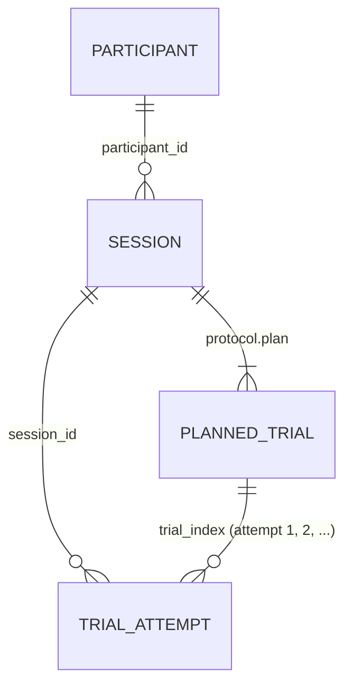

# 02 Data schema

This document describes every record the NoseTouch collector produces, where the records end up, and how to load, deduplicate and filter them.

The single source of truth is [`schema/records.schema.json`](../schema/records.schema.json) (JSON Schema 2020-12). [`app/src/core/types.ts`](../app/src/core/types.ts) mirrors it field by field, the app's tests validate generated records against it, and the analysis kit validates with [`analysis/motionlab/schema.py`](../analysis/motionlab/schema.py). If this document and the schema disagree, the schema wins.

Related documents: [Protocol](01_PROTOCOL.md) (what the conditions mean), [Sensors and platforms](03_SENSORS_AND_PLATFORMS.md) (what the raw values mean on each phone, calibration, normalisation), [Segmentation](04_SEGMENTATION.md) (`online_v1` and the offline methods), [Modeling plan](05_MODELING_PLAN.md).

## 1. Record types at a glance

| Type | `$defs` name | Written | Typical size | Ends up as |
|---|---|---|---|---|
| Session | `SessionRecord` | at session start, then rewritten after every attempt and at the end | 10–35 KB | `session.json`, one per session |
| Trial attempt | `TrialRecord` | once per attempt, including failed and redone attempts | 30–75 KB | one file per attempt |
| Upload envelope | `UploadEnvelope` | per upload request; wraps one record | record + ~100 B | HTTP request body only |
| Export bundle | `ExportBundle` | when the participant taps "Save / share my data" (Done screen) or an export on the "My data" screen | sum of its records | one `.json` file the participant shares or downloads |

Sizes were measured on schema-valid synthetic records with the app's rounding: about 8 KB per second of recording (details in [section 7](#7-storage-layout)).



- A participant can have several sessions. Each session holds its own plan (`protocol.plan`).
- Every attempt at a planned trial is its own `TrialRecord` with its own `trial_id`. Redos produce `attempt` 2, 3, and so on. Nothing is deleted.
- There is no separate participant file. The profile travels inside each `SessionRecord` (`participant`), already redacted ([section 9](#9-privacy-and-redaction)).

## 2. Conventions

| Topic | Rule |
|---|---|
| Units | Time in ms, acceleration in m/s², rotation rate in deg/s, angles in deg. |
| Wall-clock times | ISO 8601 strings in UTC from `Date.toISOString()`, e.g. `2026-10-23T18:04:05.123Z` (`$defs.IsoTime`). They come from the phone's clock, which is not synchronised with anything. `session.timezone_offset_min` stores the local offset in minutes. |
| Stream time `t` | ms since `timing.t0_perf_ms`, the `performance.now()` value when recording of the trial started. It is read at the top of each event handler. Every stream, touch, cue and `timing.*_ms` field of a trial uses this same zero. Wall clock of a sample: `timing.t0_epoch_ms + t`. |
| Event time `ts` | `event.timeStamp − ts_first_raw`, computed per stream: motion and orientation each have their own `ts_first_raw`. Add `ts_first_raw` back before comparing `ts` across streams. `null` where the browser gives no timestamp. |
| `interval_raw` | `event.interval` of the first motion event, exactly as reported. Its unit differs by platform (about 0.0167 s on iOS, 16 ms on Chrome), so treat it as metadata and never use it for timing ([03](03_SENSORS_AND_PLATFORMS.md#2-what-the-browser-delivers)). |
| Rounding | Stream values are rounded at serialisation (`ROUNDING` in [`constants.ts`](../app/src/core/constants.ts)): time 0.01 ms, acceleration 1e-4 m/s², rotation rate 1e-3 deg/s, angles 1e-3 deg, quaternion components 1e-6. Halves round away from zero and −0 becomes 0. This is far below sensor noise and below Chrome's own 0.1-unit quantisation, so Chrome values pass through unchanged. |
| Nulls | JSON has no NaN, so a missing value is `null`. Inside a stream, `null` at index i means that field was missing in sample i. All columns of a stream have the same length. A stream object that is `null` (`orientation`, `quaternion`) was not available on that device. |
| Optional vs nullable | Only the additions of schema 1.1 (`device.engine`, `device.in_app_browser`, `calibration.axis_check`) and 1.2 ([section 8](#8-versioning-policy)) may be absent. Every other field is always present, possibly as `null`. Readers must treat "absent" like `null` (and an absent `condition.hand_source` as `instructed`). |
| Ids | `participant_id`: `P-` plus 6 symbols from `ABCDEFGHJKLMNPQRSTUVWXYZ23456789` (no 0/O/1/I, about 1.07×10⁹ codes, crypto-random). `session_id` and `trial_id`: UUID v4. `study_code`: from `public/config.json`, pattern `[A-Za-z0-9_-]{1,64}`. |
| Indices | `trial_index` is global and contiguous from 0 in plan order. `block_index` and `trial_in_block` are contiguous from 0. `attempt` starts at 1 and `rep` at 0. |
| Simulated data | `simulated: true` on every record produced by the built-in simulator (`?sim=1`) or by `npm run synth`. Never pool simulated and real records. |

## 3. Coordinate frames

```
 Device frame D (fixed to the phone)     Body frame B (simulator only)       Earth frame E (W3C)

        +y  top edge                           +y up                            +z up
         ^                                      ^                                ^   +y north
   +-----|-----+                                |                                |  /
   |     |     |                                o----> +x participant's right    | /
   |     o-----|----> +x  right edge           /                                 o-----> +x east
   |   screen  |                              v
   +-----------+                            +z backward (face -> back of head)
   +z points out of the screen,             origin at the nose tip;
      toward whoever looks at it            extended-arm phone at z ~ -0.55 m
```

| Frame | Axes | Used by |
|---|---|---|
| Device D (W3C) | x toward the right edge, y toward the top edge, z out of the screen. Fixed to the phone in its natural portrait orientation. Rotating the screen UI does not change it. | Every motion stream, calibration, gravity vectors, `segmentation.baseline.gravity` |
| Earth E (W3C) | x East, y North, z Up. The heading is arbitrary for relative orientation (iOS `deviceorientation`, Chrome `deviceorientation`, `RelativeOrientationSensor`). | Reference frame of the orientation angles and quaternions |
| Body B | Origin at the nose tip, x toward the participant's right, y up, z backward. | Simulator ([`sim/model.ts`](../app/src/sim/model.ts)) and the mirror derivation. Not stored. |

Conventions inside these frames ([W3C DeviceOrientation CRD, 12 Feb 2025](https://w3c.github.io/deviceorientation/)):

- `rr_alpha`, `rr_beta`, `rr_gamma` are the rotation rates about device **x, y, z** respectively (deg/s, right-hand rule). The spec adopted this mapping in 2019 to match Chrome, Firefox and Safari ([PR #43](https://github.com/w3c/deviceorientation/pull/43)). MDN's [`DeviceMotionEventRotationRate.alpha`](https://developer.mozilla.org/en-US/docs/Web/API/DeviceMotionEventRotationRate/alpha) page still says "around the Z axis", which is outdated.
- `deviceorientation` angles use a **different** convention: intrinsic Z-X'-Y'', `R = Rz(alpha)·Rx(beta)·Ry(gamma)`, with `v_earth = R·v_device`. Ranges: alpha [0, 360), beta [−180, 180), gamma [−90, 90). At beta = ±90° (phone upright, which is the start pose of `upright_toward`) alpha and gamma are not defined (gimbal lock). The angles are therefore stored as metadata only.
- At rest, W3C `accelerationIncludingGravity` is the reaction to gravity and points **up**: a phone lying face-up reads about +9.81 m/s² on z. WebKit (every iOS browser) forwards Core Motion's sign, so iOS reports all acceleration axes inverted ([WebKit source](https://github.com/WebKit/WebKit/blob/main/Source/WebCore/platform/ios/WebCoreMotionManager.mm), [W3C list, 2014](https://lists.w3.org/Archives/Public/public-geolocation/2014Jul/0024.html)). Normalisation is defined in [03, section 5](03_SENSORS_AND_PLATFORMS.md#5-normalisation-layer-for-analysis).

**Expected gravity per instructed orientation** (W3C sign, i.e. after normalisation; derived from the grip matrices in `sim/model.ts`, same logic as `core/orientationDetect.ts`):

| `OrientationId` | Device axis pointing up | `accg` at rest (m/s²) |
|---|---|---|
| `upright_toward`, `upright_away` | +y | (0, +9.81, 0) |
| `upside_down_toward`, `upside_down_away` | −y | (0, −9.81, 0) |
| `top_left_toward`, `top_right_away` | +x | (+9.81, 0, 0) |
| `top_right_toward`, `top_left_away` | −x | (−9.81, 0, 0) |
| `flat_up` | +z | (0, 0, +9.81) |
| `free` | any | — |

Gravity cannot tell "screen toward" from "screen away" for upright and upside-down grips. For sideways grips the facing is coupled with top-left/top-right, as the table shows.

**Left/right mirror in record field names.** Reflecting the body across its sagittal plane maps device readings as acc (x, y, z) → (−x, y, z) and angular velocity (x, y, z) → (x, −y, −z), for any grip (derivation in [05](05_MODELING_PLAN.md)). Applied to the stored fields:

| Field(s) | Mirrored value |
|---|---|
| `acc_x`, `accg_x`, `baseline.gravity[0]` | negated |
| `acc_y`, `acc_z`, `accg_y`, `accg_z` | unchanged |
| `rr_alpha` (x) | unchanged |
| `rr_beta` (y), `rr_gamma` (z) | negated |
| Euler `alpha, beta, gamma` | through the matrix: `R' = M·R·M`, M = diag(−1, 1, 1); generic case (360 − alpha, beta, −gamma) |
| quaternion `x, y, z, w` | (x, −y, −z, w) |
| `compass`, `screen.angle_*` | 360 − value; `landscape-primary` ↔ `landscape-secondary` |
| `condition.hand` | left ↔ right |
| `condition.orientation`, `detected.rotation_*` | `top_left_*` ↔ `top_right_*` (`ORIENTATIONS[o].mirror`); others unchanged |
| `touches[].x/y`, ids, timing, outcome, quality | not mirrored |

The field-name form assumes the W3C axis mapping. On a device whose `axis_check.verdict` is not `w3c`, map the fields to x/y/z first ([03](03_SENSORS_AND_PLATFORMS.md#5-normalisation-layer-for-analysis)), then mirror.

## 4. SessionRecord

### 4.1 Top-level fields

| Field | Type | Null | Meaning |
|---|---|---|---|
| `record_type` | `"session"` | no | Discriminator |
| `schema_version` | string `1.x.y` | no | Schema the record was written with (currently `1.2.0`, [section 8](#8-versioning-policy)) |
| `app_version` | string | no | App release (`package.json` version, currently `0.2.0`) |
| `session_id` | UUID | no | Primary key |
| `participant_id` | `P-XXXXXX` | no | Pseudonymous participant code |
| `study_code` | Id | no | From `config.json` (default `nose-touch-v1`) |
| `started_at`, `updated_at` | ISO time | no | Creation and last change; `updated_at` decides which copy is newest |
| `ended_at` | ISO time | yes | `null` while `in_progress` |
| `status` | `in_progress` / `completed` / `ended_early` / `abandoned` | no | `completed`: every trial of the non-optional blocks is done (the bonus blocks never count). `ended_early` (schema 1.2): the participant tapped Finish before that. `abandoned`: protocol 1.0.0's Finish; in protocol 2.0.0 an unfinished session that was never resumed, closed by the app when the same participant starts a new session or at the next app start on that phone after 24 h untouched (`ended_at` = its last update) |
| `participant` | `ParticipantProfile` | no | Snapshot taken at session start, already redacted ([4.2](#42-participant-participantprofile)) |
| `device` | `DeviceInfo` | no | [4.3](#43-device-deviceinfo) |
| `capabilities` | `SensorCapabilities` | no | [4.4](#44-capabilities-sensorcapabilities) |
| `calibration` | `CalibrationResult` | yes | `null` if calibration was skipped in app 0.1.0. App 0.2.0 always writes one (`method: implicit_v1`, [4.5](#45-calibration-calibrationresult)) |
| `protocol` | object | no | Plan of the session ([4.6](#46-protocol)) |
| `settings` | object | no | [4.7](#47-settings-progress-consent) |
| `progress` | object | no | [4.7](#47-settings-progress-consent) |
| `consent` | object | no | [4.7](#47-settings-progress-consent) |
| `timezone_offset_min` | integer | no | Local time-zone offset of the phone in minutes |
| `simulated` | boolean | no | `true` = simulator data |
| `notes` | string ≤ 2000 | yes | Free text |

### 4.2 `participant` (`ParticipantProfile`)

| Field | Type | Null | Meaning |
|---|---|---|---|
| `participant_id` | `P-XXXXXX` | no | Same as the session's |
| `nickname` | string ≤ 60 | yes | Kept on the phone; `null` in uploads and exports unless `config.upload_nickname` is true |
| `age_years` | integer 0–120 | yes | The consent gate requires `config.min_age` (18) |
| `sex` | `female` / `male` / `other` / `prefer_not_to_say` | no | |
| `handedness_self` | `right` / `left` / `ambidextrous` | no | Self-report |
| `ehi_sf` | object | yes | Edinburgh Handedness Inventory short form: `writing`, `throwing`, `toothbrush`, `spoon`, each `always_right` / `usually_right` / `both` / `usually_left` / `always_left` |
| `ehi_lq` | number −100..100 | yes | Laterality quotient = mean item score (100 / 50 / 0 / −50 / −100), a multiple of 12.5 ([Veale 2014](https://www.millisecond.com/library/v7/edinburghhandednessinventory/edinburghhandednessinventory_sf.manual)) |
| `ehi_class` | `right` / `mixed` / `left` | yes | LQ ≥ 61 right, ≤ −61 left, otherwise mixed (Veale 2014 cut-offs) |
| `phone_hand` | `right` / `left` / `both` | no | Hand that usually holds the phone (prior for the handedness add-on) |
| `height_cm` | number 50–250 | yes | Optional |
| `arm_issue` | boolean | yes | Any condition affecting arm or hand movement |
| `phone_model` | string ≤ 80 | yes | Self-reported; on iOS the only model information outside in-app browsers (`device.model_hint` is just the device class there) |
| `phone_case` | boolean | yes | Phone in a case (mass, grip) |
| `created_at`, `updated_at` | ISO time | no | |

App 0.2.0 asks only for the full name (stored in `nickname`; uploaded in this study, whose `config.json` sets `upload_nickname: true`), age, sex, dominant hand, phone hand and height. It writes `ehi_sf`, `ehi_lq`, `ehi_class`, `phone_model` and `phone_case` as null and `arm_issue` as false (the consent checkbox covers arm and hand injuries), and never omits a key: the loader skips a record whose required key is missing.

### 4.3 `device` (`DeviceInfo`)

| Field | Type | Null | Meaning |
|---|---|---|---|
| `user_agent` | string | no | `navigator.userAgent` |
| `platform` | `ios` / `android` / `other` | no | From the UA. iPadOS Safari in desktop mode presents itself as a Mac; the app still reports `ios` when that "Macintosh" UA comes with touch (`navigator.maxTouchPoints > 1`), so only a touch-less Mac UA gives `other` ([03](03_SENSORS_AND_PLATFORMS.md#2-what-the-browser-delivers)); `engine` says `webkit` on every iOS/iPadOS browser |
| `browser` | string | no | Browser name parsed from the UA |
| `os_version` | string | yes | From the UA or UA Client Hints. Unreliable on iOS 26 and later, whose UA reports a frozen version ([03](03_SENSORS_AND_PLATFORMS.md#2-what-the-browser-delivers)) |
| `model_hint` | string | yes | Android: the model from UA Client Hints (or the UA). iOS: only the device class `iPhone` / `iPad` / `iPod`, or the hardware id (e.g. `iPhone15,2`) inside Instagram/Facebook webviews; Safari exposes no model, so use `participant.phone_model` there |
| `standalone` | boolean | no | Opened from the Home Screen (installed PWA) |
| `screen_w`, `screen_h`, `dpr` | number | no | Screen size and device pixel ratio |
| `language` | string | no | `navigator.language` |
| `hardware_concurrency` | number | yes | CPU threads |
| `device_memory_gb` | number | yes | [`navigator.deviceMemory`](https://developer.mozilla.org/en-US/docs/Web/API/Navigator/deviceMemory), Chromium only |
| `time_origin_ms` | number | no | `performance.timeOrigin` (epoch ms) |
| `engine` | `webkit` / `blink` / `gecko` / `unknown` | absent in 1.0 | Schema 1.1. `webkit` means every iOS browser, detected by `'webkitCompassHeading' in DeviceOrientationEvent.prototype`. Its acceleration values are sign-inverted relative to W3C |
| `in_app_browser` | string | yes, absent in 1.0 | Schema 1.1. Detected in-app browser or WebView, e.g. `whatsapp`, `instagram`, `facebook`, `android_webview`, `ios_webview` |

### 4.4 `capabilities` (`SensorCapabilities`)

Feature detection plus a short rate measurement on the sensor-check screen.

| Field | Type | Meaning |
|---|---|---|
| `secure_context` | boolean | HTTPS (motion sensors need it) |
| `device_motion`, `device_orientation` | boolean | Event interfaces exist |
| `permission_api` | boolean | `DeviceMotionEvent.requestPermission` exists. True on iOS 13+ **and** on Chrome 151+ ([Chrome 151 release notes](https://developer.chrome.com/release-notes/151)), so it does not identify iOS |
| `permission_state` | `granted` / `denied` / `not_required` / `unknown` | Result of the permission request; `unknown` before it ran or when no user gesture was present |
| `generic_relative_orientation` | boolean | `RelativeOrientationSensor` exists (Chromium) |
| `wake_lock`, `vibrate`, `share_files` | boolean | Screen Wake Lock, Vibration and Web Share with files available |
| `measured` | `MeasuredRates` or null | Rate measurement below |

`measured` (`MeasuredRates`): `duration_ms` (measurement window); `motion_hz`, `orientation_hz`, `quaternion_hz` (nullable); `motion_dt_ms_median`, `motion_dt_ms_p95` (nullable); `acc_available`, `accg_available`, `rotation_available` (booleans); `interval_raw` (first `event.interval` as reported). Rates are `(n − 1) / (t_last − t_first) · 1000`.

### 4.5 `calibration` (`CalibrationResult`)

The procedure and its use are described in [03, section 4](03_SENSORS_AND_PLATFORMS.md#4-calibration-procedure). All vectors here are **raw** device-frame values (platform sign, rotationRate field names).

Two methods exist (`method`, schema 1.2; absent = guided). **`guided_v1`** is the calibration screen of app 0.1.0 (table, upright and tilt steps), described by the rows below. **`implicit_v1`** (app 0.2.0, protocol 2.0.0) needs no extra step: the session starts with every field null, and the first complete `upright_toward` trial whose pre-GO window (`still_ms − still_hold_ms` to `go_ms`) was still, and whose grip was not detected as another one, fills it: `upright` = the `PoseStats` of that window; `gravity_sign` = sign(`accg_y`) when \|`accg_y`\| > 7 m/s²; `gravity_magnitude` = \|mean accg\| when it lies in 8.6–11.0 m/s²; `upright_check` = `ok` when the sign matches the engine prior (WebKit −1, Blink and Gecko +1; unknown engines and simulated sessions count as a match), else `inverted` with the note `upright_sign_contradicts_engine`, and `unclear` when the window was still but \|`accg_y`\| ≤ 7. A window that was not still leaves it for the next upright trial. `flat`, `gyro_bias_dps` (an in-hand mean is tremor, not bias) and `axis_check` stay null: the analysis infers the rotationRate mapping from the gravity closure of the trials ([03, section 5](03_SENSORS_AND_PLATFORMS.md#5-normalisation-layer-for-analysis)).

| Field | Type | Null | Meaning |
|---|---|---|---|
| `method` | `guided_v1` / `implicit_v1` | absent before 1.2 | See above |
| `performed_at` | ISO time | no | |
| `flat` | `PoseStats` | yes | Phone flat on a table, screen up |
| `upright` | `PoseStats` | yes | Phone upright in front of the participant, screen toward them |
| `gravity_sign` | `1` / `-1` | yes | +1: face-up reads `accg_z` ≈ +9.81 (W3C). −1: inverted (expected on iOS). `null`: the flat window was invalid |
| `gravity_magnitude` | number | yes | \|mean accg\| of the flat window |
| `upright_check` | `ok` / `inverted` / `unclear` | yes | Consistency of the upright window with `gravity_sign` (`y·sign > 7` ok, `< −7` inverted) |
| `gyro_bias_dps` | `{alpha, beta, gamma}` | yes | Mean rotationRate in the flat window (raw field names); `null` when that window gave no gravity sign. The analysis subtracts it only when the window was still (`flat.still`) and the bias norm is below 3 deg/s, which also screens records from app versions that stored the bias of a moving window ([03, section 5.1](03_SENSORS_AND_PLATFORMS.md#51-rules)) |
| `notes` | string[] | no | Why a step was rejected ("not flat", "moving", "implausible magnitude", ...). `flat_sign_contradicts_engine` means the participant continued although the flat sign contradicted `device.engine` ([03, section 4](03_SENSORS_AND_PLATFORMS.md#4-calibration-procedure)); `upright_sign_contradicts_engine` (implicit_v1) means the upright hold's sign contradicted the engine prior |
| `axis_check` | `AxisCheck` | yes, absent in 1.0 | Schema 1.1. Tilt-gesture check of the rotationRate axis mapping, sign and unit |

`PoseStats`: `n`, `duration_ms`, `accg_mean` and `accg_sd` (Vec3, population SD), `acc_mean` (Vec3 or null), `rr_mean` and `rr_sd` (`{alpha, beta, gamma}` or null), `still` (every accg axis SD < 0.25 m/s², every rr SD < 3 deg/s or rr missing, and n ≥ 20).

`AxisCheck`:

| Field | Meaning |
|---|---|
| `n`, `duration_ms` | Samples and length of the tilt window |
| `tilt_deg` | Largest angle between the initial and a later gravity direction (nullable) |
| `device_axis` | Unit rotation axis in device coordinates, observed from gravity (nullable) |
| `rr_integral_deg` | Integral of each raw rotationRate field up to the moment of largest tilt (nullable) |
| `verdict` | `w3c`: (alpha, beta, gamma) = (x, y, z). `legacy`: (beta, gamma, alpha) = (x, y, z), i.e. alpha about z. `*_inverted`: same with the opposite sign. `unclear`: no candidate passed |
| `units` | `deg_per_s` / `rad_per_s` / null |
| `similarity` | Cosine similarity of the best candidate with the observed rotation (nullable) |
| `magnitude_ratio` | \|integral\| / tilt for the best candidate: ≈ 1 for deg/s, ≈ 0.0175 for rad/s (nullable) |

### 4.6 `protocol`

| Field | Type | Meaning |
|---|---|---|
| `preset` | `street` / `quick` / `standard` / `full` / `custom` | `street` (schema 1.2, protocol 2.0.0) is the participant visit: 13 blocks, 39 trials, 29 of them in the 9 non-optional blocks (`app/src/core/protocol.ts`). The others are researcher presets. See [Protocol](01_PROTOCOL.md) |
| `protocol_version` | string | Version of the plan generator (`PROTOCOL_VERSION`, currently `2.0.0`; the same seed gives another plan than under `1.0.0`) |
| `seed` | integer ≥ 0 (uint32) | Seed of the plan. The plan is reproducible from (preset, seed, posture, first_hand, custom, protocol_version) |
| `posture` | `standing` / `sitting` | Session-level factor, copied into every condition |
| `first_hand` | `left` / `right` | First hand of the ABBA order (seed parity unless overridden) |
| `n_planned_trials` | integer | Planned trials, excluding redos |
| `estimated_minutes` | number | Protocol 2.0.0: 40 s setup + per trial 5.5 s (fast), 6.5 s (natural) or 10 s (slow), +2 s for a non-standard start or variant, + 6 s per block change, over the non-optional blocks, rounded to 0.5 min (`street`: 5). Protocol 1.0.0: about 9 s per trial + 25 s per block change + 60 s setup |
| `custom` | `CustomProtocolSpec` or null | Normalised custom spec: `orientations`, `speeds`, `start_positions`, `reps` (1–10), `odd_variants`, `include_free` |
| `plan` | `PlannedBlock[]` | Blocks in presentation order |

`PlannedBlock`: `block_index`, `kind` (`main` / `odd` / `free`, and `choice` in schema 1.2: the street visit's free trial whose hand the participant reports afterwards; its planned `hand` is a placeholder), `hand`, `orientation`, `trials`, and in `street` plans (schema 1.2) `tier` (0 the choice trial, 1 basics, 2 sideways, 3 varied movements, 4 bonus) and `optional` (the bonus blocks, run only when the participant opts in at the checkpoint). `PlannedTrial`: `trial_index`, `block_index`, `trial_in_block`, `condition` (a `TrialCondition`, [5.1](#51-identity-and-labels)). `session.progress.next_trial_index` indexes the flattened plan directly.

### 4.7 `settings`, `progress`, `consent`

| Field | Meaning |
|---|---|
| `settings.language` | `en` / `he` |
| `settings.audio`, `settings.speech` | Audio cues and spoken instructions enabled |
| `settings.segmentation_params` | **Base** `SegmentationParams` of the session (`DEFAULT_SEGMENTATION_PARAMS`). The per-trial values after speed/variant overrides are in each trial's `segmentation.params` |
| `settings.review_mode` | Schema 1.2. `auto`: the hands-free flow (complete trials accepted automatically, next trial at once); `tap`: every trial reviewed with a tap (researcher setting). Absent before 1.2 (every attempt was reviewed) |
| `progress.next_trial_index` | Next planned trial to run (index into the flattened plan) |
| `progress.n_attempts`, `progress.n_accepted` | Attempts saved and attempts accepted so far. Resuming and finishing recount them (and `next_trial_index`) from the attempts stored on the phone |
| `consent.version`, `consent.accepted_at` | Consent text version (`config.consent_version`, currently `2026-10-v3`) and acceptance time |

## 5. TrialRecord

One record per attempt. It holds the label, the outcome, the online segmentation, a quality summary and the **full raw window**: settling, hold-still, foreperiod, movement, hold at the nose and post-roll. Nothing is cropped on the phone.

### 5.1 Identity and labels

| Field | Type | Meaning |
|---|---|---|
| `record_type` | `"trial"` | Discriminator |
| `schema_version`, `app_version` | string | As in the session |
| `trial_id` | UUID | Primary key of the attempt |
| `session_id`, `participant_id`, `study_code` | | Foreign keys |
| `created_at` | ISO time | When the attempt finished |
| `block_index`, `trial_index`, `trial_in_block` | integer ≥ 0 | Position in the plan |
| `attempt` | integer ≥ 1 | 1 = first attempt at this `trial_index`; each redo adds 1. If the session screen could not read the stored attempts (4 tries, 1 s apart), its numbers continue from 101, so that they never repeat a stored attempt: a jump above 100 marks such a page |
| `simulated` | boolean | Simulator data |
| `condition.hand` | `left` / `right` | **The label**: the instructed hand, or on the street visit's free-choice trial (`hand_source = reported`) the hand the participant reported. Copies of the free trial noted `hand_not_reported` or `hand_unsure` keep the plan's placeholder hand: never use them as labels |
| `condition.orientation` | `OrientationId` | Instructed grip, one of 10 (protocol 2.0.0 never instructs the `*_away` grips) |
| `condition.speed` | `natural` / `fast` / `slow` | |
| `condition.start_position` | `natural` / `shoulder` / `center` | |
| `condition.variant` | `standard` + 10 odd variants | `curved`, `pause`, `twist`, `elbow_high`, `bent_start`, `lean_in`, `chin`, `forehead`, `jerky`, and `tilted_touch` (schema 1.2) |
| `condition.posture` | `standing` / `sitting` | |
| `condition.rep` | integer ≥ 0 | Repetition of this exact condition within its block |
| `condition.hand_source` | `instructed` / `reported` | Schema 1.2, optional (absent = instructed); `reported` on every attempt of the choice trial, answered or not (see `hand`) |

### 5.2 `outcome`

| Field | Values | Meaning |
|---|---|---|
| `status` | `complete` | Onset and end detected, post-roll recorded |
| | `no_movement` | No onset within `max_wait_ms` after GO |
| | `too_long` | Still moving `max_movement_ms` after onset |
| | `aborted` | Stopped by the participant |
| | `interrupted` | Page hidden or sensors stalled |
| `accepted` | boolean | Hands-free (`settings.review_mode` `auto`): `true` for a complete attempt unless its grip was detected as another one (`detected.orientation_match == false`). Tap review: `true` only for a complete attempt the participant confirmed with "Yes, next". `false` for failed attempts, revoked ones, rejected ones and unanswered placeholders (notes below). The attempt is kept either way |
| `participant_flag` | `wrong_hand` / `wrong_orientation` / `other_problem` / null | Problem reported by the participant: on the review screen (tap mode), with "Last one was the wrong hand" on the pause sheet (`wrong_hand`), or "Not sure" at the hand question of the choice trial (`other_problem`) |
| `note` | string ≤ 500 or null | Set by the app. `auto_accept` / `auto_reject:orientation`: the hands-free decision (a rejected trial is run again at once). `review_interrupted` (tap mode) and `hand_not_reported` (the choice trial before its hand question): placeholder copies saved before the participant answered; the answer re-saves the attempt and replaces the note, so they remain only on unanswered attempts. A failed attempt of the choice trial is never asked about and keeps `hand_not_reported` (its `hand` is the plan's placeholder). `hand_unsure`: "Not sure" at the hand question (not accepted, not re-run). `redo_requested`: an accepted attempt revoked from the pause sheet ("Redo last movement", or with `participant_flag` `wrong_hand`); the planned trial is run again as a new attempt |

### 5.3 `timing`

All `*_ms` fields are on the stream clock (ms since `t0_perf_ms`).

```
t=0                         still_ms         go_ms  onset_ms       end_ms          end_detected_ms                             stop_ms
|-- settling, hold, gates --|-- foreperiod --|- RT -|-- movement --|- end_sustain -|-- post_roll, then the return of the arm --|
ready cue                                    GO cue                                end cue (double beep)
            [ baseline: the still run up to GO ]
```

The ready cue sounds only on the first trial after a tap; chained trials of the hands-free flow start without it. Protocol 2.0.0 records at least `post_roll_ms` after `end_detected_ms`, then until the arm is still again after its return, at most `return_cap_ms` after `end_detected_ms` ([04 §4.1](04_SEGMENTATION.md#41-around-the-segmenter-gates-false-starts-and-the-return-of-the-arm-protocol-200)).

| Field | Null | Meaning |
|---|---|---|
| `t0_perf_ms` | no | `performance.now()` when recording started. Every stream `t` is relative to it |
| `t0_epoch_ms` | no | Unix epoch ms of t0 (phone clock) |
| `still_ms` | yes | When the hold-still requirement and the gates before GO were last met, i.e. when the foreperiod started. Protocol 2.0.0 gates are the return of the arm (`awaitReturn`), the grip gate and the reading time of a new instruction: GO is never scheduled before 2.5 s (a new special movement or start position) or 1.2 s (a new speed) after t0, nor before the words spoken at the start of the trial are over, so `still_ms` can be at or after that reading time. The reading time itself is not stored. `[still_ms − still_hold_ms, go_ms]` is always a still window |
| `go_ms` | yes | When the GO cue was emitted. It sits on the motion-sample grid because GO is triggered inside a sample handler |
| `onset_ms` | yes | Online onset, back-dated to the end of the stillness. It can be up to 300 ms **before** `go_ms` (anticipation) |
| `end_ms` | yes | Online end, back-dated to the start of the final stillness |
| `end_detected_ms` | yes | When the end was confirmed (end cue). At least `end_sustain_ms` after `end_ms` |
| `stop_ms` | no | When recording stopped |
| `return_onset_ms`, `return_end_ms` | yes, absent before 1.2 | Schema 1.2. The first sample of the return movement after the end, and the first sample of the stillness that followed it; null when the return was not observed (the next chained trial then waits for it, `awaitReturn`) |
| `first_touch_ms` | yes | First `touchstart` after GO. With the screen toward the face this is a candidate for the moment of nose contact; screen-away grips produce no nose touch, and a finger can also touch the screen |
| `foreperiod_ms` | yes | Random foreperiod drawn for this trial |
| `false_starts` | no | Movements detected during the hold before GO |

### 5.4 `segmentation`

The online detector drives cues and QA only. The offline re-segmentation is the analysis truth ([04](04_SEGMENTATION.md)).

| Field | Type | Meaning |
|---|---|---|
| `method` | `"online_v1"` | Algorithm name; a changed online algorithm must get a new name |
| `params` | `SegmentationParams` | Parameters actually used for this trial, after overrides |
| `acc_source` | `linear` / `highpass` / `none` | Acceleration signal of the detector, decided by the first sample: browser `acceleration` if present, else accg minus an EMA gravity estimate, else none |
| `onset_index`, `end_index` | integer or null | Indices into the `streams.motion` arrays |
| `duration_ms` | number or null | `t[end_index] − t[onset_index]` |
| `peak_gyro_dps`, `peak_acc_ms2` | number or null | Peaks of the **smoothed** \|ω\| and \|a\| between onset and end |
| `baseline` | `Baseline` or null | Frozen at GO: `n`, `gyro_mean`, `gyro_sd`, `acc_mean`, `acc_sd` (population SD of the smoothed signals over the still run) and `gravity` = mean **raw** accg of the still run (platform sign) |

`SegmentationParams` (defaults from `DEFAULT_SEGMENTATION_PARAMS` of protocol 2.0.0; the protocol-1.0.0 values, which the pilot's records carry, are listed next to them in [04 §4](04_SEGMENTATION.md#4-parameters)):

| Parameter | Default | Meaning |
|---|---|---|
| `smoothing_ms` | 40 | EMA time constant applied to \|ω\| and \|a\| |
| `gravity_tau_ms` | 600 | EMA time constant of the gravity estimate (`highpass` source only) |
| `still_gyro_dps`, `still_acc_ms2` | 20, 0.5 | Hold-still: smoothed \|ω\| and \|a\| below these |
| `still_hold_ms` | 400 | Continuous stillness required before GO is scheduled |
| `foreperiod_min_ms`, `foreperiod_max_ms` | 400, 900 | Random delay between stillness and GO |
| `onset_k_sd` | 6 | Onset threshold = max(floor, baseline mean + k·SD) |
| `onset_gyro_min_dps`, `onset_acc_min_ms2` | 30, 0.6 | Floors of the onset thresholds |
| `onset_sustain_ms` | 60 | Threshold must be exceeded this long |
| `end_gyro_dps`, `end_acc_ms2` | 30, 0.6 | End: smoothed \|ω\| and \|a\| below these ... |
| `end_sustain_ms` | 250 | ... continuously for this long |
| `min_movement_ms` | 150 | No end before onset + this |
| `max_wait_ms` | 3000 | No onset within this after GO gives `no_movement` |
| `max_movement_ms` | 6000 | Movement longer than this gives `too_long` |
| `post_roll_ms` | 500 | Recording continues at least this long after the end is confirmed (then through the return of the arm) |
| `return_cap_ms` | 3000 | Schema 1.2, optional: the recording stops at the latest this long after the end was confirmed. Absent in 1.0.0 records, which end after `post_roll_ms` |

Overrides: `slow` trials lower the onset floors (25 deg/s, 0.55 m/s²) and the end thresholds (10 deg/s, 0.25 m/s²) and extend `end_sustain_ms` (450) and `max_movement_ms` (12000); `fast` shortens `onset_sustain_ms` (40); `pause` extends `end_sustain_ms` (1800) and `max_movement_ms` (12000), `jerky` extends `end_sustain_ms` (600). The exact rules are in `protocol.resolveParams` and [04](04_SEGMENTATION.md).

### 5.5 `detected`

| Field | Meaning |
|---|---|
| `rotation_start` | Phone rotation inferred from `baseline.gravity` (`upright` / `upside_down` / `top_left` / `top_right` / `flat` / `unknown`), given the calibrated sign (without one, the browser engine's known sign) and the instructed screen facing |
| `rotation_end` | Same, from the mean accg at the nose: the samples from `end_ms` to `end_detected_ms` (the hold that confirmed the end). For an attempt without an end, the last 200 ms before `stop_ms`. App 0.1.0 always used the last 200 ms before `stop_ms`, which lay in the post-roll |
| `tilt_change_deg` | Angle between the start and end gravity vectors (nullable) |
| `orientation_match` | `rotation_start` equals the instructed rotation; `null` when it cannot be checked (e.g. `free`). Screen facing cannot be verified from gravity |

### 5.6 `quality`

| Field | Meaning |
|---|---|
| `n_motion`, `n_orientation`, `n_quaternion` | Samples per stream |
| `motion_hz` | `(n − 1) / (t_last − t_first) · 1000` of the motion stream (nullable) |
| `motion_dt_ms_median`, `motion_dt_ms_max` | Sample-interval statistics (nullable) |
| `gaps_over_50ms` | Number of motion intervals longer than 50 ms |
| `acc_available`, `rotation_available` | Whether `acc_*` and `rr_*` carried values |
| `hidden_during` | The page was hidden while the movement was being recorded: before `end_detected_ms + post_roll_ms`, or at any time in an attempt without an end. It is polled at each motion sample and at the stop, and sensors deliver nothing while the page is hidden, so also check `gaps_over_50ms` and `status == 'interrupted'`. A page hidden only later, during the return of the arm, leaves it false and adds the warning `hidden_after_end` (the trial stays complete; the stop that the hide caused adds `return_cut_short`). Earlier builds of app 0.2.0 (the same `app_version`; their sessions carry `consent.version` `2026-10-v2`) set it for such a late hide too; rule T4 ([section 12](#12-data-quality-and-exclusion-rules)) recognises those records |
| `warnings` | Strings from the app; inspect them rather than parse them. Known codes: `return_cut_short` (stopped while recording the return of the arm; the trial is still complete), `hidden_after_end` (the page was hidden only after the movement window, see `hidden_during`), `screen_rotated_during_movement` (a screen rotation in `streams.screen_events` between GO and the confirmed end, or the stop of an attempt without an end), `wake_lock_not_held` (a real phone's screen wake lock was not held when an attempt that reached GO ended: the screen may have dimmed or locked during the block), `ui_abort:<reason>` (the session stopped the trial: `user`, `page_hidden`, `sensor_stall`, `idle`, `save_failed`, `unmount`, `start_failed`), `sensor_error:<code>`, `source_ended`, `source_start_failed: …`, `motion_t_invalid`, `motion_t_not_monotonic`, `no_motion_samples`, `acc_unavailable`, `rotation_unavailable`, `low_motion_rate`, and for the optional streams of schema 1.2 (written at most once per session) `quaternion_unavailable`, `abs_orientation_unavailable` / `abs_orientation_denied`, `magnetometer_unavailable` / `magnetometer_denied`. `wrong_grip_at_stop` (stopped before GO while the grip gate held GO back) exists in the engine but is not expected in stored records: the hands-free flow discards attempts that never reached GO, and the tap mode has no grip gate |

### 5.7 `screen`

`type_start`, `angle_start`, `type_end`, `angle_end`: `screen.orientation` type (e.g. `portrait-primary`) and angle at the start and end of the trial, or the `window.orientation` fallback. All are nullable. They are metadata only: the device frame does not rotate with the screen, so never use them to remap axes.

### 5.8 `streams`

Columnar arrays: one array per field, one element per sample.

**`motion` (`MotionStream`)**, always present. One sample per `devicemotion` event (about 60 Hz on every current browser; [03](03_SENSORS_AND_PLATFORMS.md#2-what-the-browser-delivers)).

| Column | Browser source | Unit | `null` when |
|---|---|---|---|
| `t` | `performance.now()` at the top of the handler − `t0_perf_ms` | ms | never |
| `ts` | `event.timeStamp − ts_first_raw` | ms | no timestamp |
| `acc_x`, `acc_y`, `acc_z` | `DeviceMotionEvent.acceleration` (gravity excluded) | m/s², **raw platform sign** | platform gives no gravity-free acceleration |
| `accg_x`, `accg_y`, `accg_z` | `accelerationIncludingGravity` | m/s², **raw platform sign** | missing |
| `rr_alpha` | `rotationRate.alpha`: rate about device **x** | deg/s | no gyroscope |
| `rr_beta` | `rotationRate.beta`: about device **y** | deg/s | no gyroscope |
| `rr_gamma` | `rotationRate.gamma`: about device **z** | deg/s | no gyroscope |
| `interval_raw` (scalar) | first `event.interval`, as reported | platform-dependent | not reported |
| `ts_first_raw` (scalar) | raw `event.timeStamp` of the first event | ms | not reported |

**`orientation` (`OrientationStream`)** or null. `deviceorientation` events: about 60 Hz on iOS (same Core Motion callback as motion); on Chrome only when an angle changes by at least 0.1° ([Chromium source](https://github.com/chromium/chromium/blob/main/third_party/blink/renderer/modules/device_orientation/device_orientation_event_pump.cc)), so the timing is irregular. Metadata only (gimbal lock, arbitrary heading).

| Column | Meaning |
|---|---|
| `t`, `ts`, `ts_first_raw` | As for motion; `ts` is relative to this stream's own `ts_first_raw` |
| `alpha`, `beta`, `gamma` | Z-X'-Y'' angles in deg (nullable) |
| `compass` | iOS `webkitCompassHeading`: deg clockwise from magnetic north; `null` elsewhere. Do not use as a feature |
| `absolute` (scalar) | `event.absolute` as reported, or null |

**`quaternion` (`QuaternionStream`)** or null. Generic Sensor API orientation, Chromium (Android) only.

| Column | Meaning |
|---|---|
| `t` | Handler time of each reading (the sensor's own `timestamp` is not stored in schema 1.1) |
| `x`, `y`, `z`, `w` | Unit quaternion of the device orientation in the sensor's reference frame (no nulls) |
| `sensor` | `RelativeOrientationSensor` (no magnetometer, arbitrary heading) or `AbsoluteOrientationSensor` |
| `frequency_hz` | Requested frequency (60; Chromium caps orientation sensors at 60 Hz, [source](https://github.com/chromium/chromium/blob/main/services/device/public/cpp/generic_sensor/sensor_traits.h)) |

**`touches`** (`TouchRecord[]`): `t`, `type` (`start` / `end` / `cancel`), `n` (touch count reported with the event), `x`, `y` (screen coordinates of the touch, nullable). The whole screen is inert during recording, so any touch is either the nose or a finger.

**`cues`** (`CueRecord[]`): `t` and `kind` (`ready` / `go` / `end` / `error` / `block_start`). `t` is when the app triggered the cue, not when the sound left the speaker. Audio output latency is not measured.

## 6. UploadEnvelope and ExportBundle

**`UploadEnvelope`** is the body of one upload request. It is not stored as such: the backend stores `record`.

| Field | Meaning |
|---|---|
| `kind` | `session` or `trial` |
| `study_key` | Shared key from `config.json` (or null). A spam filter, not security: it ships in the public JS bundle |
| `sent_at` | ISO time of this request |
| `record` | The `SessionRecord` (redacted) or `TrialRecord` |

Transport facts that shape the design ([`core/uploader.ts`](../app/src/core/uploader.ts)):

- Mode `apps_script`: a POST with a plain string body and no custom headers is a CORS "simple request" (text/plain), so no preflight is sent, and the Apps Script response is readable JSON ([Fetch spec](https://fetch.spec.whatwg.org/), [Tanaike's Web Apps tests](https://github.com/tanaikech/taking-advantage-of-Web-Apps-with-google-apps-script)). Success means the JSON says `ok: true`.
- A "Failed to fetch" can still mean "stored": Apps Script runs `doPost` before its redirect. The item stays queued and is resent; the backend overwrites by record id, so this is safe.
- Mode `json_post`: `application/json` to a server that answers CORS preflights: the study's Heroku service ([backend/heroku](../backend/heroku/README.md)) or the local [`server/receiver.py`](../server/receiver.py).
- Requests time out after 45 s and are retried with backoff, one at a time per phone. The normal queue never uses `sendBeacon` / `keepalive`, because their bodies are capped at 64 KiB ([Fetch spec](https://fetch.spec.whatwg.org/)). Only when the page is left (pagehide, or the page going hidden) are the queued envelopes smaller than 60 KiB sent once more with `fetch(…, {keepalive: true})` as CORS simple requests (`text/plain`, within a 60 KiB budget in total); larger ones wait for the next visit.
- On the phone, a trial, its session update and both outbox items are written in one IndexedDB transaction (`LocalStore.commit`): all or nothing. At every app start, and when a session is resumed, any stored trial without an outbox item is queued again (`enqueueMissing`).
- A permanent rejection (the backend answers `ok: false` with `retry: false`, e.g. a wrong study key or an invalid record) is not retried automatically. The record stays on the phone, marked failed, and "Upload now" (Done and Data screens) sends it again, for example after a configuration fix. The backend does not store rejected uploads.

**`ExportBundle`** is the "export my data" fallback for participants without upload.

| Field | Meaning |
|---|---|
| `format` | `"nose-touch-export"` |
| `schema_version`, `app_version` | The app's versions at export time; each record inside keeps its own `schema_version` |
| `exported_at` | ISO time |
| `participants` | `ParticipantProfile[]`, redacted |
| `sessions` | `SessionRecord[]`, redacted |
| `trials` | `TrialRecord[]`: every attempt of the exported sessions |

File name: `nosetouch_<participant_id or all>_<YYYYMMDD-HHMM>.json` (phone's local time). Chrome on Android refuses to share `.json` files ([share allowlist](https://github.com/chromium/chromium/blob/main/components/browser_ui/webshare/android/java/src/org/chromium/components/browser_ui/webshare/ShareServiceImpl.java)), so the app retries the same content as `text/plain` named `…json.txt`, and otherwise downloads the file. A file ending in `.json.txt` is a normal export.

## 7. Storage layout

The Heroku service's `/api/export.zip` (which `analysis/scripts/pull_live.py` unpacks into `analysis/data/live/`), the Apps Script backend on Google Drive, the local receiver and the synthetic generator all use the same tree:

```
<root>/                                   analysis/data/live/ | Drive folder | server/received/ | analysis/data/synthetic/
  <study_code>/                           e.g. nose-touch-v1
    <participant_id>/                     e.g. P-7KQ2XM
      <session_id>/                       UUID
        session.json                      SessionRecord, replaced on every update
        trial_000_a1_<trial_id>.json      TrialRecord: trial_index 0, attempt 1
        trial_001_a1_<trial_id>.json
        trial_001_a2_<trial_id>.json      redo of trial_index 1
```

- File names: `trial_<trial_index, 3 digits>_a<attempt>_<trial_id>.json`. They sort in plan order, but the ids inside the JSON are authoritative.
- Drive: one file per record. The index Sheet holds one row per received record (ids, a few metadata fields, the Drive file id), never samples: a Sheets cell holds at most 50,000 characters ([Google Drive file limits](https://support.google.com/drive/answer/37603)). Rejected uploads are never stored: the backend writes only one row of metadata (reason, size, hash, record identifiers) to the index's `quarantine` sheet, at most 500 rows per day, and no file.
- On the phone: IndexedDB database `nosetouch` (version 1) with stores `participants`, `sessions`, `trials` and `outbox` (upload queue items `<kind>:<record_id>` with status `pending` / `sent` / `failed`; a `failed` item the backend refused also carries `permanent: true` and is re-sent only by "Upload now"). This copy is a buffer, not an archive: Safari deletes a site's script-writable storage after 7 days of use without interaction with that site (Home Screen web apps are exempt) ([WebKit blog](https://webkit.org/blog/10218/full-third-party-cookie-blocking-and-more/)), and iOS can drop IndexedDB connections ([WebKit bug 273827](https://bugs.webkit.org/show_bug.cgi?id=273827)). Records are uploaded after every attempt.
- Never commit data: `.gitignore` excludes `data/`, `analysis/data/*` and `server/received/`.

Sizes, measured on schema-valid synthetic records (60 Hz, app rounding, iOS-like and Android-like value precision):

| Item | Size |
|---|---|
| Trial record, 4 / 6 / 9 s window | 31–34 / 46–50 / 68–74 KB |
| Session record, 24 / 56 / 132 planned trials | 10 / 17 / 33 KB |
| `standard` session (56 trials plus a few redos) | about 2–2.5 MB (synthetic standard sessions: 1.9–2.4 MB, about 37 KB per trial record) |
| `full` session (132 trials plus redos) | about 5 MB (synthetic full sessions: 4.5–5.7 MB) |

The synthetic figures come from `npm run synth -- --participants 12 --seed 42` with `--preset standard` and `--preset full`. Android records carry a quaternion stream that iOS records lack, which roughly offsets the shorter Chrome-quantised numbers. 100 participants with a `standard` session need about 0.25 GB.

## 8. Versioning policy

| Identifier | Where | Current | Changes when |
|---|---|---|---|
| `schema_version` | every record | `1.2.0` | The schema changes (rules below) |
| `app_version` | every record | `0.2.0` | Any app release |
| `protocol.protocol_version` | session | `2.0.0` | Presets or ordering rules change (same seed would give a different plan) |
| `consent.version` | session | `2026-10-v3` | The consent text changes |
| `segmentation.method` | trial | `online_v1` | The online algorithm changes in any way that alters indices |

Schema rules (the schema accepts `^1\.\d+\.\d+$`):

1. **Minor** bump for additive changes: a new **optional** field or a new enum value. The newest schema then validates every older 1.x record. `types.ts` states the rule: add the field to the schema, bump the minor digit.
2. **Major** bump (new schema file plus a converter) for anything that breaks old readers: renaming or removing a field, changing a unit, a meaning or an axis convention.
3. Readers branch on `schema_version`, treat absent optional fields as unknown, and fail loudly on unknown enum values instead of guessing.

What 1.1.0 added over 1.0: `device.engine`, `device.in_app_browser` and `calibration.axis_check` (with `$defs.AxisCheck`). All three are optional, so 1.0 records remain valid.

What 1.2.0 added (app 0.2.0, protocol 2.0.0; every addition optional, so 1.0 and 1.1 records stay valid, while app 0.2.0 always writes them):

| Where | Addition | Meaning |
|---|---|---|
| enums | preset `street`, variant `tilted_touch`, block kind `choice`, session status `ended_early` | [4.6](#46-protocol), [4.1](#41-top-level-fields) |
| `PlannedBlock` | `tier` (0–9), `optional` | street tiers and the bonus blocks ([4.6](#46-protocol)) |
| `calibration` | `method` (`guided_v1` / `implicit_v1`) | [4.5](#45-calibration-calibrationresult) |
| `settings` | `review_mode` (`auto` / `tap`) | [4.7](#47-settings-progress-consent) |
| `condition` | `hand_source` (`instructed` / `reported`) | `reported` on the choice trial: `hand` is what the participant said after the trial, except on copies noted `hand_not_reported` / `hand_unsure` (placeholder hand) |
| `segmentation.params` | `return_cap_ms` | [04, section 4](04_SEGMENTATION.md#4-parameters) |
| `timing` | `return_onset_ms`, `return_end_ms` (nullable) | the return of the arm after the end ([04, section 4.1](04_SEGMENTATION.md#41-around-the-segmenter-gates-false-starts-and-the-return-of-the-arm-protocol-200)) |
| `streams.touches[]` | `radius_x`, `radius_y`, `force`, `rotation_angle` (nullable), `x_norm`, `y_norm` (0–1 of the viewport) | the contact of each touch (`Touch.radiusX` …) |
| `streams` | `quaternion_abs` (`AbsoluteOrientationSensor`, magnetometer-fused, Chrome Android), `orientation_abs` (`deviceorientationabsolute` events), `screen_events` (`{t, type, angle}` screen rotations), `magnetometer` (`{t, x, y, z}` µT, only where the browser exposes it) | each null where unavailable; failures leave a warning ([5.6](#56-quality)) |
| `streams.orientation` | `compass_accuracy` | iOS `webkitCompassAccuracy`, next to `compass` |
| `quality` | `n_quaternion_abs`, `n_orientation_abs` | sample counts of the new streams |

The profile did not change: app 0.2.0 asks only name (in `nickname`), age, sex, dominant hand, usual phone hand and height, and writes `ehi_sf`, `ehi_lq`, `ehi_class`, `phone_model` and `phone_case` as null and `arm_issue` as false (the consent checkbox covers it); every key is still present.

Raw records are never edited after collection. Recommended: keep manual corrections (exclusions, relabels, notes) in a separate versioned table keyed by `trial_id`, and stamp every derived dataset with the version of the normalisation and preprocessing code that produced it ([03, section 5](03_SENSORS_AND_PLATFORMS.md#5-normalisation-layer-for-analysis)).

## 9. Privacy and redaction

What leaves the phone:

| Category | Fields | Notes |
|---|---|---|
| Pseudonymous code | `participant_id` | Random; links nothing to a name |
| Profile | age, sex, handedness, EHI-SF, phone hand, height, arm issue, phone model, phone case | Age, sex, handedness and phone hand are required (the profile cannot be saved without them; sex, handedness and phone hand offer neutral answers). The EHI-SF, height, arm issue, phone model and phone case are optional |
| Device metadata | `device.*`, `capabilities.*` | Includes the full user-agent string |
| Sensor data | streams, calibration | Motion and orientation only |
| Touches | `touches[]` | Time, type and coordinates of screen contacts during recording |
| Name | `participant.nickname` (the full name) | Uploaded only when `config.upload_nickname` is true, as in this study, with the participants' consent |
| Free text | `session.notes`, `outcome.note` | Uploaded as typed |
| Times | ISO times, `t0_epoch_ms`, `timezone_offset_min` | When the person took part |

Not collected: camera, microphone, location. The iOS `compass` heading is a magnetic direction, not a location.

Redaction rule (`core/config.ts`): `nickname` becomes `null` unless `config.upload_nickname` is true. It is applied when the session snapshot is created, again before upload, and to every profile and session in an export. The phone's own `participants` store keeps the nickname so the participant recognises their profile. This study sets `upload_nickname: true` (decided on 2026-10-24; the consent says that the name is stored on the research server), so names sit in the database, on the admin page and in downloaded raw records ([06 §2](06_CONSIDERATIONS.md#2-privacy-and-security)).

Recommendations:

1. Keep names out of analysis tables, reports and the repository; `participant_id` is the key everywhere. Set `upload_nickname: false` in any study that does not need names.
2. Tell participants not to type names into the free-text fields.
3. Keep the database, the admin token and any Drive folder private, and the backend URL out of public posts.
4. Drop `user_agent` from any dataset shared beyond the lab; `platform`, `engine`, `browser`, `os_version` and `phone_model` are enough for analysis.
5. Deletion on request, by participant code (or by name, which the admin page lists): on the server, the admin page's "Delete a participant" or `DELETE /api/participants/<code>` with the admin token removes the participant, their sessions, their trials and their `ingest_log` rows ([backend/heroku](../backend/heroku/README.md#deletion-on-request)); on the phone, the data screen deletes the participant with all sessions, trials and queue items (otherwise queued records would upload again); then delete every pulled snapshot and derived copy. With the Apps Script backend, delete the folder `<study_code>/<participant_id>/` and the participant's rows in the `sessions`, `trials` and `quarantine` sheets of the index (with the local receiver: their lines in `quarantine.log`). Rejected uploads are never stored, so nothing else holds their data. Steps: [10](10_FIELD_GUIDE.md#delete-a-participant-on-request) and [06 §1](06_CONSIDERATIONS.md#1-ethics-and-law).

The researcher decided on 2026-10-24 that this collection needs no ethics review: the participants are adult college friends who consent in the app ([06 §1](06_CONSIDERATIONS.md#1-ethics-and-law)). Israel's Privacy Protection Law Amendment 13 has been in force since 14 Aug 2025 ([IAPP summary](https://iapp.org/news/a/israel-marks-a-new-era-in-privacy-law-amendment-13-ushers-in-sweeping-reform)), and names next to motion data are personal information. Recruit people located in Israel unless GDPR basics are added (`region` in `config.json` can add the location to the consent checkbox).

## 10. Deduplication rules

Duplicates are expected by design: sessions are re-uploaded after every change, and a timed-out upload may already have been stored before it is retried.

1. **Sessions**: several copies of one `session_id` are versions of the same record. Keep the one with the latest `updated_at`. On Drive the file is replaced in place, so normally only one copy exists.
2. **Trials**: one `trial_id` is one attempt. Copies with the same `trial_id` (retried uploads, an export loaded next to a Drive download) are the same record; keep one. The app saves an attempt up to three times, with the same `created_at`, in this order: a placeholder before the participant answered (`accepted: false`, `note` `review_interrupted` when the review opens in tap mode, `hand_not_reported` before the hand question of the choice trial), the decided copy, and possibly a revoked copy later (`note` `redo_requested`, from the pause sheet). If copies disagree, keep the one latest in that order: a placeholder loses to the decided copy, which loses to a revoked one. `motionlab.io` and the Heroku service apply this rule; Drive keeps only the newest file.
3. **Attempts**: `(session_id, trial_index, attempt)` should be unique, because `attempt` = 1 + the number of attempts already stored for that `trial_index` (from 101 on when the session screen could not read the stored attempts, [5.1](#51-identity-and-labels)). Two different `trial_id`s with the same triple (e.g. the same session resumed on two copies of the app) are both kept and flagged.
4. **One row per planned trial**: use the attempt with `outcome.accepted = true`. The session only advances on acceptance, so there is normally at most one per `trial_index`. If there are several, keep the latest `created_at` and flag the trial. Keep all attempts for failure and redo analyses.
5. **Resumed and repeated sessions**: resuming (within 24 h) continues the same `session_id`. A new session gets a new id, seed and plan, and the app closes the same participant's unfinished sessions on that phone as `abandoned`; both are valid data. Order a participant's sessions by `started_at`, and decide in the analysis plan whether second sessions count (learning effects).
6. **One person, two codes**: Safari and the Home Screen copy of the app have separate storage, as does a second phone, so the same person can appear under two participant codes. The data cannot reveal this. Ask participants to stay in one browser, and look for near-identical profiles with close timestamps. An undetected duplicate person leaks across subject-wise folds.
7. **Index Sheet rows** can repeat for the same record id; deduplicate by id and keep the last row.
8. **Simulated records** are never duplicates of real ones. Filter `simulated == true` before anything else: in-app simulation mode (`?sim=1`) uploads to the same backend.

## 11. Loading the data in Python

`motionlab` (in [`analysis/`](../analysis/)) is the supported path: [`motionlab.schema`](../analysis/motionlab/schema.py) validates records (`schema.validate(record)` returns a list of errors, empty when valid; `schema.detect_def(obj)` names the record type), and `motionlab.io` loads folder trees and export bundles. The snippet below needs only pandas and shows the steps those helpers perform on the folder layout of [section 7](#7-storage-layout). It was tested on synthetic records.

```python
import json
from pathlib import Path

import pandas as pd

root = Path("analysis/data/synthetic")  # a Drive download, server/received/, ...

# 1. Read every record of <study>/<participant>/<session>/*.json, deduplicating by id.
sessions, trials = {}, {}
for f in root.glob("*/*/*/*.json"):
    rec = json.loads(f.read_text(encoding="utf-8"))
    if rec.get("record_type") == "session":
        old = sessions.get(rec["session_id"])
        if old is None or rec["updated_at"] > old["updated_at"]:  # newest snapshot wins
            sessions[rec["session_id"]] = rec
    elif rec.get("record_type") == "trial":
        trials[rec["trial_id"]] = rec  # same id = same attempt

# 2. One row per attempt: labels plus the fields used for exclusion.
rows = []
for tr in trials.values():
    s = sessions.get(tr["session_id"]) or {}
    rows.append({
        "trial_id": tr["trial_id"], "participant_id": tr["participant_id"],
        "trial_index": tr["trial_index"], "attempt": tr["attempt"], **tr["condition"],
        "status": tr["outcome"]["status"], "accepted": tr["outcome"]["accepted"],
        "flag": tr["outcome"]["participant_flag"],
        # rule T4: hidden during the movement (older 0.2.0 builds also set it during the return of the arm)
        "hidden": tr["quality"]["hidden_during"] and not (
            tr["outcome"]["status"] == "complete" and "return_cut_short" in tr["quality"]["warnings"]),
        "gaps": tr["quality"]["gaps_over_50ms"], "motion_hz": tr["quality"]["motion_hz"],
        "simulated": tr["simulated"],
        "engine": s.get("device", {}).get("engine"),  # optional field (schema 1.1)
    })
attempts = pd.DataFrame(rows)

# 3. Default exclusions (section 12).
keep = attempts.query("status == 'complete' and accepted and flag.isna() "
                      "and not hidden and gaps == 0 and motion_hz >= 50")

# 4. Raw motion stream of one trial (raw platform sign: normalise before use, see 03).
m = trials[keep.iloc[0]["trial_id"]]["streams"]["motion"]
motion = pd.DataFrame({k: v for k, v in m.items() if isinstance(v, list)})
```

Point `root` at whatever holds the tree. For an `ExportBundle`, read `participants`, `sessions` and `trials` from the single file instead of walking folders. Normalise signs and axes ([03, section 5](03_SENSORS_AND_PLATFORMS.md#5-normalisation-layer-for-analysis)) before computing any feature.

## 12. Data quality and exclusion rules

Recommended defaults. Pre-register them, together with the sensitivity variants, before the locked test set is opened ([05](05_MODELING_PLAN.md)). Excluded attempts stay in the dataset; they are filtered, not deleted.

**Trial level**

| # | Rule | Field(s) | Default | Why |
|---|---|---|---|---|
| T1 | Not completed | `outcome.status != 'complete'` | exclude | No valid movement window. Keep for failure-rate analysis |
| T2 | Not accepted | `outcome.accepted == false` | exclude | Redo or failure |
| T3 | Flagged by the participant | `outcome.participant_flag != null` | exclude | `wrong_hand` is label noise; do not relabel automatically |
| T4 | Page hidden during the movement | `quality.hidden_during`, except on a complete trial that carries the warning `return_cut_short` | exclude | Sensors stop while hidden, so the stream has a hole. `hidden_during` covers the movement window only (up to `end_detected_ms + post_roll_ms`); a hide during the return of the arm adds `hidden_after_end` instead and keeps the trial. Earlier 0.2.0 builds set `hidden_during` for that late hide too; such records are complete with `return_cut_short` and are kept (`motionlab.evaluate.hidden_during_movement`) |
| T5 | Low rate | `quality.motion_hz < 50` | exclude | Every current browser targets 60 Hz; much lower rates mean a degraded path, e.g. Firefox fires only every 100 ms when one of its three sensors is missing (inferred from the [Gecko source](https://github.com/mozilla-firefox/firefox/blob/main/dom/system/nsDeviceSensors.cpp)) |
| T6 | Gaps | `quality.gaps_over_50ms > 0` | exclude | Sensitivity analysis: allow gaps outside [onset − 0.5 s, end + 0.5 s] |
| T7 | No gyroscope | `quality.rotation_available == false` | exclude | Most features and the segmentation depend on the gyroscope |
| T8 | Orientation mismatch | `detected.orientation_match == false` | keep for hand models, exclude from per-orientation analyses | The model never sees the condition, so the hand label is still usable; the orientation label is not |
| T9 | Odd segmentation | offline methods disagree by > 100 ms, or several movement units | flag, analyse as a stratum | Typical of `odd` variants; see [04](04_SEGMENTATION.md) |
| T10 | Clipping | \|accg\| above ~3.5 g or \|ω\| above ~950 deg/s (the Android CDD only guarantees ±1000 deg/s gyroscopes), or flat-topped plateaus at a device's maximum | flag | Minimum-jerk estimates put fast trials above 4 g and at 500–700 deg/s ([minimum-jerk formulas](https://www.socsci.ru.nl/wilberth/physics/smooth.html)), and some phones run the accelerometer at ±4 g ([Galaxy A20 study](https://pmc.ncbi.nlm.nih.gov/articles/PMC9547012/)) |
| T11 | Repeated samples (iOS) | consecutive identical motion samples | flag | WebKit polls the latest Core Motion sample with a timer that is not phase-locked to the sensor and does not round values, so exact repeats reveal duplicated ticks ([WebKit source](https://github.com/WebKit/WebKit/blob/main/Source/WebCore/platform/ios/WebCoreMotionManager.mm)) |
| T12 | False starts | `timing.false_starts > 0` | keep, report | The hold restarted; the recorded movement is still valid |

**Session level**

| # | Rule | Field(s) | Default |
|---|---|---|---|
| S1 | Simulated | `simulated == true` | exclude from real analyses |
| S2 | Low measured rate | `capabilities.measured.motion_hz < 50` | exclude the session, or rely on T5 per trial |
| S3 | Gravity sign unsupported | the session's gravity sign comes from nothing (`gravity_sign_source == 'default'` in `motionlab`: no calibrated sign, no known engine, no confident trial vote) | exclude from chiral modelling (`train_baseline.py --require-sign-support`). Protocol 1.0.0 read S3 as "calibration missing"; every protocol 2.0.0 session has an implicit calibration, so that reading would say nothing ([03, section 5.2](03_SENSORS_AND_PLATFORMS.md#52-gravity-sign-resolution)) |
| S4 | Axis mapping not verified | `axis_check` absent or `verdict == 'unclear'` | assume W3C and flag; any other non-`w3c` verdict is remapped |
| S5 | In-app browser | `device.in_app_browser != null` | flag; keep if trial QC passes |
| S6 | Motor condition | `participant.arm_issue == true` | analyse separately (sensitivity) |
| S7 | Abandoned | `status == 'abandoned'` | keep its trials that pass QC; report |
| S8 | Calibrated sign in doubt | `calibration.notes` contains `flat_sign_contradicts_engine` or `upright_sign_contradicts_engine`, or `upright_check == 'inverted'` | flag and check by hand; the normalisation replaces the calibrated sign only when the trial votes clearly contradict it ([03, section 5.2](03_SENSORS_AND_PLATFORMS.md#52-gravity-sign-resolution)) |

## 13. Open questions for the PI

1. Retention period of the raw data, who may access the Drive folder, and whether the data may later be reused for publication.
2. Is the Heroku Postgres database (its region is set when the app is created) an acceptable place for the data, or must they move to university infrastructure ([06 §1](06_CONSIDERATIONS.md#1-ethics-and-law))?
3. Names: decided on 2026-10-24. Full names are uploaded with the participants' consent (`upload_nickname: true`) and kept private ([06 §2](06_CONSIDERATIONS.md#2-privacy-and-security)); how long they are kept follows the retention answer of question 1.
4. Which exclusion rules are primary and which are sensitivity analyses (especially T6 gaps and T8 orientation mismatch)?
5. May a participant contribute more than one session, and do later sessions count in the main analysis?
6. Is `height_cm` needed? It is optional; dropping it would further minimise the data.
