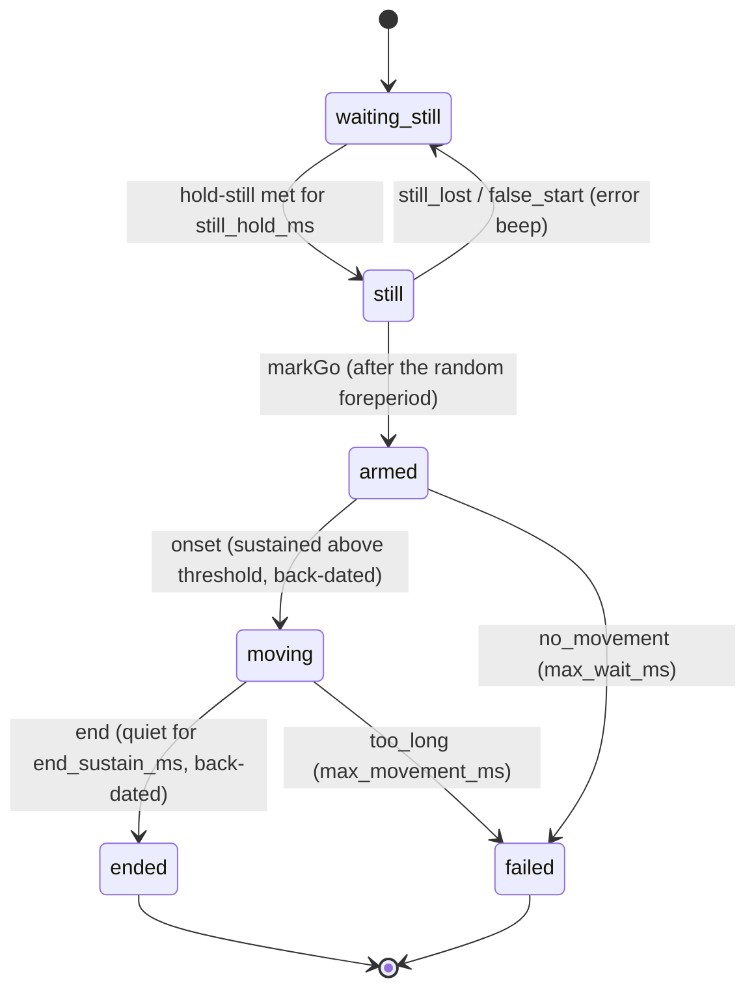

# 04 · Movement segmentation: detecting when the movement starts and ends

Every trial records a long raw window: settling, a hold-still at the extended arm, a random foreperiod, the GO beep, the movement, a hold at the nose, and a post-roll. Somewhere inside it is the movement itself. This document explains how the app finds it **online** (while recording, to drive the beeps and quality checks) and how the analysis should find it **offline** (non-causally, as the ground truth for features).

Two rules govern everything below:

1. **The app never crops.** The online boundaries are stored as indices next to the full raw stream ([02 Data schema](02_DATA_SCHEMA.md)), so any analysis can re-segment with a better method later.
2. **The online detector is for cues and QA, not for science.** Timing features (reaction time, duration, time to peak) must come from offline re-segmentation ([§7](#7-offline-segmentation-for-analysis)).

Related: [01 Protocol](01_PROTOCOL.md) (the trial timeline the participant experiences), [05 Modeling plan](05_MODELING_PLAN.md) (what the segments are used for).

---

## 1. Signals

| Signal | Definition | Why |
|---|---|---|
| Angular speed \|ω\| (primary) | Euclidean norm of `rotationRate` (deg/s) | Independent of how the phone is gripped and of which hand holds it. The forearm rotates about 50–60° during a hand-to-nose movement, so \|ω\| is large even for slow trials (≥ 40 deg/s peak) ([segmentation research](https://pmc.ncbi.nlm.nih.gov/articles/PMC6427602/)). Wrist-IMU studies use it as the standard segmentation signal ([Carpinella 2014](https://pmc.ncbi.nlm.nih.gov/articles/PMC3998062/), [Dotti 2024](https://pmc.ncbi.nlm.nih.gov/articles/PMC11435557/)). |
| Linear acceleration \|a\| (secondary) | Norm of `acceleration` when the browser provides it (`acc_source = 'linear'`), else a high-pass of `accelerationIncludingGravity` (`'highpass'`) | Catches movements with little rotation (a phone translated without turning). Weak in slow trials: 0.03–0.07 g, close to Chrome's 0.1 m/s² rounding step ([Chromium](https://github.com/chromium/chromium/blob/main/services/device/generic_sensor/platform_sensor_util.h)). |
| Euler angles | **Not used.** | `deviceorientation` angles hit gimbal lock exactly at the most common start pose (phone upright, screen toward the participant, beta ≈ 90°), fire only on ≥ 0.1° changes on Chrome, and have an arbitrary heading ([03 Sensors](03_SENSORS_AND_PLATFORMS.md)). |

Both magnitudes are smoothed with a causal exponential moving average (time constant `smoothing_ms` = 40 ms) that uses the actual time between samples, because browser sampling is jittery.

At rest with the arm extended, the signals are dominated by physiological tremor (about 1–2 deg/s, 0.05–0.3 m/s²) and arm sway, not by sensor noise ([Elble 2005](https://smithengineering.queensu.ca/mme/faculty/deluzio/jam/files/Elble.pdf)). The thresholds below sit 10× or more above that.

## 2. The trial timeline

```
t=0 Ready tap
│ settling  │== hold still (still_hold_ms) ==│== foreperiod ==│ GO beep │ RT │==== movement ====│== end_sustain ==│ end beep │== post_roll ==│ stop
            ↑ still criterion first met      ↑ 'still' event  ↑ markGo        ↑ onset (back-dated)          ↑ end (back-dated)  ↑ end confirmed
```

The participant taps Ready, extends the arm and holds still. Once the hold-still criterion has held for `still_hold_ms`, the controller waits a random foreperiod (so the GO beep cannot be anticipated), beeps, and arms the onset detector. After the movement, the participant holds the phone at the nose until the double beep; recording continues for `post_roll_ms`.



## 3. Algorithm `online_v1`

The exact, normative specification is the doc comment at the top of [`app/src/core/segmentation.ts`](../app/src/core/segmentation.ts). The Python port in [`analysis/motionlab/segment.py`](../analysis/motionlab/segment.py) follows it to the index. In prose:

1. **Smoothing.** EMA(x; τ): S₀ = x₀, Sᵢ = Sᵢ₋₁ + kᵢ(xᵢ − Sᵢ₋₁) with kᵢ = 1 − exp(−Δtᵢ/τ). A missing sample value reuses the previous raw value.
2. **Hold-still.** `C_still` = smoothed \|ω\| < `still_gyro_dps` **and** smoothed \|a\| < `still_acc_ms2`. When it has held continuously for `still_hold_ms`, the detector emits `still` and starts a **baseline buffer** of the smoothed values (and the raw gravity vector).
3. **Before GO.** Any sample that breaks `C_still` ends the hold: if the motion is already above the onset floors it is a `false_start` (the controller plays the error beep and counts it in `timing.false_starts`), otherwise `still_lost`. Either way the detector goes back to waiting, so a premature movement never contaminates the baseline.
4. **GO.** The controller gives GO at the first sample after `still` + foreperiod. The thresholds are frozen from the baseline: `thr = max(floor, mean + onset_k_sd · sd)`, separately for \|ω\| (floor `onset_gyro_min_dps`) and \|a\| (floor `onset_acc_min_ms2`). The floors matter on Chrome, where rounding can make the baseline SD zero.
5. **Onset.** Motion counts once either signal stays above its threshold for `onset_sustain_ms`. The onset is then **back-dated** to the first sample after the last still sample, searching back to at most 300 ms before GO. This removes most of the delay that any threshold introduces.
6. **End.** The end candidate starts when both signals are below the end thresholds (`end_gyro_dps`, `end_acc_ms2`) at least `min_movement_ms` after onset. It is confirmed when that quiet holds for `end_sustain_ms`, and the end is **back-dated** to the start of the quiet run. The end beep plays at confirmation.
7. **Failures.** No onset within `max_wait_ms` of GO gives `no_movement`; a movement longer than `max_movement_ms` gives `too_long`. Both are saved with `outcome.accepted = false`, and the participant repeats the trial.

## 4. Parameters

Defaults live in `DEFAULT_SEGMENTATION_PARAMS` ([`constants.ts`](../app/src/core/constants.ts)). Every trial stores the exact parameters it used in `segmentation.params`, after the per-condition overrides.

| Parameter | Default | Meaning |
|---|---|---|
| `smoothing_ms` | 40 | EMA time constant for both magnitudes |
| `gravity_tau_ms` | 600 | Gravity estimate for the `highpass` fallback |
| `still_gyro_dps`, `still_acc_ms2` | 15, 0.35 | Hold-still thresholds |
| `still_hold_ms` | 600 | Continuous stillness required before GO is scheduled |
| `foreperiod_min_ms`, `foreperiod_max_ms` | 500, 1200 | Random delay between stillness and GO (seeded per attempt) |
| `onset_k_sd` | 6 | Baseline-adaptive threshold multiplier |
| `onset_gyro_min_dps`, `onset_acc_min_ms2` | 30, 0.6 | Floors of the onset thresholds |
| `onset_sustain_ms` | 60 | Suprathreshold duration required for onset |
| `end_gyro_dps`, `end_acc_ms2` | 20, 0.45 | End thresholds |
| `end_sustain_ms` | 300 | Quiet duration required to confirm the end |
| `min_movement_ms` | 150 | No end can be declared earlier than this after onset |
| `max_wait_ms` | 6000 | GO without movement → `no_movement` |
| `max_movement_ms` | 8000 | Movement still going → `too_long` |
| `post_roll_ms` | 1000 | Recording after the end is confirmed |

**Per-condition overrides** (`resolveParams` in [`protocol.ts`](../app/src/core/protocol.ts)). Each override moves a parameter in one direction only (floors and end thresholds can only go down, sustain times and limits only up), so combinations compose safely:

| Condition | Overrides | Reason |
|---|---|---|
| speed `slow` | onset floors 15 deg/s and 0.3 m/s², end thresholds 10 deg/s and 0.25 m/s², `end_sustain_ms` 450, `max_movement_ms` 12000 | Slow movements have low peaks and long tails |
| speed `fast` | `onset_sustain_ms` 40 | Fast movements cross the threshold quickly |
| variant `pause` | `end_sustain_ms` 1800, `max_movement_ms` 12000 | A one-second pause mid-way must not end the trial |
| variant `jerky` | `end_sustain_ms` 600 | Stop-and-go movements have short quiet gaps |

**Why these timing margins.** The hold plus the foreperiod guarantee 1.1–1.8 s of stillness before GO, a clean baseline for the adaptive thresholds and an anchor for gravity propagation. The 1 s post-roll keeps a rest window after the movement, which offline segmentation and zero-velocity corrections need ([research: hold ≥ 1 s at both ends](https://pmc.ncbi.nlm.nih.gov/articles/PMC9823748/)).

## 5. How well it works (simulation)

[`app/scripts/evalSegmentation.ts`](../app/scripts/evalSegmentation.ts) (`npm run eval:seg -- --n 50`) replays simulated trials with known ground truth through the real `TrialController`. It compares `timing.onset_ms` with the moment the simulated phone starts moving, and `timing.end_ms` with the moment it reaches the nose. The setup:

- 50 trials per speed × variant × platform cell (`--n 50`; a plain `npm run eval:seg` uses 30), 3,000 normal trials per parameter set;
- Android-like data quantised like Chromium;
- the same trials replayed for every parameter set, so differences are paired.

The full tables are in [`app/scripts/out/segmentation_eval.md`](../app/scripts/out/segmentation_eval.md).

| | Onset error, median [IQR] | Onset \|error\|, 95th pct | End error, median | End > 300 ms early | Detected |
|---|---|---|---|---|---|
| All 3,000 trials | +31 ms [16, 115] | 428 ms | +83 ms | 3.5% | 100% |
| natural | +31 ms | 62 ms | +83 ms | 0% | 100% |
| fast | +14 ms | 26 ms | +137 ms | 0% | 100% |
| slow | +202 ms | 616 ms | −97 ms | 10.5% | 100% |

Positive errors mean the detector is late. These rows are the `default` set, i.e. the current `DEFAULT_SEGMENTATION_PARAMS`. Further results:

- **Timing margins.** Longer margins leave every error unchanged, as expected, because the boundaries are back-dated. A 500 ms end sustain (`candidate`) and a 500–1500 ms foreperiod with a 1200 ms post-roll (`cand+fp1500`) change the paired median onset and end errors by 0 ms and only lengthen the trial, by 0.18 s and 0.47 s. With the defaults (hold 600 ms, foreperiod 500–1200 ms, post-roll 1000 ms) the median trial lasts 4.5 s and keeps 1.4 s of data after the phone reaches the nose.
- **Stricter hold-still.** Thresholds of 10 deg/s and 0.25 m/s² were the only change that improved accuracy: the onset 95th percentile fell from 428 to 331 ms and the slow-trial median from 202 to 171 ms. They are **not** the default yet. The simulator's tremor is calmer than real hands, so the cost (participants unable to satisfy the hold) cannot be measured in simulation. Decide this in the pilot (§9).
- **Failures.** Every simulated false start (400/400) was caught before GO and the trial still completed. Every no-move trial (100/100) ended as `no_movement`. With twice the simulated tremor, the hold-still was still met at its earliest possible time.
- **Weak spot.** Slow trials: late onsets and early ends come from the absolute thresholds meeting the long, low tails of a slow minimum-jerk profile. This is the expected bias of any threshold method (§6) and the main reason timing features must be computed offline.

**Caveat.** These are sanity checks against a model, not real-world accuracy. Real movements have sub-movements, hesitations and grip adjustments the simulator does not produce ([§9](#9-validation-and-tuning-plan)).

## 6. Expected kinematics and threshold bias

Minimum-jerk reaching ([Flash & Hogan 1985](https://www.socsci.ru.nl/wilberth/physics/smooth.html)) gives a bell-shaped speed profile, v/v_peak = 16τ²(1−τ)² with τ = t/D, so peak speed is 1.875 × the mean speed. For a 0.45 m path with 60° of rotation:

| Duration D | Peak hand speed | Peak linear acceleration | Peak angular speed |
|---|---|---|---|
| 0.35 s (fast) | 2.4 m/s | 21 m/s² | 321 deg/s |
| 0.7 s (natural) | 1.2 m/s | 5.3 m/s² | 161 deg/s |
| 2 s (slow) | 0.42 m/s | 0.65 m/s² | 56 deg/s |
| 3 s (very slow) | 0.28 m/s | 0.29 m/s² | 38 deg/s |

Healthy finger-to-nose movements take about 0.6 s one way ([Chen 2021](https://pmc.ncbi.nlm.nih.gov/articles/PMC8072355/)). Fast or odd trials can exceed 4 g and 500 deg/s, near the ranges of some phone sensors, so the quality checks flag clipping (\|ω\| ≈ 950 deg/s, \|accg\| ≈ 3.5 g).

Threshold bias:

- **Relative threshold.** A threshold at p% of the peak cuts a fixed fraction of the duration off each end: 5% → 5.9% of D, i.e. 18 ms at D = 0.3 s but 119 ms at D = 2 s.
- **Absolute threshold.** These bias slow movements far more ([Botzer & Karniel 2009](https://www.frontiersin.org/journals/neuroscience/articles/10.3389/neuro.20.002.2009/full); [Blinch 2024](https://pubmed.ncbi.nlm.nih.gov/37626277)).
- **Quantisation.** At 60 Hz the onset quantisation SD is only 4.8 ms (T/√12). The method's bias dominates the timing error, not the sampling rate.

## 7. Offline segmentation for analysis

`motionlab.segment` provides:

- `rerun_online_v1(record)`: re-runs `online_v1` on a stored trial with its stored parameters and GO time. On the synthetic dataset it reproduces the app's onset and end indices on **683/683 trials**, so the port can be trusted. A CI fixture keeps the TypeScript and Python versions in sync.
- `offline_v1`: zero-phase smoothing, percentage-of-peak thresholds with a baseline-noise floor, and a sustained end. It uses the whole window, so it is not biased by causality.

Recommended practice for the stage-2 analysis:

1. Compute several boundary estimates per trial:
   - relative thresholds at 5%, 11% and 25% of peak \|ω\| ([Dotti 2024](https://pmc.ncbi.nlm.nih.gov/articles/PMC11435557/), [Carpinella 2014](https://pmc.ncbi.nlm.nih.gov/articles/PMC3998062/));
   - baseline μ + kσ with backtracking;
   - the MACC fit ([Botzer & Karniel 2009](https://www.frontiersin.org/journals/neuroscience/articles/10.3389/neuro.20.002.2009/full));
   - a change-point estimate (PELT, [Truong et al.](https://arxiv.org/abs/1801.00718)).
2. Combine them MSI-style ([Schot 2010](https://personal.fbw.vu.nl/~jsmeets/2010/Robust_Segmentation-JNM10.pdf)) or pick one method and keep it fixed. **Use identical segmentation for both hands**, otherwise segmentation differences become spurious hand differences.
3. Flag trials where the methods disagree by more than 100 ms, or where \|ω\| shows several movement units (peaks ≥ 10–20 deg/s of prominence, ≥ 150 ms apart). These are "odd" movements whatever the instruction said.
4. Bin trials by **measured** duration, not by the instructed speed, when analysing error against speed.

## 8. Failure modes

| Situation | What happens | Data consequence |
|---|---|---|
| Participant moves before GO | Error beep, "Wait for the beep", the hold restarts | `timing.false_starts` counts it; the stored baseline is from the final clean hold |
| Participant never moves | `no_movement` after 6 s | Saved as not accepted; the trial is repeated |
| Pause or hesitation mid-way | Normal trials may end early at the pause; the `pause` variant has an 1800 ms end sustain | Offline segmentation decides; flag multi-unit movements |
| Slow movement with little rotation | Lower onset floors (slow override); onset late, end early by a few hundred ms | Use offline boundaries for timing |
| Chrome rounding | Baseline SD can be 0; the floors keep thresholds sensible | None |
| Page hidden, sensors stall | The UI aborts the trial (`interrupted`) | Saved as not accepted with a `ui_abort:*` warning |
| Nose touches the screen | A touch event is logged (`first_touch_ms`) | A free contact timestamp to validate the end detector (§9) |

## 9. Validation and tuning plan

1. **Simulation (done).** `npm run eval:seg -- --n 50` (§5). The TypeScript-to-Python parity check runs in CI.
2. **Contact timestamps.** In `*_toward` trials the nose usually touches the screen, which produces a touch event. Compare `first_touch_ms` with `end_ms` across the pilot; it is a real ground truth for the end that costs nothing.
3. **Video subset.** Film 2–3 pilot participants at 60 fps with a visible GO beep (an LED or the phone screen in view). Annotate onset and contact by hand for 50–100 trials and compute the online and offline errors.
4. **Pilot tuning, in this order:**
   - Check that participants can satisfy the hold-still. Inspect `timing.still_ms` and the false-start count, then decide whether to adopt the stricter 10 deg/s / 0.25 m/s² thresholds (§5).
   - Check slow trials for premature end beeps. If they happen, raise the slow `end_sustain_ms`.
   - Re-run `npm run eval:seg -- --n 50` after any change, and bump nothing silently: parameters are stored per trial.
5. **Report** onset and end errors (median, IQR, 95th percentile) by speed and platform in the stage-2 write-up.

## 10. Reproduce

```bash
cd app
npm run eval:seg -- --n 50            # ~1 min; writes scripts/out/segmentation_eval.md (the run quoted in §5)
npx tsx scripts/evalSegmentation.ts --n 50 --sets all --out scripts/out/segmentation_eval_all.md   # adds the exploratory sets; --out keeps the §5 report
npm run synth -- --participants 12 --preset standard --seed 42 --out ../analysis/data/synthetic --validate
cd ../analysis
.venv/Scripts/python.exe scripts/qa_report.py data/synthetic    # includes the online_v1 port agreement
```

## 11. Open questions for the PI

1. Is the online detector's slow-trial bias acceptable for the stage-3 demo, or should predict mode re-segment offline before classifying? (Recommended: re-segment; it costs a few milliseconds.)
2. Should a separate "hold at the nose" be required (a longer `end_sustain_ms`), at the cost of about 0.2 s per trial, to give cleaner end windows?
3. Is a video-annotated validation subset worth the effort, or are the screen-touch timestamps enough?
